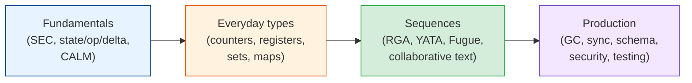

# CRDTs & Conflict-Free Replication

Sometimes replicas have to accept writes without talking to each other: a phone in airplane
mode, two regions of an active-active database, two people typing in the same paragraph. When
they reconnect, something has to decide what the data looks like now. Last-write-wins decides
by throwing writes away. Conflict-free replicated data types (CRDTs) decide by design: each
type comes with a merge that gives the same result on every replica, in any order, with no
coordination. This module covers how that works, which types exist, why text is the hard
case, and what it costs to run CRDTs in production.

## Contents

| # | Topic | File | Level |
|---|-------|------|-------|
| 0 | The map (this file) | *(here)* | L3 · Intermediate |
| 1 | CRDT fundamentals: strong eventual consistency, state vs op vs delta, the CALM boundary | [crdt-fundamentals.md](./crdt-fundamentals.md) | L3 · Intermediate |
| 2 | Counters, registers & sets: PN and bounded counters, LWW and MV registers, OR-Set, maps | [counters-registers-and-sets.md](./counters-registers-and-sets.md) | L4 · Advanced |
| 3 | Sequence CRDTs & collaborative editing: OT vs CRDTs, RGA/YATA/Fugue, tombstones, interleaving | [sequence-crdts-and-collaborative-editing.md](./sequence-crdts-and-collaborative-editing.md) | L4 · Advanced |
| 4 | CRDTs in production: metadata, garbage collection, sync, schema evolution, security, testing | [crdts-in-production.md](./crdts-in-production.md) | L4 · Advanced |

---

## How to read this module

- **Chapter 1** explains the guarantee (same updates, same state) and the three ways to build
  a type that keeps it. It also draws the line CRDTs can't cross: uniqueness, balances, and
  other invariants that need coordination.
- **Chapter 2** is the toolbox most systems actually use: counters, registers, flags, sets,
  and maps. Each one forces a choice about whose write wins, and that choice belongs to the
  product, not the database.
- **Chapter 3** is about text and lists, where indexes shift under concurrent edits. It covers
  how Yjs and Automerge solve that, and where libraries still differ.
- **Chapter 4** covers what the papers leave out. Metadata growth, when tombstones can be
  dropped, schema changes on documents you can't migrate, malicious clients, and how to test
  convergence.

## Related modules

- [distributed-systems/consensus.md](../distributed-systems/consensus.md): the other way to
  keep replicas in agreement, by coordinating before a write instead of merging after.
- [distributed-systems/time-and-idempotency.md](../distributed-systems/time-and-idempotency.md):
  Lamport and vector clocks, which CRDTs use to track causality.
- [system-design-fundamentals/cap-and-consistency.md](../system-design-fundamentals/cap-and-consistency.md):
  why accepting writes during a partition means giving up strong consistency.
- [databases/replication-sharding.md](../databases/replication-sharding.md): multi-leader
  replication, where write conflicts come from.
- [realtime/](../realtime/README.md): WebSocket and WebRTC, the transports that carry CRDT
  updates between collaborators.
- [event-sourcing-and-cqrs/](../event-sourcing-and-cqrs/README.md): append-only logs and
  snapshots, the same storage shape a CRDT sync server uses.

## The one idea

> **Put the merge in the data type, not the application.** If every type's merge is
> commutative, associative, and idempotent, replicas can sync in any order, any number of
> times, and still end up identical. What you give up is the ability to say "no" to a write,
> so anything that needs a "no" stays outside the CRDT.

Start with [crdt-fundamentals.md](./crdt-fundamentals.md). **Next >**
