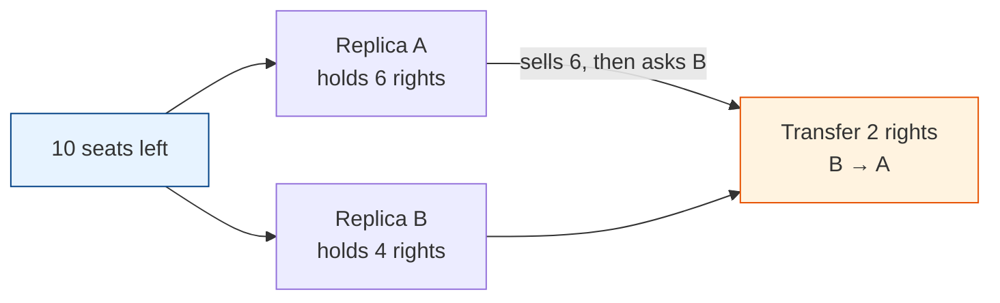
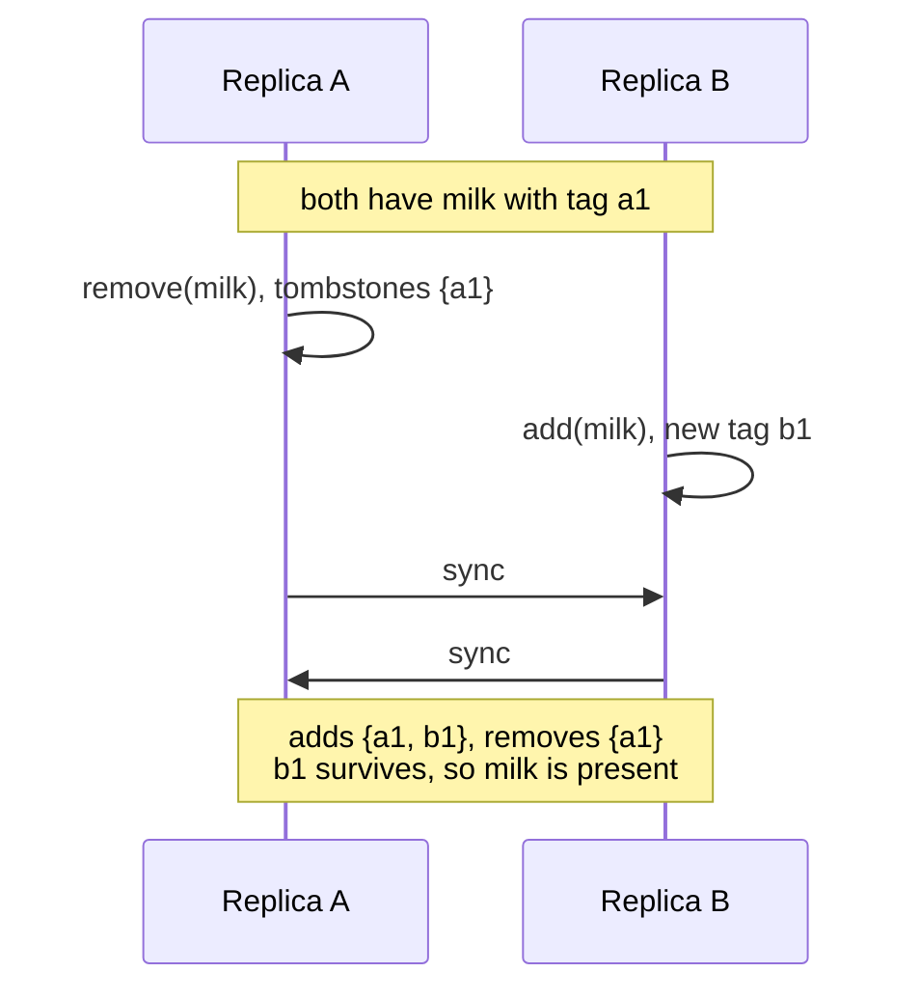
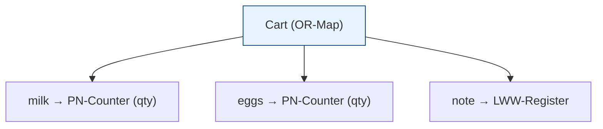

# Counters, Registers & Sets: The Everyday CRDTs

[< Back](./crdt-fundamentals.md) | [Index](./README.md) | [Next: Sequence CRDTs & Collaborative Editing >](./sequence-crdts-and-collaborative-editing.md)

---

Most data that needs a CRDT isn't a text document. It's a like count, a feature toggle, a
profile field, a shopping cart, a set of tags. This chapter covers the small types that
handle those, and the one decision each type forces on you: when two replicas disagree, whose
intent wins?

All examples are state-based (see [the fundamentals](./crdt-fundamentals.md#state-based-cvrdt-ship-the-whole-state-merge-with-a-join)):
local updates, plus a `merge` that is commutative, associative, and idempotent.

## Counters

### G-Counter and PN-Counter

The [G-Counter](./crdt-fundamentals.md#state-based-cvrdt-ship-the-whole-state-merge-with-a-join)
only goes up: one slot per replica, merge by `max`. You can't support decrements by lowering a
slot, because `max` would undo the decrement on the next merge.

The fix is two G-Counters: one for increments, one for decrements. The value is the
difference.

```python
class PNCounter:
    def __init__(self, replica_id):
        self.p = GCounter(replica_id)         # increments
        self.n = GCounter(replica_id)         # decrements

    def increment(self, k=1):
        self.p.increment(k)

    def decrement(self, k=1):
        self.n.increment(k)

    def value(self):
        return self.p.value() - self.n.value()

    def merge(self, other):
        self.p.merge(other.p)
        self.n.merge(other.n)
```

This pattern comes up again and again. When a type needs to "go backwards", split it into
two parts that both only go forwards.

Use PN-Counters for likes, view counts, inventory *estimates*, and rate-limit tallies across
regions. Both slot maps grow with every replica that ever wrote. For a few dozen servers
that's nothing. For millions of client devices it isn't, so client-side counters usually sync
through a server that holds the slot map.

### Counters that must not go negative

A PN-Counter will go below zero if two replicas both decrement concurrently. For a like count
that's harmless. For "seats left" it's an oversold flight.

The **bounded counter** (Balegas et al., 2015) keeps the invariant without coordinating on
every write. Each replica holds a share of the *rights* to decrement:



A replica can only decrement as far as its own rights allow. When it runs out, it asks a peer
to transfer some. That's a message to one replica, not consensus across all of them, and it
only happens when local rights run low. If no peer answers, the sale is refused. The counter
stays available for most writes and safe for all of them.

This is the escrow idea from old banking systems. Use it for quotas and stock where running a
little short locally is fine but going negative globally isn't.

## Registers

A register holds one value: a profile name, a document title, a setting. Two replicas set it
to different values at the same time. Which one survives?

### Last-write-wins register

Each write carries a timestamp. Merge keeps the higher one. Ties break on replica ID, so every
replica picks the same winner.

```python
class LWWRegister:
    def __init__(self, replica_id):
        self.id = replica_id
        self.value, self.ts = None, (0, "")

    def set(self, value, now):
        self.value, self.ts = value, (now, self.id)

    def merge(self, other):
        if other.ts > self.ts:                # tuple compare: time, then replica ID
            self.value, self.ts = other.value, other.ts
```

That's a valid CRDT, and it's what most systems use for scalar fields. Two cautions:

- **The timestamp source decides who wins.** With wall clocks, a server whose clock runs 30
  seconds fast wins every conflict for 30 seconds. Use a
  [hybrid logical clock](https://cse.buffalo.edu/tech-reports/2014-04.pdf) (wall time plus a
  logical counter) so a write that has *seen* another write always sorts after it.
- **The loser is gone.** LWW is right when the later value really replaces the earlier one
  (a status, a title). It's wrong when both writes carry information you'd want to keep.

### Multi-value register

The multi-value register (MV-Register) doesn't pick. It tags each write with a
[version vector](../distributed-systems/time-and-idempotency.md#vector-clocks). When one write
causally follows another, the newer one replaces it. When two writes are concurrent, the
register keeps both, and a read returns all of them.

| Situation | LWW-Register reads | MV-Register reads |
|-----------|-------------------|-------------------|
| A sets "blue", B later sees it and sets "green" | `green` | `green` |
| A sets "blue" and B sets "green", concurrently | `green` (higher timestamp) | `{blue, green}` |

This is what Riak and Dynamo call **siblings**. It loses no data, but every reader now has to
cope with a set of values, and the next write has to resolve them. Use it when a human (or a
domain-specific rule) has to make the call.

### Flags

A flag is a boolean register with an explicit tie-break. An **enable-wins flag** stays on if
one replica enables it while another concurrently disables it. A **disable-wins flag** does
the opposite. Pick based on which mistake is cheaper. A "notifications muted" flag should
probably be enable-wins: an unwanted mute is less annoying than an unwanted ping at 3 a.m.

## Sets

Sets show most clearly that "merge" means choosing semantics. Here's the scenario every set
type has to answer:

> Replica A and replica B both contain `milk`. A removes `milk`. At the same time, B adds
> `milk` again. They sync. Is `milk` in the set?

### G-Set and 2P-Set

A **G-Set** (grow-only set) merges by union. Elements can never be removed. That's fine for
"users who have ever logged in" or "event IDs already processed".

A **2P-Set** (two-phase set) adds a second G-Set of removed elements, called tombstones. An
element is present if it's in the add set and not in the remove set. Merge unions both. The
catch is that removal is permanent: once `milk` is tombstoned, adding it again does nothing.
In the scenario above, `milk` is gone forever, which is almost never what a user wants.

### LWW-element-set

Timestamp every add and every remove per element. An element is present if its latest add is
newer than its latest remove. SoundCloud's Roshi used this for activity streams. It allows
re-adding, but the scenario's answer depends on clocks, and whichever operation has the higher
timestamp wins regardless of what each replica had seen.

### OR-Set: observed-remove, add-wins

The observed-remove set (OR-Set) is the one most people want. Every add gets a unique tag. A
remove deletes only the tags the removing replica has *observed*. A concurrent add creates a
new tag that the remove never saw, so the element survives.

```python
class ORSet:
    def __init__(self, replica_id):
        self.id = replica_id
        self.adds = {}            # element -> set of tags
        self.removes = {}         # element -> set of tags (tombstones)
        self.counter = 0

    def add(self, e):
        self.counter += 1
        self.adds.setdefault(e, set()).add((self.id, self.counter))

    def remove(self, e):
        # remove only the tags this replica has seen
        self.removes.setdefault(e, set()).update(self.adds.get(e, set()))

    def contains(self, e):
        return bool(self.adds.get(e, set()) - self.removes.get(e, set()))

    def merge(self, other):
        for e, tags in other.adds.items():
            self.adds.setdefault(e, set()).update(tags)
        for e, tags in other.removes.items():
            self.removes.setdefault(e, set()).update(tags)
```



The answer to the scenario is: **the add wins**. That matches what users expect from a
shopping cart or a tag list. If I add something while you remove it, I probably still want it.

The version above keeps tombstones forever. Production implementations avoid that. Riak's
**ORSWOT** (OR-Set without tombstones) gives each replica a version vector and each element a
set of "dots" (replica ID plus counter). Remove just deletes the element's dots. On merge, if
the other side lacks a dot that its version vector says it has already seen, that dot was
removed. No tombstones, and the metadata grows with the number of replicas instead of the
number of removes.

A **remove-wins set** is the mirror image: a concurrent remove beats a concurrent add. It's
less common, but it's the right choice for things like an access list, where a revoked
permission should stay revoked.

### Choosing a set

| Type | Re-add after remove? | Concurrent add vs remove | Metadata | Good for |
|------|---------------------|--------------------------|----------|----------|
| G-Set | No removes | n/a | Elements only | Processed IDs, append-only facts |
| 2P-Set | No | Remove wins, forever | Tombstone per removed element | Things that can only be deleted once |
| LWW-element-set | Yes | Higher timestamp wins | Timestamp per element | Feeds, where clocks are good enough |
| OR-Set / ORSWOT | Yes | Add wins | Tags or dots per element | Carts, tags, membership lists |
| Remove-wins set | Yes | Remove wins | Tags or dots per element | Permissions, blocklists |

## Maps: composing CRDTs

A CRDT map holds a CRDT as each value and merges key by key: the cart's `quantity` field
merges as a counter, the `note` field as a register, and so on. Keys themselves are usually
tracked with OR-Set semantics.



Two people editing the same cart at once now do the right thing. Both add one carton of milk:
quantity 2. One changes the note while the other adds eggs: both changes land.

The hard case is a key that one replica removes while another updates it. Riak's map makes
update win: the key comes back with only the concurrent update applied, and everything the
remover saw is gone. That's usually right ("I removed the item, you bumped its quantity, it
comes back with your bump"), but write the semantics down, because someone will file it as a
bug.

Nesting is what makes CRDTs usable. A JSON document is a map of maps, lists, and registers,
and that's exactly what Automerge and Yjs give you. Lists are the hard part, and they get
the [next chapter](./sequence-crdts-and-collaborative-editing.md).

## Picking semantics is a product decision

Every type above makes you choose who wins a concurrent conflict. Engineers tend to treat
that as an implementation detail. It isn't. Ask the product owner:

| Question | Typical answer | Type |
|----------|----------------|------|
| Two people rename the doc at once. Which name? | Either, just be consistent | LWW-Register |
| Two people edit a contract clause at once. Which version? | Show both, let a human pick | MV-Register |
| One person adds an item, another removes it, at once | Keep it | OR-Set (add-wins) |
| One admin grants access, another revokes it, at once | Revoke | Remove-wins set |
| Two regions sell the last seat at once | Never allowed | Bounded counter or coordination |

## The takeaways

1. **To go backwards, split into two forward-only parts.** PN-Counter and 2P-Set both work
   this way.
2. **LWW is a fine default for scalars** if your timestamps are hybrid logical clocks, not
   raw wall time.
3. **MV-Registers keep conflicts for a human.** Every reader must handle multiple values.
4. **OR-Set is the set people expect:** re-adds work and a concurrent add beats a remove. Use
   a tombstone-free variant like ORSWOT in production.
5. **Maps compose CRDTs,** which is how you get JSON-shaped documents that merge per field.
6. **Who wins a conflict is a product decision.** Ask before you pick the type.

---

[< Back](./crdt-fundamentals.md) | [Index](./README.md) | [Next: Sequence CRDTs & Collaborative Editing >](./sequence-crdts-and-collaborative-editing.md)
