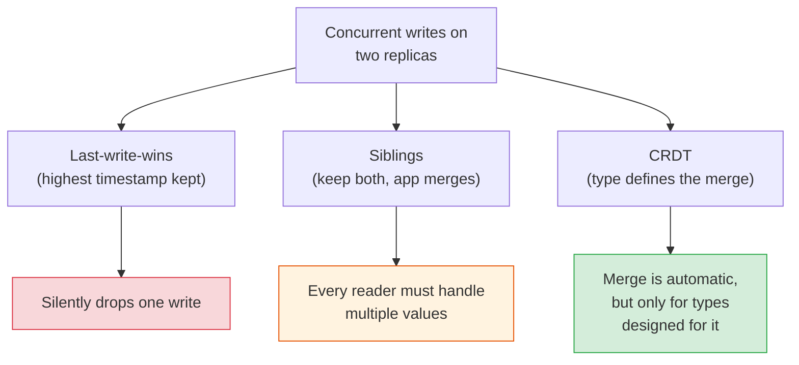

# CRDT Fundamentals: Convergence Without Coordination

[Index](./README.md) | [Next: Counters, Registers & Sets >](./counters-registers-and-sets.md)

---

Two replicas of the same data accept writes while they can't talk to each other. A phone in
airplane mode edits a note. Two regions of an active-active database both update the same
cart. When the replicas reconnect, they have to agree on one state, and nobody is around to
pick a winner.

There are three common answers. Pick a winner by timestamp and throw the loser away
(last-write-wins). Keep both versions and make the application merge them later (Dynamo's
"siblings"). Or design the data type so that any two states can always be merged
automatically, in any order, with the same result everywhere. That third option is a
**CRDT**: a conflict-free replicated data type.

## Why conflicts happen at all

Strong consistency avoids conflicts by making replicas agree *before* a write is accepted.
That's what [consensus](../distributed-systems/consensus.md) and quorum writes do. The price is
latency (every write waits for a round trip to other replicas) and availability (a replica cut
off from the majority can't accept writes). [CAP](../system-design-fundamentals/cap-and-consistency.md)
says you can't have both availability and strong consistency during a partition.

Some systems pick availability on purpose:

| System | Why it accepts writes without coordination |
|--------|--------------------------------------------|
| Multi-region active-active database | A cross-ocean round trip on every write costs 100+ ms |
| Mobile and desktop apps with offline mode | The device has no network at all |
| Collaborative editors | Waiting for the server on every keystroke makes typing feel broken |
| Edge caches and counters | Thousands of nodes, and coordinating on each increment doesn't scale |

Once two replicas accept writes independently, conflicts are guaranteed. The question is only
how you resolve them.

## The options, and what each one loses



**Last-write-wins** is what Cassandra does per cell, and what most "multi-master" setups do by
default. It converges, but it converges by losing data. If two people add an item to the same
cart at the same moment, one item disappears. And "last" means "highest wall-clock timestamp",
so a replica with a fast clock wins every conflict for as long as its clock stays ahead (see
[time and idempotency](../distributed-systems/time-and-idempotency.md)).

**Siblings** keep every concurrent version and hand them to the application on the next read.
The [Dynamo paper](https://www.allthingsdistributed.com/files/amazon-dynamo-sosp2007.pdf)
did this for Amazon's shopping cart and merged siblings by taking the union of items. It
reported the consequence itself: deleted items could reappear, because a union can't tell
"removed on one side" from "never added on the other". Every team that uses siblings
eventually writes a merge function like that one and gets it subtly wrong.

**CRDTs** move the merge function into the data type and prove it correct once. You don't get
to merge arbitrary data this way. You get a toolbox of types (counters, registers, sets, maps,
sequences) whose merge is known to be safe, and you build your data out of those.

## Strong eventual consistency

Plain eventual consistency only promises that replicas agree *at some point* if writes stop. It
says nothing about what they agree on, and it allows a replica to roll back changes it already
showed you.

CRDTs give a stronger guarantee, named in the 2011 paper by Shapiro, Preguiça, Baquero, and
Zawirski that introduced the term:

> **Strong eventual consistency (SEC):** any two replicas that have received the same set of
> updates are in the same state, no matter what order the updates arrived in.

No extra round of agreement and no rollback. As soon as two replicas have seen the same
updates, they're identical. That's the whole promise, and everything in this module is about
how to keep it.

## Two ways to build a CRDT

There are two families. They're equivalent in power (each can emulate the other), but they put
the burden in different places.

### State-based (CvRDT): ship the whole state, merge with a join

Each replica updates its own copy locally. Now and then it sends its full state to another
replica, which merges it in. The merge function has to satisfy three laws:

| Law | Meaning | Why you need it |
|-----|---------|-----------------|
| Commutative | `merge(a, b) == merge(b, a)` | Replicas receive states in different orders |
| Associative | `merge(merge(a, b), c) == merge(a, merge(b, c))` | Gossip groups merges in different ways |
| Idempotent | `merge(a, a) == a` | The network delivers the same state twice |

A merge with those three properties is the *join* of a join-semilattice. In plain terms, states
can only grow, and merge takes the smallest state that includes both inputs. Think of `max` on
integers or `union` on sets.

The payoff is that the network can do almost anything. Messages can be lost (send the state
again later), duplicated (idempotent), or reordered (commutative). Any gossip protocol works.

The simplest example is a grow-only counter. Each replica counts its own increments in its own
slot, and merge takes the maximum per slot:

```python
class GCounter:
    def __init__(self, replica_id):
        self.id = replica_id
        self.counts = {}                      # replica_id -> int

    def increment(self, n=1):
        self.counts[self.id] = self.counts.get(self.id, 0) + n

    def value(self):
        return sum(self.counts.values())

    def merge(self, other):
        for rid, c in other.counts.items():
            self.counts[rid] = max(self.counts.get(rid, 0), c)
```

Why not one shared integer? Because if replica A says "5" and replica B says "5", you can't
tell whether that's the same five increments or ten different ones. Per-replica slots make the
merge exact: `max` per slot is idempotent, and the sum counts every increment once.

The cost is size. The state grows with the number of replicas that ever wrote, and you ship
all of it on every sync.

### Operation-based (CmRDT): ship the operations

Instead of states, replicas broadcast the operations they performed ("increment by 1", "add
milk"). Each replica applies the operations it receives. For this to converge, concurrent
operations must commute: applying `op1` then `op2` gives the same result as `op2` then `op1`.

Messages are smaller, but the network has to be better behaved:

| Requirement | Why |
|-------------|-----|
| Every operation is delivered to every replica | A lost "add" never shows up anywhere else |
| Each operation is applied exactly once | Applying "increment" twice double-counts |
| Causal order | A "remove milk" must not arrive before the "add milk" it refers to |

In practice that means a reliable causal broadcast layer underneath, usually built on
[vector clocks](../distributed-systems/time-and-idempotency.md#vector-clocks) plus
deduplication. Yjs and Automerge both ship operations (bundled as updates or changes), and
both track which changes each peer has already seen.

### Delta-state CRDTs: the practical middle

Delta-state CRDTs (Almeida, Shoker, and Baquero) keep the state-based merge but send only the
part of the state that changed. A G-Counter delta is just `{"a": 7}`, the one slot that moved.
Deltas merge with the same join, so they keep the tolerance of state-based CRDTs for loss,
duplication, and reordering, with message sizes close to op-based. Many server-side systems
use this approach, even when their docs don't use the name.

| | State-based | Op-based | Delta-state |
|---|------------|----------|-------------|
| Sends | Full state | Each operation | Changed fragment of state |
| Network needs | Eventually delivers something | Reliable, exactly-once, causal | Eventually delivers something |
| Message size | Large | Small | Small |
| Merge | Join (max, union, ...) | Apply op | Join |
| Typical use | Riak data types, gossip between servers | Yjs, Automerge, collaborative editing | Modern server-side CRDT stores |

## What CRDTs can't do

CRDTs only handle data whose merge never needs to say "no". Any rule that depends on the
*global* state at the moment of a write needs coordination:

- **Uniqueness.** Two replicas can each register the username `alice`. A CRDT set will happily
  contain both registrations. Deciding which one wins after the fact means one user's signup
  silently fails.
- **Non-negative balances.** Two replicas each see a balance of 100 and each approve a
  withdrawal of 80. The merged balance is -60. No merge function can undo an approval the user
  already saw.
- **Exactly N of something.** "Only 10 tickets left" is the same problem.

This boundary has a name: the **CALM theorem** (Hellerstein and Alvaro). A program can run
without coordination if and only if it's *monotonic*, meaning new information never makes an
earlier conclusion false. Counters going up, sets growing, flags turning on: monotonic.
"Balance is still above zero": not monotonic, because a later withdrawal can falsify it.

The practical design move is to split the data. Keep the coordination-free parts (likes, edit
history, presence, cart contents) in CRDTs, and put the few invariant-bearing operations
(checkout, payment, username claims) behind a single leader or a consensus write. The
[bounded counter](./counters-registers-and-sets.md#counters-that-must-not-go-negative) in the
next chapter is a middle ground for one specific case.

## Where you meet CRDTs

| Where | What they use CRDTs for |
|-------|-------------------------|
| Riak 2.0 data types | Counters, sets, maps, flags, and registers on a Dynamo-style store |
| Redis Enterprise Active-Active | Strings, counters, sets, and other Redis types replicated across regions |
| Yjs, Automerge, Loro | Shared documents for collaborative and offline-first apps |
| SoundCloud's Roshi | A last-write-wins set on top of Redis, used for activity feeds |
| AntidoteDB | Research database built around CRDTs with transactional causal consistency |

Figma is a useful counterexample. Its 2019 engineering post explains that the multiplayer
system *borrows* CRDT ideas (last-write-wins per property, a merge that's order-independent),
but keeps a central server as the authority, because that's simpler when a server is always in
the loop. If your clients are always online and always talk to one server, you may not need a
full CRDT either.

## The takeaways

1. **CRDTs trade expressiveness for coordination-free merges.** You get a fixed set of types
   whose merge is proven, and you build your data out of them.
2. **Strong eventual consistency** means same updates, same state, no matter the order. No
   rollbacks, no extra agreement round.
3. **State-based CRDTs need a join** (commutative, associative, idempotent) and tolerate a
   sloppy network. **Op-based CRDTs** need commuting operations and reliable causal delivery.
   **Delta-state** gets the best of both.
4. **Last-write-wins is a CRDT too,** just one that loses data by design. Know when that's
   acceptable.
5. **Non-monotonic invariants need coordination.** Uniqueness and balances don't belong in a
   CRDT. Split them out.

---

[Index](./README.md) | [Next: Counters, Registers & Sets >](./counters-registers-and-sets.md)
