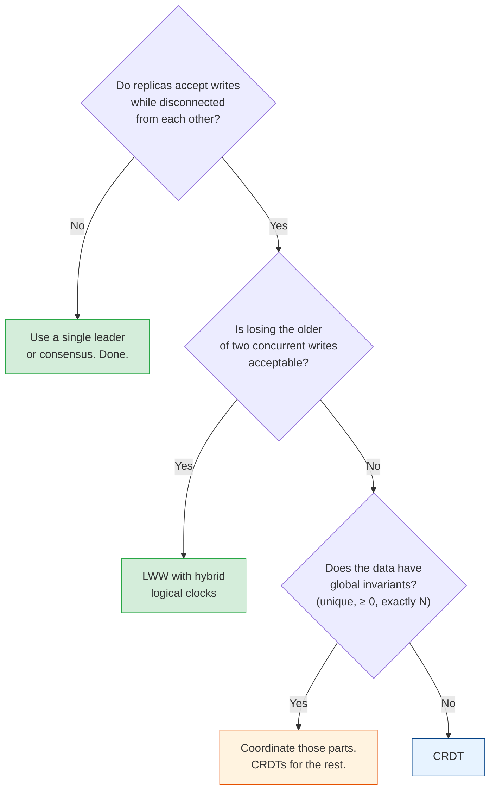

# CRDTs in Production: Metadata, Garbage Collection, Security & Testing

[< Back](./sequence-crdts-and-collaborative-editing.md) | [Index](./README.md)

---

The math in the first three chapters guarantees convergence. It says nothing about how big
the documents get, what happens when a client from 2023 syncs with a schema from 2026, or
what stops a malicious client from sending an update that deletes everything. Those are the
problems that show up once CRDTs are in production, and this chapter covers them.

## Do you actually need a CRDT?

Start here, because the cheapest CRDT is the one you don't adopt.



A lot of "real-time collaboration" features land on the first box. If every client is online
and talks to one server, the server can order the edits. Figma's multiplayer system and Google
Docs both work that way. CRDTs pay off when replicas really do diverge for a while: offline
mobile apps, local-first software, multi-region active-active stores, and peer-to-peer sync.

## Metadata grows

Every CRDT carries metadata: per-replica slots in a counter, tags or dots in a set, IDs and
tombstones in a sequence. Where that metadata comes from decides whether it stays small.

| Source of growth | Why it grows | What to do |
|------------------|--------------|------------|
| Replica IDs | Every device, tab, or session that ever wrote gets a slot in version vectors | Reuse an actor ID per device, not per session; servers can merge slots for retired replicas once everyone has synced |
| Tombstones | Deleted elements stay as position anchors | Garbage-collect once causally stable (below) |
| Full history | Automerge keeps every change so you can view old versions | Decide if you need history; compact or snapshot if not |
| Per-character IDs | One ID per keystroke | Libraries run-length-encode runs of typing; don't store documents in a naive format |

The replica ID one surprises people. Yjs picks a random client ID for each `Y.Doc` instance,
so a user who opens a document in 500 browser sessions over a year adds 500 entries to its
state vector. That's still only a few kilobytes, but a server-side counter keyed by
per-request IDs grows with traffic and never shrinks. Know what your replica ID is and how
many you'll have.

## Tombstones and garbage collection

You can drop a tombstone only when no replica will ever send an operation that refers to it.
That condition is called **causal stability**: an operation is causally stable once every
replica has seen it. After that, nobody can make a concurrent edit against the old state, so
the anchor is no longer needed.

The catch is "every replica". To know a delete is stable, you have to know who all the
replicas are and what each one has seen. That's a membership problem, and on open systems
(any browser can join, phones come back after six months) you never really know.

What teams do in practice:

- **Keep the IDs, drop the content.** Yjs's default garbage collection replaces deleted
  content with a compact "N items deleted" marker. The structure stays, the bytes go. For
  most text documents, that's enough.
- **Compact on the server.** The server merges the update log into one snapshot
  (`Y.mergeUpdates` or an Automerge save). Storage shrinks even if the CRDT metadata inside
  it doesn't.
- **Re-baseline with coordination.** Pick a moment, make sure every known client has synced,
  then start a fresh document from the current state and tell older clients to reload. It's
  a cutover, so treat it like one: rare, scripted, and observable.
- **Expire stale replicas.** If a replica hasn't synced for 90 days, declare it gone and stop
  waiting for it. When it comes back, it re-downloads the document instead of merging. Pick
  the window deliberately, because any offline edits on that replica are lost.

Server-side stores with a fixed set of replicas (three regions, say) have it much easier.
Membership is known, so causal stability can be tracked exactly, and tombstones can be
collected on a schedule.

## Sync: how replicas find out what's missing

For op-based and delta-based CRDTs, replicas need to know what the other side has.

| Approach | How it works | Used by |
|----------|--------------|---------|
| Version / state vectors | Each side sends "highest counter I've seen per replica"; the other sends everything above that | Yjs, Riak, most server-side systems |
| Change hashes + Bloom filters | Each side summarizes its change hashes; exchange until both have the same heads | Automerge's sync protocol |
| Merkle trees | Compare hashes top-down to find which ranges differ | Anti-entropy in Dynamo-style stores |

Two practical rules. First, make the sync protocol resumable: a phone on a train will lose the
connection mid-sync, and restarting from zero every time drains the battery. Second, cap the
size of a single sync message and stream large catch-ups, or one client that's been offline
for a month will time out every request it makes.

## Storage on the server

A server that relays CRDT updates usually stores them like an event log: append each update,
and periodically fold the log into a snapshot. That's the same shape as
[event sourcing](../event-sourcing-and-cqrs/README.md), and the same tricks apply.

```text
doc:123:snapshot      -> merged state as of update 4,812
doc:123:updates       -> updates 4,813 .. 4,907 (appended as they arrive)
```

Loading a document is "read snapshot, apply the tail". A background job compacts the tail into
a new snapshot once it passes a size threshold. Off-the-shelf servers do this for you:
Hocuspocus and y-redis for Yjs, automerge-repo for Automerge.

On the database side, you rarely build CRDTs into tables yourself. Redis Enterprise's
Active-Active mode, Riak's data types, and AntidoteDB give you CRDT semantics as a feature of
the store. cr-sqlite adds CRDT-based merging to SQLite tables, which is popular for
local-first apps that want SQL on the device.

## Schema evolution on documents you don't control

With a central database, you run a [migration](../zero-downtime-migrations/README.md) and every
row changes. With CRDTs, copies of the document live on devices you can't reach. A client that
was offline for a year will sync data shaped by last year's code, and last year's code may
still be running on someone's tablet.

Rules that keep this manageable:

- **Add fields, never rename or retype them.** Renaming `title` to `name` means old clients
  write `title`, new clients write `name`, and both values live in the merged document forever.
- **Make readers tolerant.** Missing field: use a default. Unknown field: keep it, don't strip
  it on write. The same [tolerant reader](../event-sourcing-and-cqrs/event-schema-evolution.md)
  rules apply here as in event schemas.
- **Store a schema version in the document,** and refuse to open (read-only mode with an
  "update your app" banner) documents from a newer major version.
- **Translate at the edges if you must.** Ink & Switch's Cambria project explored
  bidirectional "lenses" that convert between schema versions on read and write. It's
  research-grade, but the idea of translating at the edges is sound.

## Security and validation

A CRDT merge accepts every update by design. That's the property that makes it
coordination-free, and it's also the property an attacker will use. A client that can send
updates can:

- Delete the whole document, in a way that merges cleanly everywhere.
- Claim another user's replica ID, so its edits look like theirs.
- Send a huge or deeply nested update to exhaust memory on every peer.
- Write fields the UI never exposes, like `role: "owner"` in a shared settings map.

Convergence doesn't protect you from any of these. Put the checks on the server, before an
update is stored or relayed:

| Check | Where |
|-------|-------|
| Can this user write to this document at all? | Authenticate the socket, authorize per document, re-check on every update (permissions change mid-session) |
| Does the update only use replica IDs owned by this user/device? | Bind replica IDs to the authenticated identity |
| Is it within size and rate limits? | Per-connection and per-document caps |
| Does the resulting state pass validation? | Apply to a scratch copy, validate, then accept or reject |
| Are protected fields untouched? | Keep permissions, ownership, and billing outside the CRDT document entirely |

The last row matters most. Anything that needs [authorization](../auth/README.md) decisions
or a global invariant shouldn't live in a document that any editor can merge into.

For peer-to-peer systems with no trusted server, the problem is harder. Kleppmann and Howard's
"Byzantine Eventual Consistency" (2020) shows that convergence is still possible with
malicious peers, using hash-linked changes, but the honest peers can only reject updates that
are *invalid*, not ones that are merely unwelcome.

## Testing CRDTs

Unit tests with two replicas and a hand-picked order don't catch much. Convergence bugs live
in the orderings you didn't think of. Test the properties instead:

1. **The merge laws.** For random states `a`, `b`, `c`: `merge(a, b) == merge(b, a)`,
   associativity, and `merge(a, a) == a`.
2. **Convergence under chaos.** Several replicas, random operations, random syncs with stale
   and duplicated states, then deliver everything in a different order per replica. All
   replicas must end in the same state.
3. **Intent.** Specific scenarios that encode the product semantics: concurrent add and remove
   keeps the item, concurrent renames pick the same winner everywhere.

The convergence test for the [OR-Set](./counters-registers-and-sets.md#or-set-observed-remove-add-wins)
from chapter 2 fits in a few lines:

```python
import copy, random

def test_or_set_converges(seed):
    rng = random.Random(seed)
    replicas = [ORSet(f"r{i}") for i in range(3)]
    in_flight = []                                   # states sent over the "network"
    for _ in range(50):
        r = rng.choice(replicas)
        if rng.random() < 0.7:
            e = rng.choice(["milk", "eggs", "bread"])
            r.add(e) if rng.random() < 0.6 else r.remove(e)
            in_flight.append(copy.deepcopy(r))
        elif in_flight:
            r.merge(rng.choice(in_flight))           # stale or duplicate, on purpose
    for r in replicas:                               # deliver everything, shuffled per replica
        for s in rng.sample(in_flight, len(in_flight)):
            r.merge(s)
    states = [{e for e in ("milk", "eggs", "bread") if r.contains(e)} for r in replicas]
    assert all(s == states[0] for s in states), (seed, states)

for seed in range(1000):
    test_or_set_converges(seed)
```

Seeded randomness means a failure reproduces exactly. Run a few thousand seeds in CI. A
property-based testing library like Hypothesis will also shrink a failing case to the
smallest sequence of operations that breaks it, which saves a lot of debugging. This is the
same idea as [fault injection](../chaos-engineering/fault-injection.md), applied to message
delivery instead of infrastructure.

## Common pitfalls

| Pitfall | What happens | Fix |
|---------|--------------|-----|
| Wall-clock timestamps in LWW | A server with a fast clock wins every conflict | Hybrid logical clocks |
| Merge that isn't idempotent | A duplicated sync message double-counts | Test the merge laws with random inputs |
| Treating delete + insert as "move" | Concurrent moves duplicate the item | Use a library with a real move operation |
| Invariants inside the CRDT | Oversold seats, duplicate usernames | Coordinate those operations; bounded counter for quotas |
| No server-side validation | One bad client corrupts every replica | Authorize and validate every update before relaying |
| Renaming fields in documents | Old and new clients write both fields forever | Add-only schema changes, tolerant readers |
| Per-session replica IDs on a server-side counter | Metadata grows with traffic | Stable replica IDs per node or device |
| Writing your own sequence CRDT | Interleaving bugs, slow editors, years of work | Use Yjs, Automerge, or Loro |

## When not to use CRDTs

- **Every write already goes through one server.** Let the server order writes. It's simpler
  and the storage is smaller.
- **The data is mostly invariants.** Payments, inventory, bookings. Use transactions.
- **You need to explain conflicts to users.** If "who wins" has to be a visible, reviewable
  decision (contracts, code), a merge that silently picks for you is wrong. Use MV-Registers
  or a branch-and-merge workflow like Git.
- **The team can't own it.** CRDT bugs show up as "my edit disappeared three days later on
  one device". Debugging that requires people who understand the data type and the sync
  protocol.

## The takeaways

1. **Make sure you need one.** If a single server can order writes, let it.
2. **Metadata is the operating cost.** Know your replica IDs, collect tombstones once they're
   causally stable, and plan re-baselines for open systems.
3. **Treat documents as long-lived data on devices you can't migrate.** Add-only schemas and
   tolerant readers.
4. **Convergence isn't security.** Authorize, bind replica IDs to identities, cap sizes, and
   keep protected data out of the shared document.
5. **Test with randomized delivery,** not hand-picked orders. Seeded, in CI, thousands of runs.

---

[< Back](./sequence-crdts-and-collaborative-editing.md) | [Index](./README.md)
