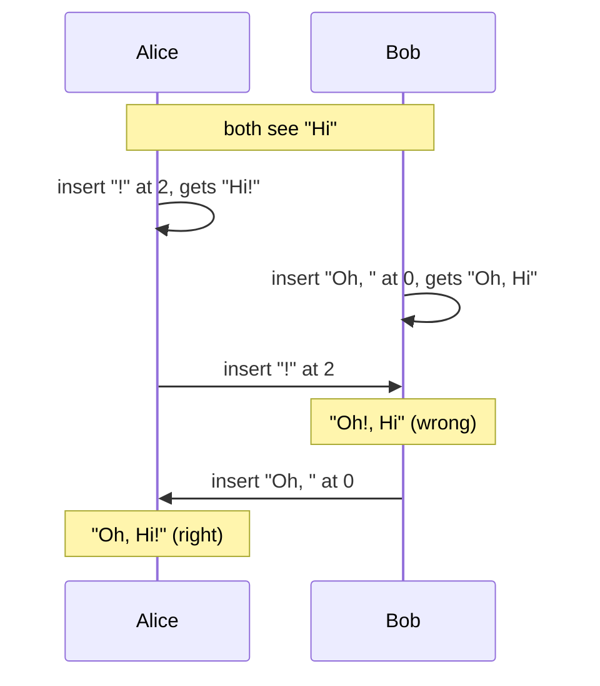
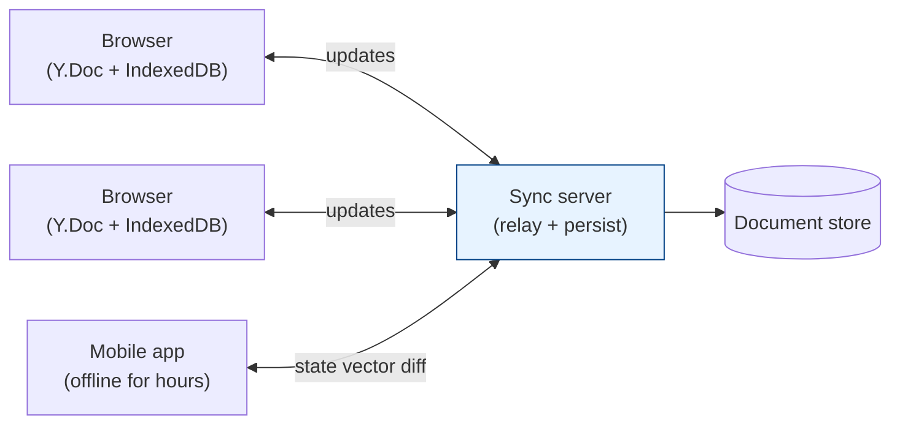

# Sequence CRDTs & Collaborative Editing

[< Back](./counters-registers-and-sets.md) | [Index](./README.md) | [Next: CRDTs in Production >](./crdts-in-production.md)

---

Counters and sets are the easy part. Text is where CRDTs get hard and where most of the
research money went, because it's the problem behind Google Docs, Notion, Figma's text
layers, code editors with live share, and every "works offline" notes app.

This chapter covers why ordered lists need their own kind of CRDT, how the main algorithms
work, what goes wrong (interleaving, tombstones, moves), and what a real editor built on Yjs
or Automerge looks like.

## Why indexes break

The obvious way to describe a text edit is by position: "insert `!` at index 2". That works
until two people edit at once.



Bob's insert shifted every character after it, so Alice's "index 2" now points somewhere
else. The two replicas disagree, and neither of them did anything wrong.

There are two ways out. Rewrite the index on arrival to account for concurrent edits
(operational transformation), or stop using indexes at all (sequence CRDTs).

## Operational transformation, briefly

**Operational transformation (OT)** keeps index-based operations and transforms each incoming
one against the concurrent operations it missed. When Bob receives "insert `!` at 2", he knows
he inserted 4 characters before position 2 concurrently, so he applies it at 6.

Google Docs uses OT, descended from the 1995 Jupiter system. It works well, with one big
condition: a central server puts every operation into a single order. Peer-to-peer OT, without
that server, turned out to be very hard to get right. Several published algorithms were later
shown to diverge in corner cases. If you have a server in the loop for every edit, OT is a
proven choice. If you want offline editing for hours or sync between peers, that's where
CRDTs come in.

## The sequence CRDT idea: stable IDs, not positions

A sequence CRDT gives every inserted element (usually every character) a **unique, immutable
ID**, typically `(counter, replica_id)`. Operations refer to IDs:

- Insert: "put `!` with ID `(3, A)` right after the element with ID `(2, A)`".
- Delete: "mark `(2, A)` as deleted".

IDs never shift, so an operation means the same thing on every replica regardless of what
else happened concurrently. The only remaining question is how to order two elements inserted
at the same spot at the same time. Each algorithm answers that with a deterministic
tie-break.

There are two main families.

### Dense position identifiers: Logoot, LSEQ, Treedoc

Give each element a position from a dense ordered space, like a fraction. To insert between
positions 0.4 and 0.5, pick 0.45. Ordering is just sorting by position, with the replica ID as
a tie-break.

These are easy to explain but have two problems. Identifiers get longer as people keep
inserting into the same gap, so a heavily edited paragraph can end up with very long IDs. And
concurrent inserts at the same spot pick random-looking positions in the same gap, which
causes interleaving (below).

### Linked insert-after: RGA, YATA, Fugue

Each insert names the element it comes right after (its *origin*). The document is a tree:
each element's children are the things inserted right after it. Reading the document is a
depth-first walk. Concurrent children of the same parent are ordered by ID, with the higher
ID first.

This is **RGA** (Replicated Growable Array, Roh et al. 2011). **YATA**, the algorithm behind
Yjs, also records the right-hand neighbour at insert time to resolve more cases.
**Fugue** (Weidner and Kleppmann, 2023) refines the same idea to minimize interleaving.

A toy RGA fits on one screen:

```python
class RGA:
    def __init__(self, replica_id):
        self.rid = replica_id
        self.counter = 0
        self.nodes = {}               # id -> (parent_id, char, deleted)

    def _children(self, parent):
        kids = [i for i, n in self.nodes.items() if n[0] == parent]
        return sorted(kids, reverse=True)       # higher (counter, replica) first

    def _walk(self, parent=None):
        for k in self._children(parent):
            yield k
            yield from self._walk(k)

    def visible_ids(self):
        return [i for i in self._walk() if not self.nodes[i][2]]

    def text(self):
        return "".join(self.nodes[i][1] for i in self.visible_ids())

    def insert(self, index, ch):
        ids = self.visible_ids()
        parent = ids[index - 1] if index > 0 else None
        self.counter = max([self.counter] + [i[0] for i in self.nodes]) + 1
        nid = (self.counter, self.rid)
        self.nodes[nid] = (parent, ch, False)
        return ("ins", nid, parent, ch)          # broadcast this

    def delete(self, index):
        nid = self.visible_ids()[index]
        parent, ch, _ = self.nodes[nid]
        self.nodes[nid] = (parent, ch, True)     # tombstone, keep the node
        return ("del", nid)

    def apply(self, op):
        if op[0] == "ins":
            _, nid, parent, ch = op
            self.nodes.setdefault(nid, (parent, ch, False))
        else:
            parent, ch, _ = self.nodes[op[1]]
            self.nodes[op[1]] = (parent, ch, True)
```

Alice and Bob both start from "Hi". Alice types `!` at the end and Bob types `?` at the end,
concurrently. Both new characters have parent `i` and the same counter, so the tie-break uses
the replica ID: `(3, "B") > (3, "A")`, and both replicas show `Hi?!`. Not necessarily the order
either person expected, but the same everywhere, and that's the guarantee.

Note that `insert` turns the user's index into an ID before anything leaves the replica. The
UI speaks in indexes, the wire speaks in IDs. Every real library has this translation layer,
and making it fast is most of the engineering.

The toy also needs causal delivery: a character's parent has to arrive before the character.
Real libraries buffer operations whose dependencies haven't arrived yet.

## Deletes leave tombstones

A deleted character can't just vanish. Another replica may still send "insert after `(2, A)`",
and if `(2, A)` is gone, there's nothing to anchor that insert to. So deletes mark the element
and keep it.

That means a document's metadata grows with everything ever typed, not with what's currently
visible. A page that someone rewrote twenty times carries all twenty drafts as tombstones.
Libraries reduce the cost (Yjs stores a deleted run as a tiny "deleted N items" marker and
drops the content), but they can't drop the IDs without knowing every replica has moved past
them. [Chapter 4](./crdts-in-production.md#tombstones-and-garbage-collection) covers when you
can.

## The interleaving problem

Alice and Bob both put their cursor at the same spot and type a word while offline. Alice
types "Alice ", Bob types "Bob ". After sync, the right result is "Alice Bob " or
"Bob Alice ". The bad result is something like "BAolbice ", with the characters shuffled
together.

Kleppmann and co-authors showed in 2019 that Logoot and LSEQ can interleave this way, because
each character picks its position independently in the same gap. RGA avoids the worst case
because each new character is inserted after the previous one the same user typed, so a
run stays together. It still interleaves in some editing patterns. Fugue was designed to
avoid interleaving in both directions, and its authors proved what they call maximal
non-interleaving.

If you're picking a library, this is a fair question to ask. It's rare in live
collaboration, where people see each other's cursors, and common when long offline edits
merge.

## Making it fast

A naive sequence CRDT stores an object per character: ID, parent, content, deleted flag. A
10-page document with its edit history can mean millions of objects and tens of bytes of
metadata per character typed. Early libraries were slow enough that people dismissed CRDTs
for text entirely.

That's no longer true. The main tricks:

| Technique | What it does |
|-----------|--------------|
| Run-length encoding of IDs | Consecutive keystrokes by one user get IDs `(5,A)`, `(6,A)`, `(7,A)`; store them as one block of length 3 |
| Columnar storage | Automerge stores each field (actor, counter, action) as its own compressed column |
| Index structures | B-trees or skip lists map visible index → ID in `O(log n)` instead of a list scan |
| Lazy history | Eg-walker (Gentle and Kleppmann, 2024) keeps a plain event graph and only builds CRDT state when merging concurrent branches |

Joseph Gentle's 2021 post "5000x faster CRDTs" walks through these optimizations on a real
editing trace and is the best single read on why the old benchmarks don't apply anymore.

## Beyond plain text

### Cursors and selections

A cursor stored as an index breaks the moment someone else types above it. Store it as an ID
instead: "right after element `(42, B)`". Yjs calls these relative positions
(`Y.createRelativePositionFromTypeIndex`). They survive concurrent edits and convert back to
an index when rendering.

Presence (who's online, where their cursor is) is usually *not* stored in the document. It's
ephemeral, so Yjs sends it over a separate awareness protocol that just broadcasts the latest
state and lets it time out.

### Rich text

Bold, italics, and links are spans over text, and spans merge badly if stored as
"bold from index 3 to 9". **Peritext** (Ink & Switch, 2022) anchors each formatting mark to
character IDs and defines what happens at the edges. Type at the end of a bold word: does the
new text get bold? For bold, yes. For a link, no. Those rules sound trivial, but if you get
them wrong, users notice in the first hour.

### Moving items

Reordering a to-do list looks like delete plus insert. With CRDTs that breaks badly: two
people move the same item concurrently, and you get two copies of it. A real move operation
needs its own design (Kleppmann, "Moving elements in list CRDTs", 2020). Moving nodes in a
tree, like folders, is worse, because two concurrent moves can create a cycle. "A highly-available
move operation for replicated trees" (Kleppmann et al., 2021) handles that with undo-and-redo
of moves in timestamp order. Check whether your library supports move before you design a
drag-and-drop feature on top of it.

## What a real setup looks like

A typical Yjs app has a document per editable thing, a provider that syncs updates, and a
persistence layer.

```js
import * as Y from "yjs";

const doc = new Y.Doc();
const text = doc.getText("body");

// Send every local change to the server (or peers).
doc.on("update", (update, origin) => {
  if (origin !== "remote") socket.send(update);
});

// Apply changes from others. Order and duplicates don't matter.
socket.onmessage = (msg) => {
  Y.applyUpdate(doc, new Uint8Array(msg.data), "remote");
};

text.insert(0, "Hello");
```

To sync a replica that's been offline, exchange state vectors (a compact summary of what each
side has seen) and send only the missing part:

```js
const theirVector = await askPeerForStateVector();       // Y.encodeStateVector(peerDoc)
const missing = Y.encodeStateAsUpdate(doc, theirVector);
sendToPeer(missing);
```



The server here isn't an authority. It relays updates, stores them, and can merge them into a
compact snapshot, but any client could do the same. That's what lets the system keep working
when the server is down or the client is offline. It's also why you still need a server-side
authorization check on every update (see [chapter 4](./crdts-in-production.md#security-and-validation)).

## OT or CRDT?

| | OT | Sequence CRDT |
|---|----|---------------|
| Operations | Index-based, transformed on arrival | ID-based, applied as-is |
| Needs a central server | In practice, yes | No |
| Long offline edits | Possible, but transforms get expensive | The normal case |
| Metadata | Small; history can be discarded | IDs and tombstones for every element |
| Mature examples | Google Docs, many in-house editors | Yjs, Automerge, Loro, Diamond Types |

If every client is always online through your server, both work, and OT keeps the stored
document smaller. If offline editing, peer-to-peer sync, or local-first apps are in scope,
use a CRDT library. Don't write your own sequence CRDT for production. The toy above takes about 50
lines; a correct and fast one takes years.

## The takeaways

1. **Indexes shift under concurrent edits.** Sequence CRDTs replace them with stable IDs.
2. **Insert-after designs (RGA, YATA, Fugue) dominate** because they keep runs of typing
   together and compress well.
3. **Deletes are tombstones.** The document remembers everything ever typed until you can
   prove nobody needs it.
4. **Interleaving, rich text, and moves are where libraries differ.** Test them with your
   real editing patterns.
5. **Use a library.** Yjs and Automerge are production-grade; a homegrown sequence CRDT isn't.

---

[< Back](./counters-registers-and-sets.md) | [Index](./README.md) | [Next: CRDTs in Production >](./crdts-in-production.md)
