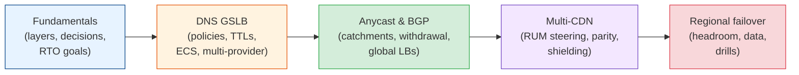

# Global Traffic Management

Once a product runs in more than one region, something has to decide which region each user
reaches, and something has to move users when a region breaks. That decision is spread
across several layers run by different parties: DNS answers cached by resolvers you don't
control, anycast routes chosen by other networks' BGP policy, CDN edges, and global load
balancers. This module covers how each layer steers traffic, how fast each one can change
its mind, and what it takes to move a region's worth of users without causing a second
outage. It picks up where [DNS](../networking/dns-deep-dive.md) and
[CDNs](../networking/cdns-and-edge.md) in the networking module leave off.

## Contents

| # | Topic | File | Level |
|---|-------|------|-------|
| 0 | The map (this file) | *(here)* | L3 · Intermediate |
| 1 | Global traffic fundamentals: why, the layers, what each can decide, failover goals, vocabulary | [global-traffic-fundamentals.md](./global-traffic-fundamentals.md) | L3 · Intermediate |
| 2 | DNS-based GSLB: geo, latency, weighted & failover routing, TTLs, ECS, multi-provider DNS | [dns-based-gslb.md](./dns-based-gslb.md) | L4 · Advanced |
| 3 | Anycast & BGP: catchments, TCP over anycast, DDoS absorption, withdrawing a PoP, global LBs | [anycast-and-bgp.md](./anycast-and-bgp.md) | L4 · Advanced |
| 4 | Multi-CDN & edge steering: RUM vs synthetic, shielding, config parity, commits, edge compute | [multi-cdn-and-edge-steering.md](./multi-cdn-and-edge-steering.md) | L4 · Advanced |
| 5 | Regional failover & traffic shifting: N+1 headroom, cold caches, data limits, evacuation drills | [regional-failover-and-traffic-shifting.md](./regional-failover-and-traffic-shifting.md) | L4 · Advanced |

---

## How to read this module

- **Chapter 1** lays out the layers a request passes through and what each one can see.
  Most steering mistakes come from asking a layer to decide something it has no information
  about, like DNS routing by user or URL.
- **Chapter 2** is DNS steering in depth. The policies are simple. The resolver caches,
  runtimes, and open connections between you and the user are what make DNS failover take
  minutes instead of seconds.
- **Chapter 3** covers anycast: one address announced from many places, with BGP picking
  the location. It's fast to fail over and good at absorbing attacks, but other networks
  decide where your users land.
- **Chapter 4** is running more than one CDN. Steering between them is the easy part.
  Keeping certificates, cache keys, purges, and WAF rules identical is the real work.
- **Chapter 5** is moving users between regions. Capacity headroom, cold caches, and the
  data layer decide whether a failover works, long after the steering layer has done its
  job.

## Related modules

- [networking/](../networking/README.md): DNS resolution, record types, TTLs, and CDN basics.
  This module assumes them.
- [cloud-and-serverless/cloud-architecture-patterns.md](../cloud-and-serverless/cloud-architecture-patterns.md):
  multi-region architecture and RPO/RTO, the targets traffic management has to meet.
- [infrastructure/l4-load-balancer.md](../infrastructure/l4-load-balancer.md): the regional
  load balancer layer, health checks, and balancing algorithms.
- [distributed-systems/failure-handling.md](../distributed-systems/failure-handling.md):
  timeouts, retries, and load shedding, which decide how clients behave during a failover.
- [chaos-engineering/gamedays.md](../chaos-engineering/gamedays.md): how to run the region
  evacuation drills chapter 5 recommends.
- [observability-and-reliability/slos-and-error-budgets.md](../observability-and-reliability/slos-and-error-budgets.md):
  the error budget that tells you how slow a failover you can afford.
- [crdts/](../crdts/README.md): what happens to data when more than one region accepts
  writes.

## The one idea

> **Every layer can only steer on what it can see, and only as fast as its caches allow.**
> DNS sees resolvers and changes in minutes. Anycast sees network paths and changes in
> seconds. A global load balancer sees requests and changes instantly. Put each decision at
> the first layer that has the information it needs, and remember that no steering layer
> can move users faster than the data and capacity waiting for them.

Start with [global-traffic-fundamentals.md](./global-traffic-fundamentals.md). **Next >**
