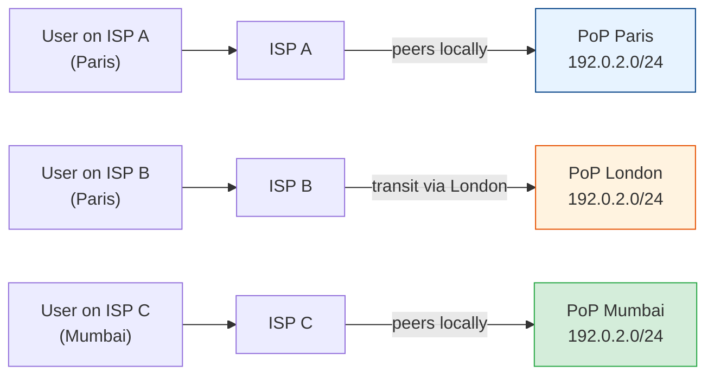

# Anycast and BGP: One Address, Many Locations

[< Back](./dns-based-gslb.md) | [Index](./README.md) | [Next: Multi-CDN & Edge Steering >](./multi-cdn-and-edge-steering.md)

---

DNS steering hands each user a different address. Anycast hands everyone the same address
and lets the internet's routing system deliver each packet to one of many sites that
announce it. 1.1.1.1, 8.8.8.8, every root DNS server, and most CDNs work this way. There is
no TTL to wait out, because the address never changes. When a site goes away, routers stop
sending traffic to it.

That sounds strictly better than DNS, and for failover speed it usually is. The price is
control. With DNS you decide where each resolver goes. With anycast, other people's routers
decide, using rules about cost and business relationships that have little to do with
distance. The [networking module](../networking/cdns-and-edge.md#anycast-routing) says
anycast sends users "to the closest server". This chapter is about what "closest" actually
means, and what to do when it's wrong.

## The BGP you need

The internet is about 75,000 autonomous systems (ASes), each a network under one
administration with its own AS number: Cloudflare is AS13335, Google AS15169, Amazon
AS16509. They exchange reachability with the Border Gateway Protocol (BGP).

| Concept | What it is | Why it matters for anycast |
|---------|-----------|----------------------------|
| Prefix | A block of addresses, like `192.0.2.0/24` | The unit you announce. /24 is the smallest IPv4 block most networks accept; /48 for IPv6 |
| Announcement | "I can reach this prefix" sent to a neighbour | Every anycast PoP announces the same prefix |
| Withdrawal | "I can no longer reach this prefix" | How a PoP removes itself from service |
| AS path | The list of ASes a route passes through | Shorter paths are usually preferred, so it shapes catchments |
| Local preference | A network's own ranking of routes, checked first | ISPs prefer routes from paying customers over peers over transit. Geography isn't in it |
| Communities | Tags attached to a route (`64497:100`) | Ask a neighbour to prepend, not export, or blackhole a route |
| RPKI ROA | A signed record saying which AS may originate a prefix | Without one, more and more networks drop your announcement as invalid |

Route selection runs in a fixed order: highest local preference, then shortest AS path,
then origin type, then lowest MED, then a series of tie-breakers. The key point is that
local preference comes first. An ISP in Delhi that pays a transit provider in Singapore and
peers for free with a CDN in Chennai will send traffic to the peer in Chennai. If it only
reaches the CDN through transit, packets may go to whichever PoP that transit provider
prefers, which might be Singapore.

## Anycast in one picture



Two users in the same city on different ISPs reach different PoPs. The set of networks that
end up at a given PoP is its **catchment**. Catchments follow peering and transit
relationships, not maps.

Announcing the prefix is ordinary BGP. An FRR configuration for one PoP's edge router might
look like this:

```text
router bgp 64496
 bgp router-id 198.51.100.10
 neighbor 203.0.113.1 remote-as 64497
 neighbor 203.0.113.1 description transit-a
 !
 address-family ipv4 unicast
  network 192.0.2.0/24
  neighbor 203.0.113.1 route-map TRANSIT-A-OUT out
 exit-address-family
!
ip prefix-list ANYCAST seq 10 permit 192.0.2.0/24
!
route-map TRANSIT-A-OUT permit 10
 match ip address prefix-list ANYCAST
 set as-path prepend 64496 64496
 set community 64497:100 additive
```

Every PoP has the same `network` line. This one also prepends its own AS twice towards
transit-a, making the path look longer so fewer networks pick this PoP through that
provider. That's the main tool for moving catchments around.

## Why "nearest" means "BGP-nearest"

BGP counts AS hops, not kilometres or milliseconds. A path through two large ASes that
crosses an ocean beats a path through three small ones across town. Some consequences you
will see in practice:

- **Users land on the wrong continent.** A South American ISP with transit only through
  Miami sends its users to a US PoP even when there's a PoP in São Paulo.
- **Adding a PoP can make things worse.** A new PoP with a good transit link may pull in
  networks from far away that were better served elsewhere.
- **Catchments change without you doing anything.** An ISP changes its transit contract and
  half a country moves to a different PoP overnight.

Measure catchments instead of assuming them. Useful tools:

```bash
# Which Cloudflare PoP am I reaching? (works for many anycast DNS services)
$ dig @1.1.1.1 CH TXT id.server +short
"FRA"

# Same question over HTTP
$ curl -s https://www.cloudflare.com/cdn-cgi/trace | grep colo
colo=FRA
```

For your own anycast prefix, return the PoP name in a response header and log it. RIPE Atlas
lets you run traceroutes and DNS queries from thousands of probes in other people's
networks. Verfploeter-style measurement pings a large set of addresses from your anycast
prefix and records which PoP receives each reply, which maps catchments for the whole
internet at once.

To fix a bad catchment you can prepend towards certain neighbours, stop announcing to a
transit provider at one PoP, use provider communities ("don't export to peer X"), or add
more peering at the PoP you want traffic to reach. Large operators also announce
region-specific unicast prefixes alongside the anycast one, so DNS can override BGP when it
needs to.

## TCP over anycast and route flaps

Anycast was long considered unsafe for TCP. If routing changes mid-connection, packets
start arriving at a different PoP, which has no state for that connection and answers with
a reset.

In practice this is rare, because routes to a given PoP change far less often than a
typical connection lasts. Web requests take seconds. It matters for long-lived connections:
WebSockets, video streams, large downloads, gRPC channels held open for hours. Those will
occasionally break during route changes, so clients must reconnect cleanly.

Inside a PoP, the same problem shows up between servers. Many servers share the anycast
address behind ECMP routing, and a server joining or leaving reshuffles the hash. Layer 4
balancers built for this use consistent hashing plus connection tracking so existing flows
stay put: Google's Maglev, Facebook's Katran, Cloudflare's Unimog. QUIC adds connection
IDs, which let a load balancer route by connection rather than by address tuple, so a
client changing networks keeps its connection within a PoP.

A **route flap** is a prefix being withdrawn and re-announced repeatedly. Each flap moves
users between PoPs and resets their connections. Some networks apply route flap damping
(RFC 2439) and suppress a flapping prefix for many minutes, which can turn a short wobble
into a long outage for those networks. Health-driven announcements need hysteresis for this
reason: several failed checks before withdrawing, several passes before announcing again.

## DDoS absorption

Anycast spreads an attack the same way it spreads users. A botnet spread across the world
lands on hundreds of PoPs, each taking a small share, instead of on one origin. Multi-terabit
attacks are now routine (Cloudflare reported mitigating a 5.6 Tbps UDP flood in late 2024),
and only a large anycast network has the aggregate capacity to absorb them.

The weakness is uneven catchments. Botnets are not uniform. If most of the attack comes
from a few networks that all land on one PoP, that PoP takes the full load. Operators handle
this by withdrawing the prefix from the overloaded PoP so the attack spreads to neighbours,
by asking upstreams to drop the traffic with a blackhole community (`65535:666`, RFC 7999)
on a more specific prefix, or by keeping some PoPs as sacrificial capacity. Withdrawing also
moves legitimate users, so it's a trade, not a fix.

## Withdrawing a PoP

Withdrawal is how anycast does failover and maintenance. Typically each server announces a
/32 to the PoP's routers only while its local health check passes, and the routers announce
the /24 to the internet while enough servers are up:

```text
process healthcheck {
  run python3 -m exabgp healthcheck --cmd "curl -sf http://127.0.0.1/healthz" --ip 192.0.2.1/32 --interval 2 --rise 3 --fall 2 --withdraw-on-down;
  encoder text;
}
```

When the PoP withdraws, the internet converges on the next-best paths. Within one large
network that takes seconds. Globally, withdrawals can trigger path hunting, where routers
try progressively worse backup routes before settling, and convergence can stretch to a
minute or more. Users mid-connection get resets and reconnect to the next PoP.

Automated withdrawal needs a floor. On 4 October 2021 a maintenance command cut Facebook's
data centres off from its backbone. Its DNS servers were designed to withdraw their anycast
prefixes when they couldn't reach the data centres, and every one of them did. Facebook's
domains disappeared from the internet for about six hours, and the tools engineers needed to
fix it were behind the same DNS. A health check that can withdraw every location at once
is a global outage switch. Cap automatic withdrawals to a fraction of sites, and require a
human beyond that.

## Global anycast load balancers

You don't need your own ASN and PoPs to use anycast. Several products sell it:

| Product | Layer | How it steers | Notes |
|---------|-------|---------------|-------|
| Google Cloud external Application LB | L7 | One anycast IP. Google front ends pick the nearest region with capacity | Overflows to the next region when a backend hits its configured capacity |
| AWS Global Accelerator | L4 (TCP/UDP) | Two static anycast IPs. Traffic enters AWS at the nearest edge and rides the AWS backbone | Per-region traffic dials (0-100%) and endpoint weights. Client affinity by source IP |
| Cloudflare Load Balancing | L7 | Runs inside Cloudflare's anycast proxy, picks an origin pool per request | Steering by health, geography, RTT, or outstanding requests. Spectrum covers L4 |
| Azure Front Door | L7 | Anycast front end, routes to origins by latency and priority | Similar model to Google's, with WAF built in |

These combine anycast's stable address with a real load balancer's per-request decisions.
Failover is health-check driven inside the provider's network, so it lands in tens of
seconds with no DNS cache in the way. The trade is that the provider's control plane is now
in your critical path, and moving off it later means changing your users' IP addresses.

## Anycast vs DNS steering

| | DNS steering | Anycast |
|---|--------------|---------|
| Who decides | Your authoritative server | Other networks' BGP policy |
| Granularity | Per resolver or ECS subnet | Per network path |
| Failover speed | TTL plus caching: minutes, long tail | BGP convergence: seconds to a minute |
| Uses real latency | Only if fed RUM or latency data | No. Uses AS path and business policy |
| Stable client address | No, the IP changes on failover | Yes |
| Long-lived connections | Unaffected by steering changes | Can reset on route changes |
| What you need | A DNS provider | An ASN, a /24, PoPs, peering, or a product that has them |
| DDoS absorption | None by itself | Spreads attacks across PoPs |
| Debugging | `dig` with `+subnet` from anywhere | Traceroutes and probes from inside other networks |

Most large systems use both. Anycast gets packets into the nearest edge quickly and absorbs
attacks. DNS picks between providers or overrides bad catchments with unicast addresses.
A global L7 LB behind the edge picks the region.

## The takeaways

1. **Anycast lets routing do the steering.** Every PoP announces the same prefix, and
   withdrawal is the failover.
2. **"Nearest" means BGP-nearest.** Local preference and AS path length decide, so measure
   catchments rather than assuming geography.
3. **TCP over anycast mostly works.** Route changes are rare compared to request lifetimes.
   Long-lived connections need clean reconnects.
4. **Automatic withdrawal needs a floor.** A health check that can withdraw every site at
   once can take you off the internet, as Facebook found in 2021.
5. **Use both.** Anycast for the edge and DDoS absorption, DNS for provider choice and
   overrides, a global L7 LB for picking regions.

---

[< Back](./dns-based-gslb.md) | [Index](./README.md) | [Next: Multi-CDN & Edge Steering >](./multi-cdn-and-edge-steering.md)
