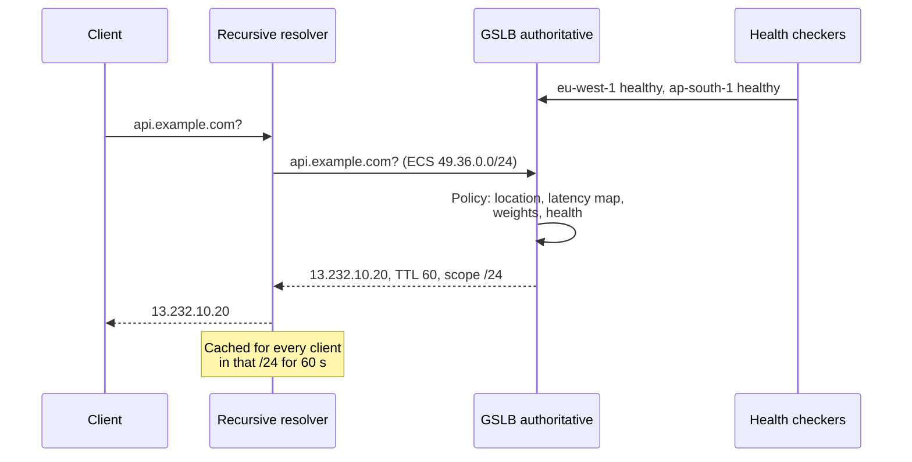

# DNS-Based GSLB: Geo, Latency, Weighted & Failover Routing

[< Back](./global-traffic-fundamentals.md) | [Index](./README.md) | [Next: Anycast & BGP >](./anycast-and-bgp.md)

---

DNS-based global server load balancing is the oldest way to send users to different places,
and still the most common. The authoritative server looks at who is asking, checks which
backends are healthy, and returns a different answer to different people. It needs no
network of your own and no special IP space, and every client on earth already speaks the
protocol.

The catch is that DNS was built to be cached, and you don't control the caches. Your
authoritative server answers a recursive resolver, not a user. The resolver may be in a
different country, may share its cache with a million people, and may keep your answer
longer than you asked. This chapter covers the routing policies, then spends most of its
time on those caches, because that's where DNS failover plans usually go wrong. It assumes
you know [resolution and TTLs](../networking/dns-deep-dive.md#caching-and-ttl).

## How a GSLB answer gets made



The authoritative server never talks to the client. Everything it knows about the user comes
from the resolver's source IP, or from the EDNS Client Subnet option if the resolver sends
one. Health comes from a separate checking system, and the answer it returns is reused by
every client behind that resolver until the TTL runs out.

## The routing policies

The major providers offer the same handful of ideas under different names:

| Policy | How it picks | Route 53 | NS1 | Cloudflare Load Balancing |
|--------|-------------|----------|-----|---------------------------|
| Weighted | Random, proportional to weights | Weighted | `weighted_shuffle` filter | Random steering |
| Failover | Primary while healthy, then secondary | Failover | `priority` filter | Off (ordered pools) |
| Geolocation | Country or continent of the resolver/subnet | Geolocation | `geotarget_country` | Geo steering |
| Latency | Lowest measured latency to each region | Latency | Pulsar (RUM data) | Dynamic steering |
| Proximity | Physical distance, optionally biased | Geoproximity | `geotarget_latlong` | Proximity steering |
| Network | The resolver's or client's CIDR or ASN | IP-based (CIDR collections) | `netfence_prefix`, `netfence_asn` | Custom rules |
| Multi-answer | Several healthy IPs, client picks | Multivalue (up to 8) | `select_first_n` | Not applicable |

Route 53's latency routing doesn't measure your users in real time. AWS keeps a table of
latency between resolver networks and AWS regions, built from its own measurements, and
answers from that table. It works well for the regions AWS knows about and can't account for
your app being slow in one region.

Geolocation has a trap. If you create records for India and Europe and nothing else, a query
from Brazil gets an empty answer. Route 53 needs an explicit default location record. NS1 and
Cloudflare need a fallback pool. Always define one.

Policies can be nested. A common shape is geolocation at the top ("Europe goes to the EU
set") with failover or weighted records under each location ("eu-west-1 primary,
eu-central-1 secondary"). In Route 53 you build this by pointing alias records at other
record sets. In NS1 you chain filters on a single record:

```json
"filters": [
  { "filter": "up",                "config": {} },
  { "filter": "geotarget_country", "config": {} },
  { "filter": "weighted_shuffle",  "config": {} },
  { "filter": "select_first_n",    "config": { "N": 1 } }
]
```

Each filter narrows the list of answers. Drop the unhealthy ones, keep the ones nearest the
requester's country, shuffle by weight, return one.

## A Route 53 setup in Terraform

Two regions, latency-based, each with its own health check:

```hcl
resource "aws_route53_health_check" "eu" {
  fqdn              = "eu.api.example.com"
  port              = 443
  type              = "HTTPS"
  resource_path     = "/healthz"
  request_interval  = 10          # fast checks; 30 is the default
  failure_threshold = 3
  regions           = ["eu-west-1", "us-east-1", "ap-southeast-1"]
}

resource "aws_route53_record" "api_eu" {
  zone_id         = aws_route53_zone.main.zone_id
  name            = "api.example.com"
  type            = "A"
  set_identifier  = "eu-west-1"
  health_check_id = aws_route53_health_check.eu.id

  latency_routing_policy {
    region = "eu-west-1"
  }

  alias {
    name                   = aws_lb.eu.dns_name
    zone_id                = aws_lb.eu.zone_id
    evaluate_target_health = true
  }
}

# api_in is identical with region = "ap-south-1" and its own health check.
```

Alias records to an ALB don't take a TTL. Route 53 uses the target's TTL, which is 60
seconds for ALBs. Set `evaluate_target_health` too, so an ALB with no healthy targets counts
as down even when the ALB itself still answers.

## Health checks

A DNS health check decides whether an entire region gets traffic, so it deserves more
thought than an instance check.

- **Check from many places.** Route 53 probes from up to eight AWS regions and treats an
  endpoint as healthy if more than 18% of checkers say so. One checker region with a network
  problem shouldn't take your region out of DNS.
- **Check something meaningful.** A `/healthz` that returns 200 while the database is
  unreachable keeps a broken region in rotation. A check that calls every dependency removes
  a healthy region because one non-critical service is slow. Check the dependencies that
  make the region useless if they fail, and nothing else.
- **Know the fail-open rule.** When every record in a group is unhealthy, Route 53 returns
  them all anyway, on the theory that a wrong answer beats no answer. That's usually right,
  but it means a bad health check across all regions looks like no failover at all.
- **Use calculated checks for "region is down".** A Route 53 calculated health check can
  combine child checks ("at least 2 of 3 front-end checks healthy"), which is closer to what
  you mean than one URL.

## TTLs, and why resolvers ignore them

You set a 60-second TTL. Some users still hit the old region an hour later. Every layer
between your authoritative server and the user's socket can keep an answer:

| Where the answer is held | What happens |
|--------------------------|--------------|
| Recursive resolver | Most honour the TTL. Some clamp low TTLs up to a minimum, often 300 s or more |
| OS stub resolver | systemd-resolved, mDNSResponder, and Windows DNS Client cache too, usually honouring TTL |
| Browser | Keeps its own host cache, and reuses open connections regardless of DNS |
| JVM | `networkaddress.cache.ttl` defaults to 30 s, but older setups with a security manager cache forever |
| Connection pools | An HTTP/2 or gRPC connection opened before the change stays on the old IP until it closes |
| Mobile apps and IoT | Some resolve once at startup and never again |

Connection reuse is the biggest effect for APIs. A gRPC client with a long-lived channel
doesn't look up DNS again until the connection breaks, so a DNS change does nothing for it.
If the old region is still accepting connections, the traffic just keeps going there. Set
`max connection age` on servers (gRPC has `MaxConnectionAge`, Envoy has
`max_connection_duration`) so clients reconnect and re-resolve every few minutes.

The practical rule: after a DNS change, expect most traffic to move within one or two TTLs
and a tail of a few percent to take much longer. Watch the old region's request rate to see
the real curve, and don't shut it down until it's near zero.

## EDNS Client Subnet

Without help, a GSLB sees only the resolver's address. EDNS Client Subnet (RFC 7871) lets
the resolver include a truncated client prefix, usually a /24 for IPv4 or /56 for IPv6.
The authoritative server answers for that subnet and returns a scope telling the resolver
which clients the answer can be cached for.

```bash
$ dig @ns-1234.awsdns-26.org api.example.com +subnet=49.36.0.0/24 +noall +comments +answer
;; OPT PSEUDOSECTION:
; EDNS: version: 0, flags:; udp: 4096
; CLIENT-SUBNET: 49.36.0.0/24/24
;; ANSWER SECTION:
api.example.com.        60      IN      A       13.232.10.20

$ dig @ns-1234.awsdns-26.org api.example.com +subnet=81.2.69.0/24 +noall +answer
api.example.com.        60      IN      A       34.240.18.77
```

The same name, two subnets, two regions. `/24/24` means the client sent a /24 and the
server says the answer is valid for that whole /24. Querying with `+subnet` is the quickest
way to check what your GSLB returns for a country without a VPN.

ECS has costs. Resolvers have to cache one answer per subnet, so cache hit rates drop. It
also leaks part of the user's address to every authoritative server, which is why Cloudflare's
1.1.1.1 doesn't send it at all. Google Public DNS sends it to authoritative servers that
support it. Quad9 offers it only on a separate address (9.9.9.11).

## When public resolvers break geo

Geo and latency routing guess the user's location from the resolver. That guess fails in
predictable ways:

- **Resolvers without ECS.** A user in Chennai on 1.1.1.1 reaches Cloudflare's nearest
  resolver PoP, which may be in Chennai or Mumbai. Usually close enough. Sometimes their ISP
  routes them to Singapore, and your GSLB sends an Indian user to ap-southeast-1.
- **Corporate DNS.** A company with offices in 40 countries resolves everything through two
  resolvers at headquarters. Every employee looks like they're in Frankfurt.
- **Mobile carriers.** Many carriers run a few large resolver sites per country, so geo
  accuracy is at country level at best.
- **VPNs.** The user is wherever the VPN exit is, which for compliance routing is the wrong
  answer in a way you can't detect.

For latency this costs some milliseconds. For regulatory routing it can put data in the
wrong country. DNS is not a compliance control. If data must stay in a region, enforce it at
the application layer, with the user's account or tenant deciding the region.

## Failover timing math

How long between "the region died" and "users stop going there"?

```text
detection      = request_interval x failure_threshold
               = 10 s x 3                                = 30 s
health update  = time for health state to reach the DNS servers    ~ a few seconds
cache expiry   = record TTL (worst case: just cached)    = 60 s
client caching = OS / runtime / connection reuse         = 0 s to "until reconnect"

worst case for a well-behaved client ~ 30 + 5 + 60     ~ 95 s
with default 30 s checks             ~ 90 + 5 + 60     ~ 155 s
```

Lowering the TTL to 10 seconds saves 50 seconds on paper. It also multiplies query volume
(and the bill, on Route 53 at $0.40 per million queries for standard records), and resolvers
that clamp low TTLs ignore it anyway. Most teams settle on 30-60 seconds and accept a
failover measured in a couple of minutes. If that's too slow, move failover to a layer
after DNS: an anycast proxy or global LB, covered in the
[next chapter](./anycast-and-bgp.md).

## DNS as a single point of failure

On 21 October 2016 the Mirai botnet attacked Dyn, a managed DNS provider. Twitter, GitHub,
Reddit, Netflix, and Spotify were unreachable for many users for hours. Their servers were
fine. Nobody could look up their addresses.

The fix is more than one authoritative provider. You list nameservers from both providers in
the NS records at the registrar, and resolvers pick between them by response time, retrying
the other one if a server doesn't answer. When one provider is down, lookups get slower
(a timeout, then a retry) but still work.

The hard part is keeping two providers identical. Static records are easy with a tool that
pushes one source of truth to both. [octoDNS](https://github.com/octodns/octodns) (from
GitHub) and [DNSControl](https://github.com/StackExchange/dnscontrol) (from Stack Exchange)
both exist for exactly this reason:

```yaml
providers:
  config:
    class: octodns.provider.yaml.YamlProvider
    directory: ./zones
  route53:
    class: octodns_route53.Route53Provider
    access_key_id: env/AWS_ACCESS_KEY_ID
    secret_access_key: env/AWS_SECRET_ACCESS_KEY
  ns1:
    class: octodns_ns1.Ns1Provider
    api_key: env/NS1_API_KEY

zones:
  example.com.:
    sources: [config]
    targets: [route53, ns1]
```

GSLB records are harder. A Route 53 latency record and an NS1 filter chain don't map one to
one, and health checks live in each provider separately. A common compromise: both
providers serve static records for everything, and the GSLB names are kept on one provider,
with a simple weighted or static fallback on the other. DNSSEC across two providers needs a
multi-signer setup (RFC 8901) where each provider publishes the other's keys. It works, but
plan for it before you sign the zone, not after.

## The takeaways

1. **The GSLB answers a resolver, not a user.** Every policy is a guess about the user made
   from the resolver's address or an ECS subnet.
2. **Always define a default.** Geolocation without a fallback record returns nothing for
   unmapped countries.
3. **TTL is a request, not a guarantee.** Resolvers clamp, runtimes cache, and long-lived
   connections never re-resolve. Cap connection age so clients come back.
4. **DNS failover takes minutes.** Detection plus TTL is roughly 1.5-3 minutes, with a tail.
   Faster failover belongs in a later layer.
5. **Run two DNS providers.** Keep them in sync from one source of truth, and decide
   upfront how GSLB records and DNSSEC will work across both.

---

[< Back](./global-traffic-fundamentals.md) | [Index](./README.md) | [Next: Anycast & BGP >](./anycast-and-bgp.md)
