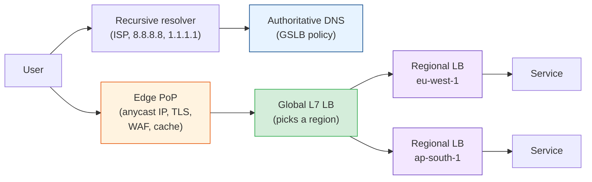

# Global Traffic Fundamentals: Layers, Decisions & Failover Goals

[Index](./README.md) | [Next: DNS-Based GSLB >](./dns-based-gslb.md)

---

A user in Mumbai types your URL. Before a single line of your code runs, at least four
systems have made a decision about where that request goes: a DNS server picked an address,
the internet's routers picked a location for that address, an edge proxy picked an origin,
and a load balancer picked a region. Each of those decisions can send the user somewhere
fast, somewhere slow, or somewhere broken.

Global traffic management is the practice of controlling those decisions on purpose. It
covers which region serves which user, how quickly traffic moves when a region fails, and
how you shift load gradually without dropping requests. The basics of
[DNS](../networking/dns-deep-dive.md) and [CDNs](../networking/cdns-and-edge.md) are covered
in the networking module. This chapter starts where those stop: with more than one region,
and a need to choose between them.

## Why bother

One region in one cloud is the simplest thing that works, and for many products it's the
right answer. Teams outgrow it for four reasons:

| Reason | What it looks like | Typical numbers |
|--------|--------------------|-----------------|
| Latency | Users far from the only region wait on every round trip | Light in fibre covers about 200 km per ms. Mumbai to us-east-1 is 190-230 ms RTT |
| Availability | One region going down takes the whole product with it | AWS us-east-1 had multi-hour regional incidents in 2017, 2020, 2021 and 2025 |
| Regulatory routing | Some data must be processed in a specific country | GDPR transfer rules, RBI payment data localisation in India, ICP licensing in China |
| Cost | Bandwidth and compute prices differ by region and provider | Cross-region transfer on AWS is around $0.02/GB. CDN egress varies 3-5x by continent |

Latency compounds. A cold HTTPS request needs a TCP handshake, a TLS 1.3 handshake, and the
request itself: three round trips before the first byte. At 200 ms RTT that's 600 ms of pure
physics. Terminating TCP and TLS at an edge 10 ms away cuts the handshake cost to 20 ms, and
only the request itself crosses the ocean, over a connection the edge already holds open.

Availability is the reason that drives most of the hard work. Moving users to a closer
region is an optimisation. Moving them away from a dead region quickly is a requirement,
and it's where most of this module spends its time.

## The layers a request passes through



1. **DNS.** The authoritative server returns an address, or a CNAME to another name. A
   global server load balancer (GSLB) is an authoritative server that answers differently
   depending on who is asking and which backends are healthy.
2. **Anycast network.** The address DNS returned may be announced from dozens of locations
   at once. BGP routing decides which one the packets reach.
3. **Edge or CDN.** The point of presence (PoP) terminates TCP and TLS, applies WAF rules,
   serves cached content, and forwards the rest.
4. **Global L7 load balancer.** Something with a view of every region picks one for this
   request. Sometimes this lives inside the edge (Cloudflare Load Balancing, Google's
   front ends), sometimes it doesn't exist and DNS did the job already.
5. **Regional load balancer.** An ALB, NLB, Envoy, or nginx fleet picks an instance inside
   the region. See [L4 load balancers](../infrastructure/l4-load-balancer.md) for how this
   layer works.

Not every system has every layer. Three common stacks:

| Stack | Layers used | Typical setup |
|-------|-------------|---------------|
| Small SaaS, two regions | 1 and 5 | Route 53 latency records pointing straight at two ALBs |
| Mid-size, one CDN | 1, 2, 3, 5 | Cloudflare or CloudFront in front, origin pools per region, regional ALBs |
| Large consumer product | All five | Two DNS providers, two CDNs, a global L7 LB, Envoy or ALBs per region |

The large stack is often run by three or four vendors, each with its own health checks,
dashboards, and idea of what "down" means. Part of the job is making those agree.

## What each layer can and can't decide

Each layer sees different information, and that limits what it can decide well.

| Layer | What it sees | Good at deciding | Can't decide | How fast a change lands |
|-------|-------------|------------------|--------------|-------------------------|
| DNS | The resolver's IP, maybe a client subnet | Region or CDN per network, coarse weights | Anything per request: path, cookie, user ID | TTL plus resolver behaviour: 1 min to hours |
| Anycast / BGP | Destination prefix and routing policy | Which PoP a network reaches | Load or health of a backend, per-user choice | Seconds to a few minutes of BGP convergence |
| Edge / CDN | The full HTTP request after TLS | Cache, block, rewrite, pick an origin pool | How much capacity the origin has left | Seconds, once config is pushed |
| Global L7 LB | Requests plus health and load of every region | Region per request, overflow when one fills up | Which PoP the user reached | Seconds, health-check driven |
| Regional LB | Instances and their health in one region | Instance per request or connection | Anything outside its region | Seconds |

Two rules fall out of this table:

- **Decisions that need request details belong at layer 3 or later.** DNS can't route
  `/api/payments` differently from `/images`, because it never sees the path.
- **Decisions that need to happen fast belong after DNS.** DNS is the slowest layer to
  change, because other people's caches hold your answers. Anything that relies on DNS to
  fail over inherits that delay.

Teams often discover the first rule late. They build geo-routing in DNS, then need one
tenant pinned to Frankfurt for compliance, and find there is no way to express "this
customer" at a layer that only sees resolver IPs.

## Failover goals: seconds or minutes

[RTO](../cloud-and-serverless/cloud-architecture-patterns.md#disaster-recovery-rpo-vs-rto)
says how long you can be down. The layer you fail over at mostly decides which RTO you can
hit:

| Failover mechanism | Detection | Shift | Realistic RTO |
|--------------------|-----------|-------|---------------|
| Client retries to a second endpoint | One timeout | Immediate | Under a second for that client |
| Regional LB removes a bad instance | 2-3 failed checks at 5-10 s | Immediate | 10-30 s |
| Global L7 LB or anycast proxy moves traffic | 2-3 failed checks at 5-15 s | Immediate | 15-60 s |
| Anycast PoP withdrawn via BGP | Local health check | BGP convergence | 30 s to a few minutes |
| DNS failover record | 3 failed checks at 10-30 s | TTL plus resolver caching | 2-5 min for most users, hours for the tail |
| Human-triggered region evacuation | An alert plus a person deciding | Depends on the runbook | 10-60 min |

Read the last row carefully. If failing over the database needs a human to approve a
promotion, every fast mechanism above it is capped by that human. The
[regional failover chapter](./regional-failover-and-traffic-shifting.md) covers that
problem in depth.

A useful way to set the goal is to work backwards from the
[error budget](../observability-and-reliability/slos-and-error-budgets.md). A 99.95% monthly
availability target allows about 22 minutes of downtime per month. One region outage with
a 5-minute DNS failover spends almost a quarter of it. One with a 30-minute manual
evacuation spends more than the whole month.

## A request, traced

Here's what the layers look like from the outside for a typical setup with a GSLB in front
of a CDN:

```bash
$ dig +noall +answer www.example.com
www.example.com.             60    IN  CNAME  www.example.com.gslb.example.net.
www.example.com.gslb.example.net. 30 IN  CNAME  example.global.ssl.fastly.net.
example.global.ssl.fastly.net. 30 IN  A      151.101.1.57
example.global.ssl.fastly.net. 30 IN  A      151.101.65.57
```

The first CNAME hands the decision to a steering service. The steering service picked a CDN
(Fastly here) with a 30-second TTL so it can change its mind quickly. Fastly's addresses are
anycast, so which PoP you reach depends on your network. The response headers then say
where you ended up:

```bash
$ curl -sI https://www.example.com | grep -iE 'x-served-by|x-cache|x-origin-region'
x-served-by: cache-fra-eddf8230045-FRA
x-cache: MISS
x-origin-region: eu-central-1
```

Frankfurt PoP, a cache miss, and the origin pool picked eu-central-1. Three layers, three
decisions, and all three visible to anyone who knows where to look. Adding headers like
`x-origin-region` to every response costs nothing and saves hours during an incident.

## The vocabulary

| Term | Meaning |
|------|---------|
| GSLB | Global server load balancing. Usually means DNS that answers based on location, health, and weights |
| PoP | Point of presence. A site where a network or CDN has servers and connects to other networks |
| Origin | Your own servers, behind the CDN or edge |
| Catchment | The set of users or networks whose traffic reaches a given anycast PoP |
| Steering | Choosing a destination (region, CDN, PoP) for a user or request |
| Health check | A probe that decides whether a destination should receive traffic |
| Drain | Stop sending new traffic to a destination and let existing work finish |
| Evacuate | Move all traffic, background jobs, and data roles out of a region |
| RUM | Real user monitoring. Measurements collected from actual users' browsers or apps |
| ECS | EDNS Client Subnet. A DNS extension that passes part of the user's IP to the authoritative server |
| Traffic dial | A percentage control for how much traffic a region or endpoint group receives |

Note how "load balancer" means different things at different layers. A GSLB never sees a
packet of your application traffic. It only answers DNS queries. A global L7 LB sees every
request. Keep that difference in mind when a vendor calls both products "global load
balancing".

## The takeaways

1. **Every request passes through several decision points.** DNS, anycast routing, the
   edge, a global LB, and a regional LB each pick something, and each can be wrong.
2. **Each layer only knows what it sees.** DNS sees resolvers, not users or URLs. Put
   decisions at the first layer that has the information they need.
3. **DNS is the slowest layer to change.** Failover that depends on DNS has an RTO measured
   in minutes, with a long tail.
4. **Work out the RTO from the error budget.** A 99.95% target leaves 22 minutes a month,
   which rules out manual failover as the main plan.
5. **Make every layer's decision visible.** Response headers naming the PoP, the origin
   region, and the cache result turn guessing into reading.

---

[Index](./README.md) | [Next: DNS-Based GSLB >](./dns-based-gslb.md)
