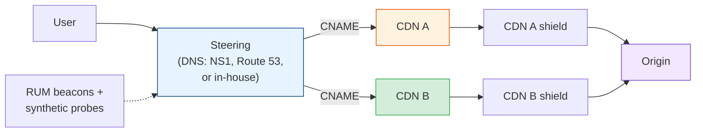

# Multi-CDN and Edge Steering

[< Back](./anycast-and-bgp.md) | [Index](./README.md) | [Next: Regional Failover & Traffic Shifting >](./regional-failover-and-traffic-shifting.md)

---

Once you put a CDN in front of everything, the CDN is part of your availability. When it has
a bad day, so do you, and it will have bad days. On 8 June 2021 a single customer's valid
configuration change triggered a latent bug at Fastly, and about 85% of its network returned
errors for close to an hour. Amazon, Reddit, the UK government, and the New York Times went
down with it. In July 2021 an Akamai Edge DNS bug did the same to a different list of
companies. On 21 June 2022 a network change in 19 Cloudflare data centres took down a large
share of its traffic for over an hour.

Multi-CDN means running two or more CDNs in production at the same time and steering users
between them. It protects against that kind of outage, and it lets you pick the faster CDN
per country, but it doubles the configuration you have to keep correct. Most of the work in
a multi-CDN setup is keeping the CDNs identical, not steering between them.

## Why run more than one

| Reason | What it buys | What it costs |
|--------|-------------|---------------|
| Availability | A whole-CDN outage becomes a steering change | Every config, cert, and rule exists twice |
| Performance per region | CDN A may be faster in Brazil, CDN B in India | Need measurement data per country or network |
| Commercial leverage | Credible ability to move traffic at renewal time | Lower volume per CDN, so weaker volume discounts |
| Peak capacity | Big launches and live events beyond one CDN's spare capacity | Contracts and capacity planning with each |
| Market access | China needs a CDN with ICP-licensed nodes in-country | One more vendor for one market |

If your CDN only serves cacheable static assets and the site still works without them, a
single CDN plus a fallback hostname that points at the origin may be enough. Multi-CDN pays
off when the CDN fronts your API and HTML, so a CDN outage is a full outage.

## The shape of a multi-CDN setup



The steering layer is almost always DNS, using the policies from the
[DNS GSLB chapter](./dns-based-gslb.md). Your hostname is a CNAME to a steering name, which
returns a CNAME to one CDN's hostname:

```bash
$ dig +noall +answer www.example.com
www.example.com.                    300 IN CNAME www.example.com.steer.example.net.
www.example.com.steer.example.net.   30 IN CNAME example.com.edgekey.net.
example.com.edgekey.net.            300 IN CNAME e1234.a.akamaiedge.net.
e1234.a.akamaiedge.net.              20 IN A     23.45.67.89
```

The steering record carries the short TTL (30 s), because that's the decision you want to
change quickly. The apex (`example.com`) can't be a CNAME, so either redirect the apex to
`www` or use your DNS provider's ALIAS, ANAME, or CNAME-flattening feature.

## Steering inputs: RUM vs synthetic

Steering needs data on which CDN is faster and healthier for each group of users. There are
two sources:

| | Real user monitoring (RUM) | Synthetic probes |
|---|---------------------------|------------------|
| How | A script in real users' browsers fetches a test object from each CDN | Agents in data centres (Catchpoint, ThousandEyes) fetch on a schedule |
| Measures | Real last mile, real resolvers, real ISPs | Backbone and data-centre networks |
| Coverage | Wherever you have users, weighted by traffic | Wherever the vendor has agents |
| Volume needed | Hundreds of samples per country/ASN per hour to be stable | One agent per location is enough |
| Detects outages when idle | No, no traffic means no data | Yes, probes run anyway |
| Bias | Only users who load your pages and run JS | Data-centre networks are faster than homes |

Use synthetic probes for health ("is CDN B serving errors in Germany?") and RUM for ranking
("which CDN is faster for Airtel users in India?"). A minimal RUM beacon:

```js
// Runs after page load on a 5% sample of sessions
const targets = {
  fastly: "https://rum-fastly.example.com/rum/15kb.bin",
  akamai: "https://rum-akamai.example.com/rum/15kb.bin",
};
for (const [cdn, url] of Object.entries(targets)) {
  await fetch(url, { cache: "no-store", mode: "cors" });
  const t = performance.getEntriesByName(url).pop();
  navigator.sendBeacon("/rum", JSON.stringify({
    cdn,
    ttfb: t.responseStart - t.requestStart,
    total: t.responseEnd - t.startTime,
  }));
}
```

The test object stays cached at each CDN's edge, and `cache: "no-store"` only skips the
browser cache, so you measure edge performance rather than your origin. The test object
needs `Access-Control-Allow-Origin` for the fetch to succeed and `Timing-Allow-Origin` for
the detailed timing fields, which otherwise come back as zero. The collector joins each beacon with the client's country and ASN, and the
steering layer reads a ranking per (country, ASN) bucket, refreshed every few minutes.
NS1's Pulsar is the packaged version of this loop.

Add hysteresis. If CDN A and B are within 5% of each other, flipping between them on every
update costs cache warmth for no real gain. Switch only on a clear, sustained difference.

## Origin shielding and tiered caching

Every CDN PoP that misses fetches from somewhere. Without a mid-tier, that's your origin,
and with 200 PoPs a single popular object can mean 200 origin fetches each time it expires.
A **shield** is one designated PoP (or a regional tier of them) that every other PoP fetches
through, so the origin sees one fetch per object per expiry instead of hundreds.

Each CDN names it differently: Fastly shielding, Cloudflare Tiered Cache, Akamai Tiered
Distribution, CloudFront Origin Shield. With multiple CDNs, each one has its own shield, so
the origin sees one fetch per object per CDN:

| Setup | Origin fetches per object expiry | Cache hit ratio for long-tail objects |
|-------|----------------------------------|---------------------------------------|
| One CDN with a shield | 1 | Best: all requests share one cache |
| Two CDNs, each with a shield, 50/50 split | 2 | Lower: each CDN sees half the requests |
| Two CDNs, 90/10 split | 2 | The 10% CDN's cache stays mostly cold |
| Two CDNs fetching from your own cache tier | 1 to your origin | Same as one CDN at the origin |

Popular objects barely notice. The long tail does: an object requested twice per hour across
two CDNs might never get a cache hit at either. If origin load matters, put your own cache
tier (Varnish, nginx, or a third CDN's shield) in front of the origin and point both CDNs at
it. Place the shields near the origin's region so shield-to-origin traffic stays short.

Check egress pricing too. AWS doesn't charge for origin fetches from CloudFront, but charges
normal internet egress (around $0.05-0.09/GB) for fetches from any other CDN. With multi-CDN
on AWS, the second CDN's origin traffic is a real line item.

## Keeping the CDNs identical

A user shouldn't be able to tell which CDN served them. Any difference becomes a bug that
only happens in some countries, some of the time:

| What drifts | How it breaks | Keep it in parity by |
|-------------|---------------|----------------------|
| TLS certificates | Cert expires on one CDN only. CDN-managed certs fail validation through the other CDN | DNS-01 ACME validation, or uploading your own cert to both; expiry alerts per CDN |
| CAA records | CDN can't issue because your CAA list only allows the other CDN's CA | List every CA each CDN uses (`letsencrypt.org`, `digicert.com`, `pki.goog`) |
| Cache keys | One CDN ignores query strings, the other includes them; stale or broken pages | Same normalisation rules: sorted params, stripped `utm_*`, same `Vary` handling |
| TTLs and purges | Purge reaches CDN A, CDN B serves the old version | A purge service that calls every CDN's API; surrogate keys on both |
| WAF rules | A request blocked on one CDN passes on the other | One rule source, translated per CDN, plus a shared attack test suite |
| Headers and redirects | HSTS, CORS, security headers missing on one | Response header tests per CDN |
| Origin access | Origin allows CDN A's IP ranges, blocks CDN B after B adds ranges | A shared secret header or mTLS instead of IP allowlists |
| Logs | Different formats and fields | Normalise into one schema before it reaches dashboards |

Generate every CDN's configuration from one source, usually Terraform with each CDN's
provider (`fastly`, `cloudflare`, `akamai`), and test each CDN directly in CI, bypassing
steering. curl's `--connect-to` sends a request for your hostname to a specific CDN:

```bash
#!/usr/bin/env bash
# Run the same checks against each CDN, ignoring what steering would pick
CDNS=(example.global.ssl.fastly.net example.com.edgekey.net)
for cdn in "${CDNS[@]}"; do
  via=(--connect-to "www.example.com:443:${cdn}:443")
  echo "== ${cdn}"
  curl -s -o /dev/null -w 'home     %{http_code}\n' "${via[@]}" https://www.example.com/
  curl -s -o /dev/null -w 'waf      %{http_code}\n' "${via[@]}" \
    "https://www.example.com/?q=%3Cscript%3Ealert(1)%3C%2Fscript%3E"
  curl -sI "${via[@]}" https://www.example.com/app.js | grep -iE 'cache-control|strict-transport'
done
```

The WAF line should print 403 for every CDN. When it prints 200 for one, you found the drift
before an attacker did.

## Cost commits

CDN contracts usually commit you to a monthly volume (say 500 TB) at a discounted rate, with
overage charged above it. You pay the commit whether you use it or not. Steering purely on
performance ignores this. If CDN A is slightly slower in one country for two weeks and
steering moves that traffic to B, you pay for A's unused commit and B's overage rate on top.

Feed the commits into steering as constraints:

- **Floors.** Never send less than the commit to a CDN unless it's unhealthy.
- **Caps.** Stop shifting traffic to a CDN once it would exceed its commit by more than a
  set margin, unless the other one is unhealthy.
- **Health beats cost.** An outage overrides every commercial rule.

Some CDNs bill on 95th-percentile bandwidth instead of total GB. A failover that pushes a
CDN to a new peak for a few hours can raise that month's bill noticeably.

## Failover between CDNs

DNS-based CDN failover inherits all of DNS's timing: health detection plus the steering
TTL, then a tail of clients on cached answers or open connections. Plan for two to five
minutes for most users.

Two habits make it work when you need it:

- **Never run 100/0.** Keep at least 5-10% of traffic on every CDN at all times. That keeps
  its caches warm, its config exercised, and its certificates tested by real users. A CDN
  that has carried no traffic for six months will fail in some way the moment you need it.
- **Detect partial failures.** CDNs rarely fail everywhere at once. More often one PoP or
  one country breaks. Steering on per-country health catches that, and a global health
  check doesn't.

Check capacity before you rely on it. If the secondary CDN normally carries 10% and suddenly
gets 100%, its cache hit ratio for your content drops and origin traffic climbs sharply. The
[regional failover chapter](./regional-failover-and-traffic-shifting.md) covers the same
cold-cache problem one layer down.

## Edge compute caveats

[Edge compute](../networking/cdns-and-edge.md#edge-computing) is where multi-CDN parity
breaks hardest. The platforms look similar and aren't portable:

| Platform | Runtime | Notable limits |
|----------|---------|----------------|
| Cloudflare Workers | V8 isolates, JS/TS/Wasm | CPU time limits per request; KV is eventually consistent, with changes taking up to a minute to appear everywhere |
| Fastly Compute | WebAssembly (Rust, JS, Go) | Different APIs for cache, KV, and backends |
| Akamai EdgeWorkers | JavaScript | Event model tied to Akamai's request phases |
| CloudFront Functions | JavaScript subset | Sub-millisecond budget, no network calls |
| Lambda@Edge | Node.js, Python | Runs at regional edge caches; 5 s viewer and 30 s origin timeouts |

Each platform has its own request and cache APIs, storage, limits, and deployment model.
Logic you write for one won't run on the other without a rewrite, and the two versions will
drift. WinterTC (the Ecma committee formerly called WinterCG) is standardising a common
subset around the Fetch API, which helps for simple request rewriting but not for storage
or cache control.

Keep edge logic small: header rewrites, redirects, token checks. Anything heavier either
moves to the origin or gets pinned to one CDN, with steering always sending those paths
there. Pinning means those paths lose multi-CDN protection, so decide deliberately.

## The takeaways

1. **Multi-CDN is mostly a parity problem.** Steering is the easy part. Certs, cache keys,
   purges, WAF rules, and headers must match on every CDN, tested in CI.
2. **Use RUM for ranking and synthetics for health.** RUM sees real users but goes quiet
   when traffic does. Synthetic probes catch outages when nobody's looking.
3. **Each CDN adds origin load.** Separate shields multiply origin fetches and split cache
   hits. A shared cache tier in front of the origin fixes both.
4. **Never run 100/0.** A standby CDN that carries no traffic will fail when you need it.
5. **Edge code is lock-in.** Keep it thin, or accept that those paths live on one CDN.

---

[< Back](./anycast-and-bgp.md) | [Index](./README.md) | [Next: Regional Failover & Traffic Shifting >](./regional-failover-and-traffic-shifting.md)
