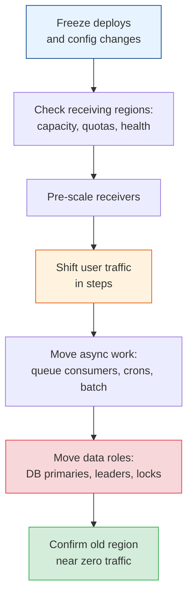

# Regional Failover and Traffic Shifting

[< Back](./multi-cdn-and-edge-steering.md) | [Index](./README.md)

---

The earlier chapters covered how to point users at a region. This one covers moving them
off one, on purpose or in a hurry. Every steering layer can shift traffic in seconds to
minutes. Whether the receiving regions can take that traffic, and whether the data is there
waiting for it, is a separate question, and it's the one that decides your real RTO.

Most failed failovers don't fail at the steering step. The DNS change works, users arrive in
the other region, and then the other region falls over from the extra load, or serves stale
data, or can't accept writes because the database primary is still in the dead region. This
chapter is about those parts. It builds on the
[multi-region patterns](../cloud-and-serverless/cloud-architecture-patterns.md#multi-region-architecture)
in the cloud module.

## Active-active vs active-passive

| | Active-passive | Active-active |
|---|----------------|---------------|
| Normal traffic | All in the primary; standby idle or scaled down | Spread across every region |
| Capacity cost | Standby can be smaller, scaled up during failover | Every region carries headroom for the others |
| Failover time | Minutes to hours: scale up, promote data, switch traffic | Seconds to minutes: stop sending to the bad region |
| Data | One writable primary, async replicas | Either one writer per item (home region) or multi-writer with conflict handling |
| Confidence | Low unless drilled. The standby never runs real traffic | High. Every region serves users every day |
| Hard part | The standby rots: config drift, expired creds, missing capacity | The data layer |

Active-active is safer mainly because every region proves it works every minute of every
day. A passive region is a set of assumptions nobody has checked since the last drill.

Many active-active systems avoid multi-writer data with **home regions**. Each user or
tenant is assigned a home region that holds the writable copy of their data, and other
regions hold replicas. The global LB sends each request to the user's home region, and
failover means re-homing users. This is the cell pattern applied to regions, and it keeps
write conflicts out of the picture.

## Capacity headroom: the N+1 math

If you run N regions active-active and want to survive losing one, the other N-1 must carry
the whole peak. With an even split, each region needs capacity for `peak / (N-1)`:

| Regions (N) | Max safe utilisation at peak | Provisioned capacity vs peak |
|-------------|------------------------------|------------------------------|
| 2 | 50% | 2.0x |
| 3 | 67% | 1.5x |
| 4 | 75% | 1.33x |
| 5 | 80% | 1.25x |

Worked example: peak is 90,000 requests per second across three regions, 30,000 each.
Losing one leaves 90,000 for two regions, so each must handle 45,000. You provision 135,000
in total, 1.5x peak, and every region runs at two-thirds of capacity at peak. See
[back-of-the-envelope estimation](../system-design-fundamentals/back-of-envelope.md) for the
same style of reasoning applied elsewhere.

The even split is optimistic. Latency-based routing doesn't spread an evacuated region's
users evenly. It sends them to the next-nearest region. With regions in us-east-1, eu-west-1
and ap-south-1, losing eu-west-1 sends almost all European users to us-east-1, which is
closer to Europe than Mumbai is. us-east-1 goes from 33% to 67% of global traffic, double
its normal load. Plan headroom for the pair, not the average, or use weighted shifting that
splits the evacuated traffic on purpose.

Autoscaling won't cover the gap. Scaling up takes minutes, the alarms that trigger it lag
behind the load, and during a real regional outage every other customer of that cloud is
scaling into the same neighbouring regions at the same time. AWS On-Demand Capacity
Reservations and similar products exist because "we'll scale up when it happens" fails at
exactly the moment it's needed.

## Draining vs evacuating

**Draining** stops new traffic to a target and lets in-flight work finish. An AWS ALB target
group waits 300 seconds by default (the deregistration delay) before cutting connections
to a removed target. **Evacuating** a region moves everything: user traffic, background
work, and the data roles.



The steps people forget are E and F. Traffic moves, but a cron job still runs in the old
region, a Kafka consumer group still reads from the old cluster, or a scheduler still holds
a leader lease there. When the region later dies for real, those jobs stop and nobody
notices for a day. List every singleton and background process per region, and include
them in the runbook.

## Thundering herds and cold caches

Moving a third of global traffic into a region in one step hits that region with things
that never happen at steady state:

- **Cold caches.** The local Redis or Memcached has no entries for the users who just
  arrived. Every request misses and goes to the database. A 95% cache hit ratio that drops
  to 60% means eight times the database reads. See
  [cache failure modes](../infrastructure/caching-redis.md#cache-invalidation--the-classic-failures).
- **Connection storms.** Every arriving client opens new TCP and TLS connections. TLS
  handshakes are CPU-heavy, and connection pools to databases fill up.
- **Cold runtimes.** New instances from autoscaling start with cold JIT, empty local caches,
  and lazy-loaded config.
- **Retry amplification.** Clients that saw errors during the failover retry. Three retries
  at each of three layers is up to 64 attempts per original request.

Mitigations:

| Problem | Mitigation |
|---------|-----------|
| Cold caches | Shift in steps so caches fill gradually; send a small steady share of each user population to other regions so their caches stay warm |
| Connection storms | Pre-scale front ends; stagger shifts; keep TLS session resumption enabled |
| Retry amplification | Retry budgets (Envoy's `retry_budget`, for example, caps retries at a percentage of active requests); retries with jitter |
| Overload despite all that | [Load shedding](../distributed-systems/failure-handling.md#6-load-shedding--backpressure): reject low-priority work early, so high-priority requests succeed |

## You can only fail over as fast as your data

Stateless services can move in 30 seconds. Data can't. Your RTO is the slowest of: moving
traffic, moving the data roles, and deciding to do it. Your RPO is whatever replication lag
was in flight when the region died.

| Data store | Cross-region model | Failover cost |
|------------|--------------------|---------------|
| Postgres/MySQL async replica (RDS cross-region replica) | One primary, async replicas | Promotion takes minutes; RPO is the replication lag; old primary must be fenced |
| Aurora Global Database | One writer region, storage-level replication | Lag usually under a second; managed failover on the order of a minute, plus deciding |
| DynamoDB global tables | Multi-writer, last-writer-wins per item | No promotion, but concurrent writes in two regions silently overwrite each other |
| Spanner, CockroachDB multi-region | Consensus across regions | No promotion; surviving a region needs 3+ regions; every write pays a cross-region quorum round trip |
| Kafka with MirrorMaker 2 | Async topic mirroring | Consumers need translated offsets; some messages replay or are missed |
| S3 cross-region replication | Async object copy | Replication Time Control promises 99.99% of objects within 15 minutes |

Three rules follow from this:

- **Don't auto-promote on a network partition.** If the old primary is alive but cut off,
  promoting a replica gives you two primaries taking writes (split brain). Fence the old
  primary first, by revoking its credentials or shutting down its network path, then
  promote.
- **Have a read-only mode.** If writes need the dead region, serving reads from replicas
  with writes disabled is better than serving nothing. Build and test it before you need it.
- **Know which data is multi-writer.** Last-writer-wins on a shopping cart is tolerable.
  On an account balance it isn't. [CAP](../system-design-fundamentals/cap-and-consistency.md)
  and the [CRDTs module](../crdts/README.md) cover what you can safely merge.

## Gradual traffic shifting

For planned moves (maintenance, migrations, testing), shift in steps and watch the
[SLOs](../observability-and-reliability/slos-and-error-budgets.md) at each one:

| Step | Share moved | Hold | Check before continuing |
|------|-------------|------|-------------------------|
| 1 | 1% | 10 min | Error rate and p99 in the receiving region unchanged |
| 2 | 5% | 10 min | Cache hit ratio recovering, DB CPU normal |
| 3 | 25% | 15 min | Autoscaling kept up, no connection pool saturation |
| 4 | 50% | 15 min | Headroom still positive at projected peak |
| 5 | 100% | | Old region near zero; background work moved |

Each layer has a control for this. Weighted DNS records shift slowly because of caching.
AWS Global Accelerator traffic dials and global L7 LB weights shift in seconds:

```bash
# Global Accelerator's API lives in us-west-2, whatever region the endpoints are in
aws globalaccelerator update-endpoint-group \
  --region us-west-2 \
  --endpoint-group-arn arn:aws:globalaccelerator::123456789012:accelerator/abcd/listener/0123/endpoint-group/eu1 \
  --traffic-dial-percentage 25
```

Rely on data-plane operations during an emergency, not control-plane ones. Route 53's
control plane (creating and editing records) runs in us-east-1. Its data plane (answering
queries and acting on health checks) runs everywhere. A failover plan that edits DNS records
breaks if us-east-1 is the region in trouble. Route 53 Application Recovery Controller
routing controls exist for this case: flipping one is a data-plane call to any of five
regional endpoints, and the pre-built health checks change the DNS answers.

```bash
aws route53-recovery-cluster update-routing-control-state \
  --routing-control-arn arn:aws:route53-recovery-control::123456789012:controlpanel/abc/routingcontrol/eu-west-1 \
  --routing-control-state Off \
  --region ap-southeast-2 \
  --endpoint-url https://host-xxxx.ap-southeast-2.example.route53-recovery-cluster.amazonaws.com/v1
```

## Automated vs human-triggered failover

| Scope | Automate it? | Why |
|-------|-------------|-----|
| One instance or pod | Yes | Health checks are reliable at this scale and mistakes are cheap |
| One availability zone | Usually | Zonal shift tools exist; capacity is normally planned for it |
| One anycast PoP or CDN | Yes, with a floor | Fast and reversible, but cap how many can be removed at once |
| One region, stateless tier | Often | Safe if capacity is pre-planned and data isn't involved |
| One region, with data promotion | Human decision, automated execution | False positives cause split brain or data loss; gray failures confuse detectors |

Regional failure is often partial: a gray failure where some requests fail, latency doubles,
or one dependency is broken. Detectors tuned to catch those also fire on monitoring bugs.
An automated regional failover triggered by a broken monitor moves all your traffic into
the other regions at peak, for no reason.

The common middle ground is to automate everything except the decision. Detection pages a
human with a recommendation. The human runs one pre-approved command. No approval chain at
3am, no hand-typed steps. Guardrails around any automation:

- If more than one region looks unhealthy at once, assume the monitoring is wrong and stop.
- Rate-limit failovers: at most one regional action per hour without a human.
- Never fail back automatically. Failback is a planned move, done in steps, in daylight.

## Test evacuations regularly

An untested failover is a hypothesis. Netflix's Chaos Kong exercises evacuate an entire AWS
region in production. Google's DiRT programme does similar drills. Both run them regularly
because the alternative is learning during a real outage. [GameDays](../chaos-engineering/gamedays.md#scaling-gamedays-up)
puts region evacuation at the top of the maturity ladder for this reason.

```markdown
## Evacuation drill: eu-west-1, quarterly
- Hypothesis:   checkout success >= 99.5% throughout; traffic out of eu-west-1 in < 15 min
- Method:       traffic dial 100 -> 0 in the steps above, then move consumers and crons
- Measure:      time per step, error rate, p99, cache hit ratio, DB CPU in receivers
- Abort if:     success < 99% for 2 min, receiving region CPU > 85%, any unrelated SEV
- Afterwards:   leave drained for 1 hour, then fail back the same way
- Record:       actual RTO, anything that still ran in eu-west-1, every manual step
```

The "anything that still ran" line usually produces the most useful findings. Each one is a
dependency that would have failed silently in a real outage. Run the drill at least
quarterly, rotate which region gets evacuated, and treat a slower time than last quarter as
a regression.

## The takeaways

1. **Steering is fast. Capacity and data aren't.** Your RTO is the slowest of traffic,
   data, and the decision.
2. **Do the N+1 math for the neighbour, not the average.** Latency routing sends an
   evacuated region's users to one place, which may need double its normal capacity.
3. **Shift in steps.** Cold caches, connection storms, and retries turn a one-step failover
   into a second outage.
4. **Fence before you promote.** Automate execution, but keep a human on the decision when
   data roles move.
5. **Evacuate regions on a schedule.** Measure the real RTO and find the jobs that never
   moved, before an outage does it for you.

---

[< Back](./multi-cdn-and-edge-steering.md) | [Index](./README.md)
