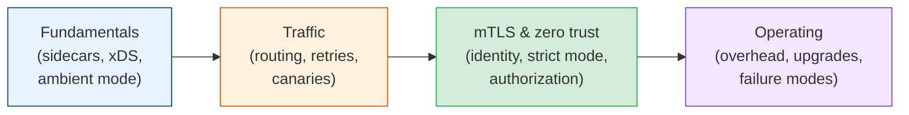

# Service Mesh

Once a system has dozens of services, every one of them needs the same network code: timeouts,
retries, TLS with a real identity, and metrics for every call. Writing that into each service
means one library per language and forty redeploys to change a retry policy. A service mesh
puts a proxy next to every workload (or on every node) and lets a control plane configure all
of them at once. The app makes a plain call, and the proxy handles routing, mTLS, and
telemetry. This module covers how meshes work, how to route and protect traffic with them, and
what it costs to run one, with Istio, Linkerd, Cilium, and the Kubernetes Gateway API as the
working examples.

## Contents

| # | Topic | File | Level |
|---|-------|------|-------|
| 0 | The map (this file) | *(here)* | L3 · Intermediate |
| 1 | Mesh fundamentals: data vs control plane, sidecars, xDS, interception, Istio vs Linkerd vs Cilium, ambient mode | [mesh-fundamentals.md](./mesh-fundamentals.md) | L3 · Intermediate |
| 2 | Traffic management: routing, canaries, retries, timeouts, outlier detection, mirroring, locality | [traffic-management.md](./traffic-management.md) | L4 · Advanced |
| 3 | mTLS & zero trust: SPIFFE identity, cert rotation, strict mTLS migration, AuthorizationPolicy, egress | [mtls-and-zero-trust.md](./mtls-and-zero-trust.md) | L4 · Advanced |
| 4 | Operating a mesh: telemetry, overhead, revision upgrades, failure modes, multi-cluster, debugging | [operating-a-mesh.md](./operating-a-mesh.md) | L4 · Advanced |

---

## How to read this module

- **Chapter 1** explains the architecture: what the proxy does, what the control plane does,
  and how traffic ends up in the proxy at all. It also lists what a mesh can't fix, which is
  worth reading before you decide to adopt one.
- **Chapter 2** is the traffic toolbox, with Istio YAML and Gateway API `HTTPRoute`
  side by side. Read the retries section twice. Retries in the proxy are the most common way a
  mesh makes an outage worse.
- **Chapter 3** covers identity and policy: where workload certificates come from, how to move
  a live cluster from plaintext to strict mTLS without breaking it, and how to write
  deny-by-default authorization.
- **Chapter 4** is day two. What the proxies cost, how to upgrade without restarting the world,
  the failure modes that show up in real incidents, and when you're better off without a mesh.

## Prerequisites

- [containers-and-orchestration/](../containers-and-orchestration/README.md): Pods, Services,
  and admission webhooks. The [production patterns](../containers-and-orchestration/production-patterns.md#the-broader-ecosystem)
  chapter introduces the mesh in one paragraph. This module expands it.
- [distributed-systems/failure-handling.md](../distributed-systems/failure-handling.md):
  timeouts, retries, circuit breakers, and bulkheads, which chapter 2 configures in the proxy.

## Related modules

- [microservices/boundaries-and-communication.md](../microservices/boundaries-and-communication.md):
  where the mesh fits next to API gateways and service discovery.
- [cicd-and-devops/deployment-strategies.md](../cicd-and-devops/deployment-strategies.md):
  canary and blue/green releases, which weighted routing makes precise.
- [auth/authorization-patterns.md](../auth/authorization-patterns.md): zero trust and user-level
  authorization, the part mTLS doesn't cover.
- [observability-and-reliability/](../observability-and-reliability/README.md): the metrics,
  traces, and SLOs that mesh telemetry feeds.
- [chaos-engineering/fault-injection.md](../chaos-engineering/fault-injection.md): using the
  mesh to inject delays and errors on purpose.
- [infrastructure/api-gateway.md](../infrastructure/api-gateway.md): north-south traffic at the
  edge, where the mesh handles east-west traffic between services.

## The one idea

> **Move the network code out of the services, but not the responsibility.** A mesh gives every
> service the same retries, timeouts, mTLS, and metrics without a library. It can't make a
> request idempotent, propagate a deadline, or decide what a user may see. Those stay in the
> app, and a mesh configured as if they didn't will amplify failures instead of absorbing them.

Start with [mesh-fundamentals.md](./mesh-fundamentals.md). **Next >**
