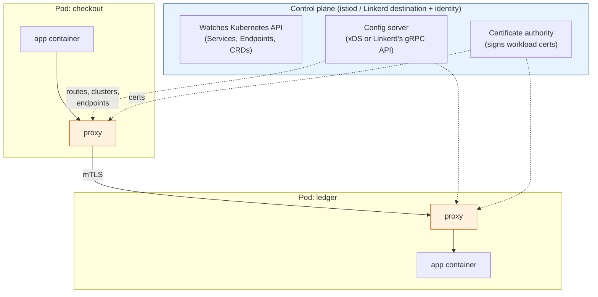
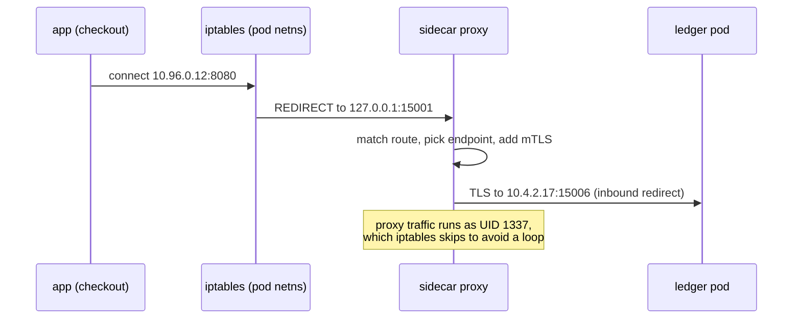
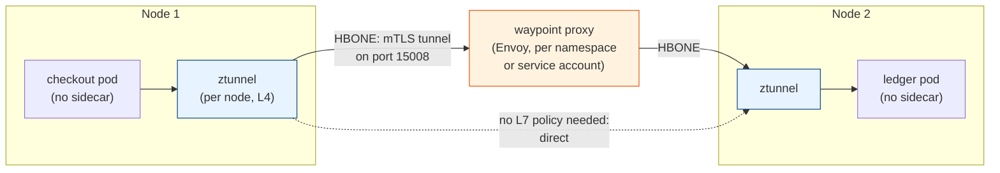

# Mesh Fundamentals: Sidecars, Control Planes & Ambient Mode

[Index](./README.md) | [Next: Traffic Management >](./traffic-management.md)

---

Every service that calls another service needs the same handful of things. A timeout. A retry
policy that doesn't melt the callee. TLS, ideally with a certificate that says which service is
calling. Metrics for request rate, errors, and latency. For years each team got those from a
library: Hystrix and Ribbon in Java, Finagle in Scala, a hand-rolled wrapper in Go. Every
language needed its own copy, every copy drifted, and changing a retry policy meant a
redeploy of forty services.

A service mesh moves that code out of the application and into a proxy that sits on the
network path. The proxy does the retries, the TLS, and the metrics. A central control plane
tells every proxy what to do. The application makes a plain HTTP call to `http://ledger` and
never knows the mesh is there.

That's the whole pitch, and it's a real one. It also means adding a network hop, a second
process per pod (or per node), and a distributed system you now have to operate. This chapter
covers how the pieces fit, how traffic gets into the proxy, and how the three main meshes
differ.

## Why not just use a library?

| Concern | In a library | In a mesh |
|---------|--------------|-----------|
| Retries and timeouts | Per language, per version, per team | One config, applied by every proxy |
| mTLS | Each service loads certs and rotates them | Proxy gets a short-lived cert, rotates it, app sees plaintext on localhost |
| Metrics | Depends on who remembered to instrument | Every request counted the same way, every language |
| Changing policy | Code change, build, deploy every caller | Apply a YAML object, proxies update in seconds |
| Polyglot fleet | One library per language, each with different bugs | Same proxy in front of Go, Java, Python, Node |
| Cost | A function call | An extra hop, extra CPU and memory per pod |

The library approach isn't wrong. gRPC's built-in retries, deadlines, and xDS client support
give you much of a mesh without a proxy (Istio calls this "proxyless gRPC"). If your fleet is
one or two languages owned by one platform team, a shared library may be cheaper. The mesh
wins when the fleet is large, polyglot, and owned by many teams who won't all upgrade a
library on time.

The [microservices module](../microservices/boundaries-and-communication.md#service-mesh-sidecar)
and [container production patterns](../containers-and-orchestration/production-patterns.md#the-broader-ecosystem)
introduce the mesh in one paragraph each. This module is the long version.

## Data plane and control plane

The **data plane** is the set of proxies that touch every request. They have to be fast and
they have to keep working when the control plane is down.

The **control plane** never sees a request. It watches the Kubernetes API, turns Services,
Endpoints, and mesh CRDs into proxy configuration, pushes that configuration out, and runs the
certificate authority that issues workload identities.

That split is the most important operational fact about a mesh. If istiod dies, existing
proxies keep routing with their last known config. What stops working is change: new pods
don't get certs or config, endpoint updates don't propagate, and certificates eventually
expire (Istio's default workload cert lives 24 hours). A control-plane outage is a slow
failure, not an instant one, which is exactly why people miss it.

## The proxies

| Proxy | Used by | Written in | Notes |
|-------|---------|-----------|-------|
| Envoy | Istio (sidecars, gateways, waypoints), Cilium (per node), Consul, AWS App Mesh (retired 2026) | C++ | General-purpose, huge feature set, configured entirely through xDS |
| linkerd2-proxy | Linkerd | Rust | Built only to be a sidecar. Small, few knobs, no general config language |
| ztunnel | Istio ambient mode | Rust | Per-node L4 proxy. mTLS and L4 policy only, no HTTP parsing |

Envoy is the default answer because it does almost everything: HTTP/1.1, HTTP/2, gRPC, TCP,
WebSockets, outlier detection, rate limiting, Wasm and Lua filters. The cost is size and
configuration complexity. A sidecar Envoy in a large cluster can hold tens of megabytes of
config describing services it never talks to (chapter 4 covers how to scope that).

linkerd2-proxy takes the opposite bet. It supports what Linkerd needs and nothing else, so
there's less to tune and less memory per pod. You can't write a custom filter for it.

## xDS: how Envoy gets its config

Envoy doesn't read a config file in a mesh. It opens a long-lived gRPC stream to the control
plane and subscribes to a set of discovery services, together called **xDS**:

| API | Delivers | Example |
|-----|----------|---------|
| LDS (listeners) | Ports to listen on and the filter chain for each | `0.0.0.0:15006` inbound, `0.0.0.0:15001` outbound |
| RDS (routes) | HTTP routing tables | `/api/v2/*` goes to `ledger` subset `v2` |
| CDS (clusters) | Upstream groups and their policies | `outbound\|8080\|\|ledger.payments.svc.cluster.local` with outlier detection |
| EDS (endpoints) | Pod IPs behind each cluster | `10.4.2.17:8080`, `10.4.5.3:8080` |
| SDS (secrets) | Certificates and keys | The workload's SPIFFE cert, rotated without a restart |

Istio sends these over a single aggregated stream (ADS) so updates arrive in a safe order: a
route never points at a cluster the proxy hasn't heard of yet. xDS is an open protocol, so
gRPC clients, Cilium, and other control planes speak it too. Linkerd does not use xDS. Its
`destination` controller serves its own gRPC API to linkerd2-proxy.

## Getting traffic into the proxy

The app calls `ledger:8080`. Something has to make that packet go to the proxy instead. In
sidecar meshes, that something is iptables.

How the rules get installed:

- **Init container** (`istio-init`, `linkerd-init`). Runs before the app, writes iptables rules
  into the pod's network namespace, exits. Simple, but it needs `NET_ADMIN` and `NET_RAW`,
  which many [Pod Security Standards](../containers-and-orchestration/production-patterns.md#security--multi-tenancy)
  setups forbid.
- **CNI plugin** (Istio CNI, `linkerd-cni`). A node agent writes the same rules when the pod's
  network is set up, so application pods need no extra privileges. Most production installs
  use this.
- **eBPF** (Cilium, and optional in some Istio setups). Redirects at the socket or TC layer
  instead of with iptables rules. Fewer rules to walk, but harder to inspect with tools people
  already know.

Injection itself is a mutating admission webhook. Label a namespace (`istio-injection=enabled`
or `istio.io/rev=<revision>` for Istio, `linkerd.io/inject: enabled` annotation for Linkerd)
and the webhook adds the proxy container to every new pod. Existing pods don't change until
they restart.

## Istio vs Linkerd vs Cilium

| | Istio | Linkerd | Cilium Service Mesh |
|---|-------|---------|---------------------|
| Data plane | Envoy sidecars, or ambient (ztunnel + waypoints) | linkerd2-proxy sidecars | eBPF in the kernel + one Envoy per node for L7 |
| mTLS | Built-in CA, SPIFFE identities, on by default in auto mode | Built-in, on by default for every meshed pod | WireGuard or IPsec node-to-node encryption; SPIFFE-based mutual auth is newer and less mature |
| Traffic features | Everything: header routing, mirroring, fault injection, locality LB, Wasm | Splits, retries, timeouts, circuit breaking, mostly via Gateway API HTTPRoute | L7 via Envoy config and Gateway API; fewer mesh-specific features |
| Config surface | Large (VirtualService, DestinationRule, Sidecar, PeerAuthentication, ...) | Small | Cilium CRDs plus Gateway API |
| Operational weight | Highest | Lowest of the sidecar meshes | Low if you already run Cilium as CNI |
| Governance | CNCF graduated | CNCF graduated; since 2024 stable releases come from Buoyant, open source ships edge releases | CNCF graduated |

A rough guide that holds up in practice: pick **Linkerd** if you want mTLS and golden metrics
with the least operating effort and can live with fewer knobs. Pick **Istio** if you need the
full traffic and policy feature set, or ambient mode. Look at **Cilium** if it's already your
CNI and your main need is encryption plus network policy, with light L7.

## Sidecarless: ambient mode

Sidecars have real costs. Every pod pays for a proxy whether it needs HTTP features or not.
Upgrading the proxy means restarting every pod. Startup and shutdown ordering between app and
sidecar is a source of bugs (chapter 4). Istio's ambient mode, GA since Istio 1.24, splits the
proxy into two layers:

- **ztunnel** runs once per node as a DaemonSet. It intercepts traffic for every ambient pod on
  that node, wraps it in mTLS, and enforces L4 authorization (which identity may connect to
  which port). It does not parse HTTP.
- **Waypoint proxies** are ordinary Envoy deployments that you add only where you need L7:
  header routing, retries, HTTP-level authorization. You declare one with a Gateway API
  `Gateway` using `gatewayClassName: istio-waypoint` and point a namespace or service at it.

Enabling ambient for a namespace is a label (`istio.io/dataplane-mode=ambient`), and it
doesn't restart pods. The trade-off is a different failure and security model. A ztunnel holds
keys for every identity on its node, so a compromised node exposes more than a compromised
sidecar would. And traffic that needs L7 now crosses an extra network hop to a waypoint, which
may sit on another node.

Ambient makes most sense when most services need only mTLS and L4 policy, which is common.
Pay for Envoy only on the services that need it.

## What a mesh does not solve

The mesh handles the network between services. Most outages that look like network problems
aren't.

| Problem | Why the mesh can't fix it |
|---------|---------------------------|
| Bad service boundaries | A chatty design with 40 calls per page is still 40 calls, now with 80 proxy hops |
| Non-idempotent retries | The proxy will happily retry a `POST /charge`. Only the app knows it isn't safe ([idempotency](../distributed-systems/time-and-idempotency.md)) |
| Deadline propagation | The proxy can time out one hop. It doesn't know the user gave up two hops ago unless the app forwards the deadline |
| Distributed traces | Proxies emit spans, but the app must copy `traceparent` from incoming to outgoing requests or the trace breaks at every service |
| End-user authorization | mTLS proves which *service* called. Whether *user 42* may see invoice 9 is app logic ([authorization patterns](../auth/authorization-patterns.md)) |
| Data consistency | Sagas, outboxes, and dual writes are still yours ([distributed data](../microservices/distributed-data-patterns.md)) |
| Slow dependencies | A mesh can time out a slow database query. It can't make it fast |

A mesh also adds a failure domain. When requests fail, there's one more component that might
be the cause, and one more set of logs to read.

## The takeaways

1. **A mesh moves cross-cutting network code out of every service.** Retries, timeouts, mTLS,
   and metrics become proxy config instead of library code in each language.
2. **The control plane configures, the data plane carries traffic.** A control-plane outage
   freezes change and slowly expires certs. It doesn't drop traffic right away.
3. **Envoy speaks xDS, linkerd2-proxy speaks Linkerd's own API.** Envoy does everything,
   linkerd2-proxy does less with less memory.
4. **Interception is iptables, installed by an init container or a CNI plugin.** Use the CNI
   plugin in production so app pods don't need `NET_ADMIN`.
5. **Ambient mode splits L4 and L7.** ztunnel per node for mTLS, waypoints only where you need
   HTTP features.
6. **The mesh doesn't fix your design.** Idempotency, deadlines, trace propagation, and user
   authorization stay in the application.

---

[Index](./README.md) | [Next: Traffic Management >](./traffic-management.md)
