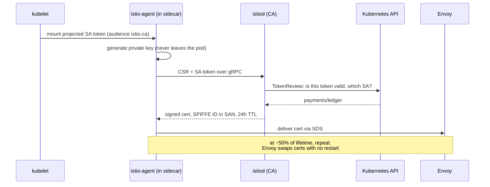
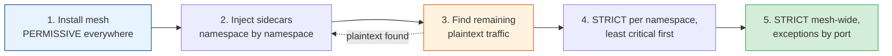

# mTLS & Zero Trust: Workload Identity and Authorization

[< Back](./traffic-management.md) | [Index](./README.md) | [Next: Operating a Mesh >](./operating-a-mesh.md)

---

Inside most clusters, any pod can call any other pod in plaintext. The only thing protecting
the payments database API is that nobody has tried to call it from the wrong place yet. A
single compromised pod, a leaked debug endpoint, or a misrouted request can reach anything.

A mesh changes the default. Every proxy holds a short-lived certificate that names the
workload, every connection between proxies is mutual TLS, and the server-side proxy can check
who's calling before the request reaches the app. That gives you encryption on the wire and,
more usefully, an identity per service that policies can refer to. It's the network half of
[zero trust](../auth/authorization-patterns.md#zero-trust-principles): don't trust a request
because of where it came from, trust it because of who it proves it is.

This chapter covers how identities are issued, how to turn on strict mTLS without breaking a
running cluster, how to write authorization policy, and where mTLS stops helping.

## Workload identity: SPIFFE

Istio follows **SPIFFE** (Secure Production Identity Framework for Everyone), a CNCF standard
for naming workloads. A SPIFFE ID is a URI:

```
spiffe://cluster.local/ns/payments/sa/ledger

trust domain:     cluster.local
namespace:        payments
service account:  ledger
```

The document that proves you own that ID is an **SVID** (SPIFFE Verifiable Identity Document).
There are two kinds:

| SVID | Format | Used for |
|------|--------|----------|
| X.509-SVID | Certificate with the SPIFFE ID in the URI SAN | mTLS between proxies. What meshes use |
| JWT-SVID | Signed JWT with the SPIFFE ID as `sub` | Passing identity through L7 hops where TLS terminates |

Identity comes from the **Kubernetes service account**, not the pod name, IP, or labels. That
has consequences. Every pod that runs as service account `ledger` in `payments` is the same
identity. If five deployments share the `default` service account, policy can't tell them
apart. Give each workload its own service account before you write any policy.

Linkerd uses the same idea with a DNS-style name:
`ledger.payments.serviceaccount.identity.linkerd.cluster.local`.

## How the mesh issues and rotates certificates



Some details matter in practice:

- **Short lifetimes replace revocation.** Istio workload certs last 24 hours by default and
  rotate at roughly the halfway point. Nobody runs a CRL for pod certs. A stolen key is useful
  for hours, not years.
- **The root is your responsibility.** By default istiod generates a self-signed root and keeps
  it in a Secret (`istio-ca-secret`). That's fine for one cluster you might rebuild. For
  production, plug in an intermediate CA from your own PKI (`cacerts` Secret), use cert-manager
  with `istio-csr`, or use SPIRE as the issuer. Multi-cluster meshes need a shared root, so
  decide this before cluster two exists.
- **Linkerd has two levels.** You provide a trust anchor (root) and an issuer certificate.
  Linkerd's identity controller uses the issuer to sign 24-hour proxy certs. The issuer and
  the anchor both expire, and an expired trust anchor is the classic Linkerd outage, so let
  cert-manager rotate the issuer and put the anchor's expiry date in a calendar.

## PeerAuthentication: permissive vs strict

`PeerAuthentication` controls what the *server-side* proxy accepts. The client side is handled
by auto mTLS: Istio's sidecars use mTLS whenever the destination has a sidecar, with no config.

| Mode | Server accepts | When to use |
|------|----------------|-------------|
| `PERMISSIVE` | mTLS and plaintext on the same port | Default. During migration |
| `STRICT` | mTLS only. Plaintext connections are rejected | The goal |
| `DISABLE` | Plaintext only | Rare, for a port a non-mesh system must reach |
| `UNSET` | Inherit from the parent scope | Default for namespace and workload policies |

```yaml
apiVersion: security.istio.io/v1
kind: PeerAuthentication
metadata:
  name: default
  namespace: istio-system          # root namespace: applies mesh-wide
spec:
  mtls:
    mode: STRICT
---
apiVersion: security.istio.io/v1
kind: PeerAuthentication
metadata:
  name: legacy-metrics
  namespace: payments
spec:
  selector:
    matchLabels: {app: ledger}
  mtls:
    mode: STRICT
  portLevelMtls:
    9102:                          # a scraper outside the mesh reads this port
      mode: PERMISSIVE
```

The most specific policy wins: workload over namespace over mesh-wide. Linkerd works the other
way around. Meshed-to-meshed traffic is always mTLS, and you restrict what's accepted with the
`config.linkerd.io/default-inbound-policy` annotation (`all-unauthenticated`,
`all-authenticated`, `cluster-authenticated`, `deny`).

## Migrating a running cluster to strict mTLS

Flipping mesh-wide `STRICT` on day one breaks every client that doesn't have a sidecar yet:
ingress controllers, Prometheus, CronJobs in an un-injected namespace, VMs outside the cluster.
The safe path takes weeks, not minutes:



Step 3 is the one that matters. The server-side proxy labels every request with how it
arrived, so you can query for plaintext directly:

```promql
sum by (source_workload, destination_workload, destination_service_namespace) (
  rate(istio_requests_total{reporter="destination", connection_security_policy!="mutual_tls"}[1h])
)
```

Anything in that result will break under `STRICT`. `source_workload="unknown"` means the caller
has no sidecar. Kiali shows the same thing as a missing lock icon on the graph edge. In
Linkerd, `linkerd viz edges deploy -n payments` lists each connection with a `SECURED` column.

Watch the query for a full business cycle (a week covers most batch jobs) before switching a
namespace. Kubelet health probes don't need an exception, because Istio rewrites HTTP probes to
go through the agent on port 15020. Rolling back is one line: set the namespace back to
`PERMISSIVE`.

## AuthorizationPolicy: who may call what

mTLS tells the server who's calling. `AuthorizationPolicy` decides whether that's allowed.
Istio evaluates policies for a workload in a fixed order:

1. `CUSTOM` policies (delegated to an external authorizer such as OPA). Any deny ends it.
2. `DENY` policies. Any match denies.
3. `ALLOW` policies. If at least one `ALLOW` policy applies to the workload, the request must
   match one of them, otherwise it's denied. If none apply, the request is allowed.

That last rule means a cluster with no policies allows everything. Deny-by-default takes an
explicit allow-nothing policy, then specific allows on top:

```yaml
apiVersion: security.istio.io/v1
kind: AuthorizationPolicy
metadata:
  name: allow-nothing
  namespace: payments
spec: {}                           # empty spec: ALLOW with no rules, so nothing matches
---
apiVersion: security.istio.io/v1
kind: AuthorizationPolicy
metadata:
  name: ledger-from-checkout
  namespace: payments
spec:
  selector:
    matchLabels: {app: ledger}
  action: ALLOW
  rules:
  - from:
    - source:
        principals: ["cluster.local/ns/checkout/sa/checkout-api"]   # L4: identity
    to:
    - operation:
        ports: ["8080"]
        methods: ["POST"]                                           # L7: HTTP
        paths: ["/v1/charges", "/v1/refunds/*"]
  - from:
    - source:
        principals: ["cluster.local/ns/reporting/sa/report-builder"]
    to:
    - operation:
        methods: ["GET"]
        paths: ["/v1/reports/*"]
```

`principals` rely on mTLS. Under `PERMISSIVE`, a plaintext caller has no principal and won't
match, so enforce `STRICT` first or the policy will deny traffic you meant to allow.

| Rule type | Matches on | Enforced by |
|-----------|-----------|-------------|
| L4 | `principals`, `namespaces`, `ipBlocks`, `ports` | Sidecar, or ztunnel in ambient mode |
| L7 | `methods`, `paths`, `hosts`, request headers, JWT claims (`requestPrincipals`) | Sidecar, or a waypoint in ambient mode |

In ambient mode this split is literal. ztunnel can't read HTTP, so a policy with `methods` or
`paths` has to target the waypoint (`targetRefs` pointing at the `Service` or the waypoint
`Gateway`) instead of using a pod `selector`. Linkerd expresses the same rules with `Server`,
`HTTPRoute`, `AuthorizationPolicy`, and `MeshTLSAuthentication` resources from
`policy.linkerd.io`.

Roll out new policies with `action: AUDIT` first, or apply them under a dry-run annotation
(`istio.io/dry-run: "true"`), and check the logs before enforcing. A wrong deny on the payment
path is an outage you wrote yourself.

## Egress control

By default Istio's `outboundTrafficPolicy` is `ALLOW_ANY`: pods can reach any external host.
For a zero-trust posture, switch to `REGISTRY_ONLY` and list each allowed destination:

```yaml
apiVersion: networking.istio.io/v1
kind: ServiceEntry
metadata:
  name: stripe
  namespace: payments
spec:
  hosts: ["api.stripe.com"]
  location: MESH_EXTERNAL
  resolution: DNS
  ports:
  - {number: 443, name: tls, protocol: TLS}
```

Two caveats. First, the sidecar sees the TLS SNI, not the full URL, so you can allow
`api.stripe.com` but not `api.stripe.com/v1/charges` unless you also route through an egress
gateway that originates TLS. Second, a sidecar is not a firewall. A pod with `NET_ADMIN` can
rewrite its own iptables, and an un-injected pod skips the proxy entirely. Back egress rules
with a Kubernetes `NetworkPolicy` (or Cilium policy) that only lets pods leave through the
egress gateway, so bypassing the proxy means having no route out.

## What mTLS protects, and what it doesn't

| Threat | Does mTLS help? |
|--------|-----------------|
| Sniffing traffic between nodes | Yes. Everything between proxies is encrypted |
| A pod spoofing another service's identity | Yes. It would need that service's private key |
| A random pod calling the payments API | Yes, with `STRICT` plus deny-by-default `AuthorizationPolicy` |
| A compromised `checkout` pod calling `ledger` | No. It holds a valid `checkout` cert and is allowed by policy. Policy limits the blast radius to what `checkout` may do |
| Anyone who can create pods with service account `ledger` | No. They get `ledger`'s identity. Kubernetes RBAC on who may use which service account is part of your security |
| A compromised node | Partly. The attacker gets every key on that node: one per pod with sidecars, every ambient workload's identity through ztunnel |
| User-level access ("may user 42 read invoice 9?") | No. That's app logic with [JWTs or sessions](../auth/jwt-and-token-security.md) |
| Injection, SSRF, bugs in the app | No. The request is authenticated and still malicious |
| Traffic to external APIs | No. That TLS is between your app (or egress gateway) and the vendor |

mTLS between proxies also leaves the last hop, proxy to app over `localhost`, in plaintext
inside the pod. That's fine, since anything that can read the pod's loopback traffic already
owns the pod.

## The takeaways

1. **Identity is the service account.** SPIFFE IDs come from it, so give every workload its own
   service account before writing policy.
2. **Short-lived certs replace revocation.** 24-hour certs, rotated automatically. Own the root
   CA yourself in production, and track trust-anchor expiry in Linkerd.
3. **Migrate through PERMISSIVE.** Inject everything, query for plaintext with
   `connection_security_policy`, then go `STRICT` one namespace at a time.
4. **No policy means allow all.** Deny-by-default needs an explicit allow-nothing policy plus
   specific allows, rolled out in audit or dry-run mode first.
5. **Egress control needs NetworkPolicy behind it.** The sidecar can be bypassed. The network
   can't.
6. **mTLS proves which service is calling, nothing more.** Compromised workloads, user
   authorization, and app bugs are still your problem.

---

[< Back](./traffic-management.md) | [Index](./README.md) | [Next: Operating a Mesh >](./operating-a-mesh.md)
