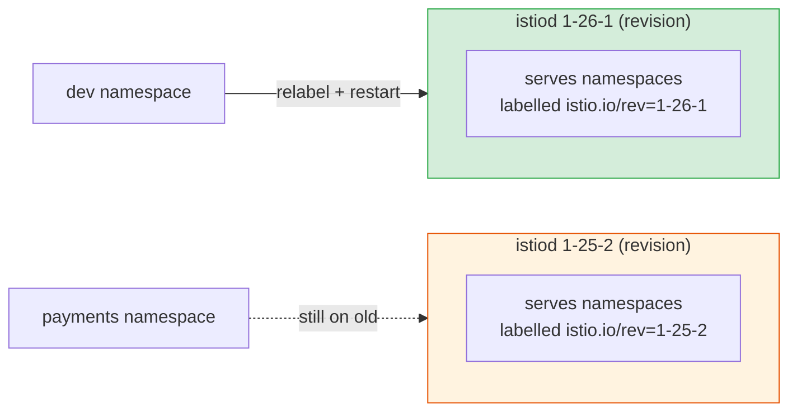

# Operating a Mesh: Telemetry, Overhead, Upgrades & Failure Modes

[< Back](./mtls-and-zero-trust.md) | [Index](./README.md)

---

Installing a mesh takes an afternoon. Running one takes a team. The proxies sit on every
request path, so when they misbehave, everything misbehaves at once, and the error messages
come from Envoy rather than from code your developers wrote.

This chapter is about the day-two work: the telemetry you get, what the proxies cost in CPU,
memory, and latency, how to upgrade the control plane without a cluster-wide restart, the
failure modes that show up in real incidents, and how to debug them. It ends with when not to
adopt a mesh at all.

## Telemetry you get for free

Every proxy reports the same metrics for every request, in every language, with no code
change. That's often the first thing teams notice after installing a mesh, and it's enough to
build [SLOs](../observability-and-reliability/slos-and-error-budgets.md) for every service on
day one.

| Signal | Istio metric | Linkerd metric |
|--------|--------------|----------------|
| Traffic | `istio_requests_total` (rate) | `request_total` |
| Errors | `istio_requests_total{response_code=~"5.."}` | `response_total{classification="failure"}` |
| Latency | `istio_request_duration_milliseconds` histogram | `response_latency_ms` histogram |
| TCP | `istio_tcp_sent_bytes_total`, `istio_tcp_connections_opened_total` | `tcp_open_connections`, `tcp_read_bytes_total` |

```promql
# p99 latency per service, measured at the server-side proxy
histogram_quantile(0.99,
  sum by (le, destination_workload) (
    rate(istio_request_duration_milliseconds_bucket{reporter="destination"}[5m])))
```

`reporter="source"` measures from the caller's proxy and includes the network hop.
`reporter="destination"` measures at the callee. The gap between the two is the network plus
the proxies.

Three limits to know:

- **Cardinality.** Each metric is labelled by source workload, destination workload, response
  code, and more. A cluster with 500 services can produce millions of series. Use Istio's
  `Telemetry` API to drop labels you don't query, or Prometheus will be the first casualty.
- **Traces need the app.** Proxies create spans, but the app must copy `traceparent` (or B3
  headers) from each incoming request to its outgoing ones. Without that you get disconnected
  single-hop spans. See [traces](../observability-and-reliability/three-pillars.md#3-traces--where-is-the-time-going).
- **The mesh sees requests, not business logic.** It knows `/checkout` returned 200. It doesn't
  know the cart was empty because of a bug.

Envoy's access log has one field worth learning: the **response flags**. They tell you whether
an error came from the app or from the proxy.

| Flag | Meaning | Usually |
|------|---------|---------|
| `UF` | Upstream connection failure | Pod gone, wrong port, mTLS mismatch |
| `UH` | No healthy upstream | Every endpoint ejected or none ready |
| `UO` | Upstream overflow | `connectionPool` limit hit (circuit breaker) |
| `UT` | Upstream request timeout | Route `timeout` fired |
| `URX` | Retry limit exceeded | Retries ran out |
| `NR` | No route | Missing or wrong `VirtualService`/`HTTPRoute` |
| `DC` | Downstream closed connection | Caller gave up first |

## What the proxies cost

Numbers vary by release, request size, and protocol. These are the right order of magnitude,
taken from Istio's and Linkerd's published benchmarks and from production reports:

| Component | CPU | Memory | Added latency |
|-----------|-----|--------|---------------|
| Istio sidecar (Envoy) | ~0.2 vCPU per 1,000 req/s | 40-100 MB, grows with config size | ~0.5-1 ms p50 per hop (two proxies), several ms at p99 |
| Linkerd sidecar (linkerd2-proxy) | Lower than Envoy, often ~0.1 vCPU per 1,000 req/s | ~10-20 MB | Under 1 ms p50 per hop |
| Istio ztunnel (ambient, per node) | ~0.06 vCPU per 1,000 req/s | ~10-20 MB, shared by the node | Lower than a sidecar for L4-only traffic |
| Istio waypoint (ambient, L7) | Similar to a sidecar, per waypoint replica | ~60 MB per replica | One extra hop, possibly cross-node |
| istiod | ~1 vCPU, spikes on config change | 1-2 GB in a mid-size cluster | None on the request path |

Per request, that looks cheap. Per cluster, it adds up. Istio's default sidecar resource
request is 100m CPU and 128 Mi memory, so 1,000 pods **reserve** 100 vCPU and 125 GiB that the
scheduler can't give to apps, before a single request. Tune requests per workload with the
`sidecar.istio.io/proxyCPU` and `sidecar.istio.io/proxyMemory` annotations, or move L4-only
services to ambient mode.

Latency also compounds. A call graph 6 services deep crosses 12 proxies. At 0.5 ms each, the
mesh is 6 ms of a 200 ms [latency budget](../performance-engineering/latency-and-budgets.md).
Fine for most APIs. Not fine for a 5 ms trading path.

## Upgrading the control plane

Upgrading istiod in place means every proxy reconnects to a new control plane at once. If the
new version has a bug, the whole mesh has it. Istio's answer is **revision-based canary
upgrades**: run old and new control planes side by side and move namespaces across one at a
time.



```bash
# 1. Install the new control plane next to the old one
istioctl install --set revision=1-26-1 -f mesh-config.yaml

# 2. Move one namespace, then restart its pods to get the new proxy
kubectl label namespace dev istio.io/rev=1-26-1 --overwrite
kubectl rollout restart deployment -n dev

# 3. Watch error rates and proxy-status for that namespace, then continue

# 4. Tags make this one switch instead of relabelling every namespace
istioctl tag set prod-stable --revision 1-26-1 --overwrite

# 5. When nothing points at the old revision, remove it
istioctl uninstall --revision 1-25-2
```

Tags are the part that makes this practical. Label namespaces with `istio.io/rev=prod-stable`
once, and an upgrade moves the tag instead of touching every namespace. Pods only pick up the
new proxy when they restart, so plan the restarts like a deploy and respect
[PodDisruptionBudgets](../containers-and-orchestration/production-patterns.md#scaling-and-updates).
Check the supported version skew in the release notes before skipping a minor version.

Linkerd upgrades the control plane in place (`linkerd upgrade` or Helm), then you restart
workloads to roll the proxies. Run `linkerd check --proxy` afterwards to find pods still on the
old proxy version.

## Failure modes that show up in real incidents

| Failure | Symptom | Fix |
|---------|---------|-----|
| App starts before the sidecar | Connection refused or 503s for the first few seconds after a pod starts; crash loops if the app fetches config at boot | `holdApplicationUntilProxyStarts: true`, or native sidecars (below) |
| Sidecar exits before the app on shutdown | In-flight requests fail during rollouts | Raise `terminationDrainDuration`, set `EXIT_ON_ZERO_ACTIVE_CONNECTIONS`, add a `preStop` sleep to the app |
| Jobs never complete | `Job` pod stays `Running` forever after the work finishes, because the proxy never exits | Native sidecars; or have the job call `curl -X POST localhost:15020/quitquitquit` (Istio) or run under `linkerd-await --shutdown` |
| Config push storms | istiod CPU pegged, `pilot_proxy_convergence_time` climbs to tens of seconds, proxies run stale endpoints | Scope config with `Sidecar` resources and `discoverySelectors` |
| Retries amplify an outage | A dependency slows down, then load on it triples and it falls over | One retry layer, `maxRetries` caps, retry budgets ([chapter 2](./traffic-management.md#retries-useful-and-the-fastest-way-to-turn-a-blip-into-an-outage)) |
| Protocol detection wrong | MySQL, Redis, or other server-speaks-first protocols hang | Name ports `tcp-*`, `http-*`, `grpc-*` or set `appProtocol` |
| Injection webhook down | New pods start without a sidecar, then fail `STRICT` mTLS | Run istiod with 2+ replicas and a PDB, alert on pods missing the proxy |
| Root or trust anchor expires | Every mTLS connection fails at once | Monitor CA expiry, automate rotation |

### Native sidecars fix the ordering problems

Kubernetes 1.29 enabled native sidecar containers by default (GA in 1.33): an init container
with `restartPolicy: Always`. Kubernetes starts it before the app containers, waits for its
startup probe, keeps it running, and stops it **after** the app exits. That solves startup
ordering, shutdown ordering, and Jobs that never finish, all at once. Istio can inject the
proxy this way (`ENABLE_NATIVE_SIDECARS=true` on istiod, where it isn't already the default),
and Linkerd supports it with the `config.alpha.linkerd.io/proxy-enable-native-sidecar`
annotation. On a recent cluster, turn it on.

### Config push storms

By default every Envoy sidecar gets configuration for every service in the mesh. With 3,000
services and 5,000 pods, each sidecar can hold 100+ MB of clusters and endpoints it will never
call. Every deploy changes endpoints, and istiod pushes updates to all 5,000 proxies. During a
large rollout istiod can't keep up, and proxies route to pods that no longer exist.

```yaml
apiVersion: networking.istio.io/v1
kind: Sidecar
metadata:
  name: default
  namespace: checkout
spec:
  egress:
  - hosts:
    - "./*"                                    # own namespace
    - "payments/ledger.payments.svc.cluster.local"
    - "istio-system/*"
```

A `Sidecar` resource like this one cuts each proxy's config to what it actually calls, which
often reduces sidecar memory by 5-10x and push work by the same. `discoverySelectors` in mesh
config goes further and stops istiod watching namespaces that aren't in the mesh at all.

## Multi-cluster meshes

| Model | How it works | Trade-off |
|-------|--------------|-----------|
| Istio multi-primary | An istiod in each cluster, each watching every cluster's API server | Survives losing any control plane. Each istiod needs credentials to every cluster |
| Istio primary-remote | One istiod serves its own cluster and remote ones | Simpler, but the primary is a shared failure point |
| Different networks | Traffic between clusters goes through an east-west gateway | Works without a flat pod network, adds a hop |
| Linkerd multicluster | `linkerd multicluster link` mirrors selected services from the other cluster | Explicit and small. You choose which services cross |
| Cilium ClusterMesh | Shared service discovery and policy across clusters at the CNI level | Needs non-overlapping pod CIDRs |

Every model needs a **shared root of trust**, so certificates from cluster A verify in cluster
B. That's the reason to plug in your own CA from the start. Locality-aware load balancing
([chapter 2](./traffic-management.md#locality-aware-load-balancing)) keeps traffic in-cluster
until local endpoints fail, which is what makes multi-cluster useful for
[disaster recovery](../cloud-and-serverless/cloud-architecture-patterns.md#disaster-recovery-rpo-vs-rto).

## Debugging with the CLIs

```bash
# Istio
istioctl analyze -n payments                          # static checks on your mesh config
istioctl proxy-status                                 # is every proxy in sync with istiod?
istioctl x describe pod ledger-7d9f-abcde -n payments # which policies and routes apply here
istioctl proxy-config routes deploy/checkout -n checkout       # what Envoy will do with a request
istioctl proxy-config endpoints deploy/checkout -n checkout \
  --cluster "outbound|8080||ledger.payments.svc.cluster.local" # healthy or ejected endpoints
istioctl proxy-config secret deploy/ledger -n payments          # cert, SPIFFE ID, expiry
istioctl ztunnel-config workloads                     # ambient: what ztunnel knows
kubectl logs deploy/checkout -c istio-proxy -n checkout         # access log with response flags

# Linkerd
linkerd check && linkerd check --proxy -n payments    # control plane and data plane health
linkerd viz stat deploy -n payments                   # success rate, RPS, latency per deployment
linkerd viz top deploy/checkout -n checkout           # live view of the busiest paths
linkerd viz tap deploy/checkout -n checkout --to deploy/ledger  # live requests, with tls=true/false
linkerd diagnostics proxy-metrics -n payments po/ledger-7d9f-abcde
```

The usual order: `analyze` for config mistakes, `proxy-status` for sync problems, then
`proxy-config` on the caller to see the route and endpoints it actually has, then the access
log's response flag to see who returned the error.

## When not to adopt a mesh

- **You have a handful of services in one or two languages.** A shared client library with
  timeouts, retries, and metrics costs less to run.
- **Nobody will own it.** A mesh needs a platform team that can read Envoy config at 3am. If
  the plan is "install and forget", the first upgrade will be an incident.
- **You only need encryption.** Cilium with WireGuard, or Istio ambient with no waypoints,
  gives you encrypted traffic without per-pod proxies.
- **Your latency budget is in single milliseconds** and the call graph is deep.
- **The basics aren't there yet.** Without [probes, resource limits](../containers-and-orchestration/production-patterns.md#health-probes),
  and dashboards, a mesh adds another moving part to a system you already can't see into.

## The takeaways

1. **Golden metrics come free, traces don't.** Watch metric cardinality, and make apps
   propagate trace headers.
2. **Overhead is small per request and large per cluster.** Default sidecar requests reserve
   100m CPU per pod. Tune them, or use ambient for L4-only services.
3. **Upgrade with revisions and tags.** Run two control planes, move namespaces one at a time,
   and restart pods to roll the proxy.
4. **Most mesh incidents are lifecycle and config scope.** Native sidecars fix ordering and
   Jobs. `Sidecar` resources and `discoverySelectors` fix push storms.
5. **Read the response flag first.** It tells you whether the proxy or the app produced the
   error.
6. **A mesh is a platform commitment.** Adopt one when the fleet is big and polyglot enough to
   need it, and someone owns it.

---

[< Back](./mtls-and-zero-trust.md) | [Index](./README.md)
