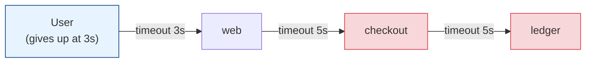
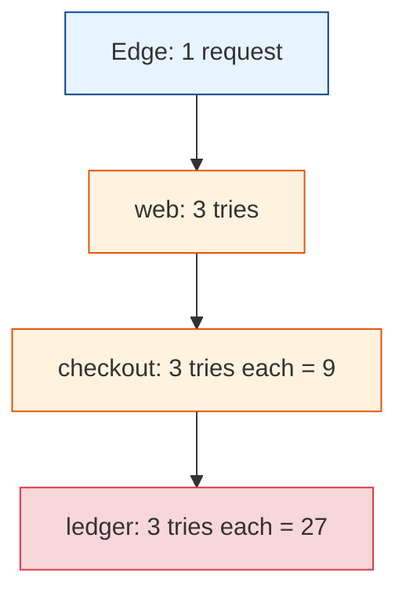

# Traffic Management: Routing, Retries, Timeouts & Canaries

[< Back](./mesh-fundamentals.md) | [Index](./README.md) | [Next: mTLS & Zero Trust >](./mtls-and-zero-trust.md)

---

Once every request goes through a proxy, you can change what happens to it without touching the
application. Send 5% of traffic to the new version. Route anyone with a `x-canary: true` header
to a test build. Give up on a slow dependency after 500 ms. Stop sending requests to the one pod
that keeps returning 503.

These features make teams adopt a mesh, and they also cause the worst mesh-induced outages. A
retry policy is load you add to a system at the moment it's weakest. The patterns themselves
are explained in [failure handling](../distributed-systems/failure-handling.md). This chapter
covers configuring them in the proxy, with Istio YAML, the Gateway API equivalent, and the
numbers that keep them from backfiring.

## The config objects

| Job | Istio | Gateway API (GAMMA, for mesh traffic) | Linkerd |
|-----|-------|---------------------------------------|---------|
| Match requests and pick a backend | `VirtualService` | `HTTPRoute` with a `Service` as `parentRef` | `HTTPRoute` (Gateway API) |
| Define versions of a service | `DestinationRule` subsets (by pod label) | One `Service` per version | One `Service` per version |
| Timeouts | `VirtualService` `timeout` | `HTTPRoute` `timeouts` | `timeout.linkerd.io/*` annotations |
| Retries | `VirtualService` `retries` | `HTTPRoute` `retry` (experimental channel) | `retry.linkerd.io/*` annotations |
| Connection limits, outlier detection | `DestinationRule` | Not in the core spec | Failure accrual annotations on the `Service` |

**VirtualService decides where a request goes. DestinationRule decides how it gets there.**

Istio, Linkerd, and Cilium all implement `HTTPRoute` for east-west traffic (the GAMMA
initiative), so those routes move between meshes. Istio's own APIs still cover more.

## Routing by header and path

```yaml
apiVersion: networking.istio.io/v1
kind: VirtualService
metadata: {name: ledger, namespace: payments}
spec:
  hosts: [ledger]                  # applies to calls to ledger.payments.svc
  http:
  - name: canary-testers           # rules are evaluated top to bottom, first match wins
    match:
    - headers:
        x-canary:
          exact: "true"
    route:
    - destination: {host: ledger, subset: v2}
  - name: reports
    match:
    - uri:
        prefix: /v1/reports
    timeout: 10s                   # report generation is slow on purpose
    route:
    - destination: {host: ledger, subset: v1}
  - name: default
    timeout: 2s
    route:
    - destination: {host: ledger, subset: v1}
---
apiVersion: networking.istio.io/v1
kind: DestinationRule
metadata: {name: ledger, namespace: payments}
spec:
  host: ledger
  subsets:
  - {name: v1, labels: {version: v1}}
  - {name: v2, labels: {version: v2}}
```

The same thing in Gateway API. There are no subsets, so each version gets its own `Service`
(`ledger-v1`, `ledger-v2`) selecting pods by the `version` label:

```yaml
apiVersion: gateway.networking.k8s.io/v1
kind: HTTPRoute
metadata: {name: ledger, namespace: payments}
spec:
  parentRefs:
  - group: ""                      # core group: this route attaches to a Service, not a Gateway
    kind: Service
    name: ledger
    port: 8080
  rules:
  - matches:
    - headers:
      - name: x-canary
        value: "true"
    backendRefs:
    - {name: ledger-v2, port: 8080}
  - matches:
    - path: {type: PathPrefix, value: /v1/reports}
    timeouts: {request: 10s}
    backendRefs:
    - {name: ledger-v1, port: 8080}
  - timeouts: {request: 2s}
    backendRefs:
    - {name: ledger-v1, port: 8080}
```

Header routing only works if the header survives every hop. If `web` calls `checkout` calls
`ledger`, `checkout` must copy `x-canary` onto its outgoing request. The proxy won't.

## Weighted shifting for canaries

```yaml
  - name: default
    route:
    - destination: {host: ledger, subset: v1}
      weight: 95
    - destination: {host: ledger, subset: v2}
      weight: 5
```

```yaml
  - backendRefs:
    - {name: ledger-v1, port: 8080, weight: 95}
    - {name: ledger-v2, port: 8080, weight: 5}
```

Without a mesh, a Kubernetes canary is "run 1 v2 pod next to 19 v1 pods", so the split is tied
to replica counts. With a mesh, 1% of traffic can go to v2 while it runs on 3 pods. That's the
main win for [canary releases](../cicd-and-devops/deployment-strategies.md#canary-releases).

Nobody should edit weights by hand at 2am. Argo Rollouts and Flagger step the weights (1%, 5%,
25%, 50%, 100%), query Prometheus between steps for error rate and p99 latency, and roll back
automatically if either crosses a threshold. Two things trip people up:

- **Weights are per request, not per user.** A user can hit v2, then v1, then v2. If v2 changes
  a response format, route by header or cookie instead so a session sticks to one version.
- **Low traffic makes canaries meaningless.** 5% of 20 requests per minute is one request.

## Timeouts and deadline propagation

Istio applies **no HTTP timeout by default**. A request to a hung backend waits as long as the
caller's client does. Set one on every route.

A timeout at one hop doesn't know about the hops above it:



At 3 seconds the user is gone, but `checkout` and `ledger` keep working for up to 2 more
seconds on an answer nobody will read. Under load, that wasted work keeps an overloaded
service from recovering. Two rules help:

1. **Timeouts shrink as you go down the call graph.** If the edge allows 3s, inner hops should
   allow less, not more.
2. **Propagate the remaining deadline.** gRPC does it through the `grpc-timeout` header if the
   app passes the incoming context to outgoing calls. For HTTP, Envoy adds
   `x-envoy-expected-rq-timeout-ms` upstream, and the app can forward a smaller budget.

## Retries: useful, and the fastest way to turn a blip into an outage

```yaml
  - name: default
    timeout: 2s                    # total budget, including all retries
    retries:
      attempts: 2                  # up to 2 retries after the first try
      perTryTimeout: 500ms
      retryOn: connect-failure,refused-stream,unavailable,503
    route:
    - destination: {host: ledger, subset: v1}
```

Istio retries **by default**: 2 attempts on connection failures, refused streams, and a few
gRPC and HTTP codes, even with no `retries` block. Know that before adding app retries too.

Retries multiply across layers. If each of three layers tries 3 times, one failing request at
the bottom becomes up to 27 requests:



If `ledger` is slow because it's overloaded, it now gets 27x the load. That **retry storm** is
how a 30-second database hiccup becomes a 30-minute outage. The defences:

| Defence | How |
|---------|-----|
| Retry at one layer only | Usually the hop closest to the failing dependency. Turn off app retries if the mesh retries, or the reverse |
| Retry budgets | Cap retries as a fraction of normal traffic. Linkerd's ServiceProfile retries are budgeted by default: at most 20% extra load plus 10 retries per second. Envoy supports `retry_budget` on a cluster |
| Cap concurrent retries | Istio's `DestinationRule` `connectionPool.http.maxRetries` defaults to effectively unlimited. Set it, for example to 10-20% of normal concurrency |
| Retry only safe errors | `connect-failure` and `refused-stream` mean the request never reached the app, so they're safe for any method. `5xx` and `reset` may mean the app already acted |
| Retry only idempotent requests | `GET` and `PUT` with a full body, or a `POST` carrying an [idempotency key](../distributed-systems/time-and-idempotency.md). Never blanket-retry `POST /charge` |
| Back off | Envoy uses jittered exponential backoff starting at 25 ms. Keep it |

The proxy can't tell an idempotent `POST` from a dangerous one. Put write paths on their own
route with `retryOn: connect-failure,refused-stream` and nothing else.

## Circuit breaking and outlier detection

"Circuit breaker" means two different things in Istio, and neither is the classic
open/half-open breaker from the [failure-handling chapter](../distributed-systems/failure-handling.md#3-circuit-breakers-stop-kicking-a-dead-dependency).

```yaml
# DestinationRule "ledger" from above, spec.trafficPolicy
  trafficPolicy:
    connectionPool:                # limits: excess requests fail fast with 503
      tcp: {maxConnections: 200}
      http:
        http1MaxPendingRequests: 50
        http2MaxRequests: 500
        maxRetries: 20
    outlierDetection:              # ejection: stop sending to bad pods
      {consecutive5xxErrors: 5, interval: 10s, baseEjectionTime: 30s, maxEjectionPercent: 50}
```

**Connection pool limits** are a [bulkhead](../distributed-systems/failure-handling.md#4-bulkheads-isolate-the-blast-radius).
When `checkout` already has 500 requests in flight to `ledger`, request 501 fails at once with
a 503 (Envoy's response flag `UO`, upstream overflow) instead of queueing. Fast failure keeps
`checkout`'s own threads and memory free.

**Outlier detection** ejects individual endpoints. A pod that returns 5 consecutive 5xx errors
gets removed from the pool for 30 seconds, then longer on each repeat. `maxEjectionPercent: 50`
matters: if the whole service is failing, ejecting every pod leaves nothing to send to.
Outlier detection finds one bad pod. It doesn't protect a service that's down everywhere.

Linkerd's equivalent is failure accrual (`balancer.linkerd.io/failure-accrual: consecutive` on
the `Service`): it stops sending to an endpoint after a run of failures, then probes it.

## Fault injection

The same `VirtualService` can delay or fail a percentage of requests, scoped by header to test
traffic. It's the easiest way to check the timeouts and retries above. Examples are in
[chaos engineering: fault injection](../chaos-engineering/fault-injection.md#service-mesh-istio-and-envoy-fault-injection).
Gateway API has no fault injection, so this stays Istio-specific.

## Traffic mirroring

```yaml
  - name: default
    route:
    - destination: {host: ledger, subset: v1}
    mirror: {host: ledger, subset: v2}
    mirrorPercentage: {value: 10.0}
```

Envoy sends a copy of 10% of requests to v2 and throws away v2's responses, appending
`-shadow` to the `Host` header so v2 can tell them apart. Gateway API has the same feature as a
`RequestMirror` filter.

Mirroring reads is safe: compare v2's latency and errors on real traffic before any user sees
it. Mirroring writes is not. A mirrored `POST /charge` is a second real charge unless v2 points
at a separate database or stubs out side effects.

## Locality-aware load balancing

Across three zones, round-robin sends two-thirds of calls over a zone boundary. On AWS that
costs $0.01 per GB in each direction and adds roughly 0.5-1 ms per hop. Istio's locality load
balancing prefers the caller's zone, then region, then anywhere. It only fails over if it can
tell local endpoints are unhealthy, so it needs `outlierDetection` on the same
`DestinationRule`. Without it, locality failover does nothing.

```yaml
  trafficPolicy:
    loadBalancer:
      simple: LEAST_REQUEST
      localityLbSetting:
        enabled: true
        failover: [{from: us-east-1, to: us-west-2}]
    outlierDetection: {consecutive5xxErrors: 5, interval: 10s, baseEjectionTime: 30s}
```

The risk is imbalance. If zone A has 10 callers and 2 backend pods, strict locality overloads
those 2 pods. Use `distribute` to send a share cross-zone, or scale backends per zone.

## The takeaways

1. **VirtualService picks the destination, DestinationRule shapes the connection.** Gateway API
   `HTTPRoute` covers routing, splits, timeouts, and mirroring portably, but not outlier
   detection or connection limits.
2. **Weighted routing decouples canary percentage from replica count.** Automate the steps with
   Argo Rollouts or Flagger and gate on error rate and latency.
3. **Set a timeout on every route, shrinking down the call graph.** Istio's default is none.
   Deadline propagation needs the app.
4. **Retries multiply.** Retry at one layer, cap them with a budget or `maxRetries`, and retry
   only errors and methods where a second attempt is safe.
5. **Connection limits are bulkheads, outlier detection is per-pod ejection.** Neither saves a
   service that's failing everywhere.
6. **Mirror reads freely, mirror writes never** unless the shadow copy has no real side
   effects.

---

[< Back](./mesh-fundamentals.md) | [Index](./README.md) | [Next: mTLS & Zero Trust >](./mtls-and-zero-trust.md)
