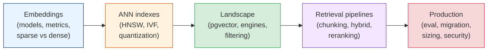

# Vector Databases & Semantic Retrieval

Keyword search matches words. Semantic search matches meaning: an embedding model turns text
into a vector, similar meanings land close together, and a query becomes "find the nearest
vectors". That one idea powers RAG, recommendations, deduplication, and "search that
understands what I meant". Making it work in production takes more than the idea: indexes
that trade a little accuracy for a lot of speed, databases that combine vectors with filters,
pipelines that mix keyword and vector results, and an operating plan for when the model,
the data, or the permissions change. This module covers all of it, from what a vector is to
what it costs to run 50 million of them.

## Contents

| # | Topic | File | Level |
|---|-------|------|-------|
| 0 | The map (this file) | *(here)* | L3 · Intermediate |
| 1 | Embeddings fundamentals: models, dimensions, similarity metrics, sparse vs dense, cost | [embeddings-fundamentals.md](./embeddings-fundamentals.md) | L3 · Intermediate |
| 2 | ANN indexes: exact kNN, HNSW, IVF, product/scalar/binary quantization, DiskANN | [ann-indexes.md](./ann-indexes.md) | L4 · Advanced |
| 3 | The vector database landscape: pgvector, Qdrant, Milvus, Weaviate, Pinecone, Elasticsearch, filtering | [vector-database-landscape.md](./vector-database-landscape.md) | L4 · Advanced |
| 4 | Retrieval pipelines: chunking, hybrid search, RRF, reranking, query rewriting, context assembly | [retrieval-pipelines.md](./retrieval-pipelines.md) | L4 · Advanced |
| 5 | Vector search in production: evaluation, model migration, sizing, multi-tenancy, security | [vector-search-in-production.md](./vector-search-in-production.md) | L4 · Advanced |

---

## How to read this module

- **Chapter 1** explains what an embedding is and why cosine, dot product, and L2 give the
  same ranking on normalized vectors. It's also honest about where semantic search loses to
  plain keywords: IDs, codes, versions, and negation.
- **Chapter 2** opens up the index. How HNSW walks a layered graph, how IVF clusters, how
  quantization shrinks vectors 4x to 32x, and what each costs in recall, latency, and RAM.
- **Chapter 3** compares the systems you'd actually deploy, with the question most teams
  should ask first: is Postgres enough? It also covers the part benchmarks skip, which is
  what happens when you add a filter.
- **Chapter 4** builds a RAG retrieval pipeline stage by stage, from chunking to the final
  prompt, with a reason for each stage.
- **Chapter 5** is the operating manual. Measuring retrieval quality, re-embedding without
  downtime, sizing hardware, and keeping retrieval from leaking data across tenants and
  permissions.

## Related modules

- [ai-ml/generative-ai-in-practice.md](../ai-ml/generative-ai-in-practice.md): where RAG
  fits among prompting, tools, and fine-tuning.
- [ai-ml/transformers-and-llms.md](../ai-ml/transformers-and-llms.md): tokenization and the
  transformer encoders that produce embeddings.
- [search-systems/](../search-systems/README.md): inverted indexes and BM25, the keyword
  half of hybrid search.
- [databases/indexing.md](../databases/indexing.md): B-trees and query plans, and why they
  don't work for nearest-neighbour search.
- [multi-tenant-architecture/data-isolation.md](../multi-tenant-architecture/data-isolation.md):
  tenant filters and row-level security, which retrieval has to respect.
- [zero-downtime-migrations/backfills-and-dual-writes.md](../zero-downtime-migrations/backfills-and-dual-writes.md):
  the pattern behind re-embedding a corpus under a new model.

## The one idea

> **Nearest isn't the same as relevant.** An index can find the closest vectors perfectly
> and still return the wrong chunks, because closeness only reflects what the model learned
> and how you chunked the text. Measure relevance with real queries, combine vectors with
> keywords, rerank, and filter by permission before anything reaches the model.

Start with [embeddings-fundamentals.md](./embeddings-fundamentals.md). **Next >**
