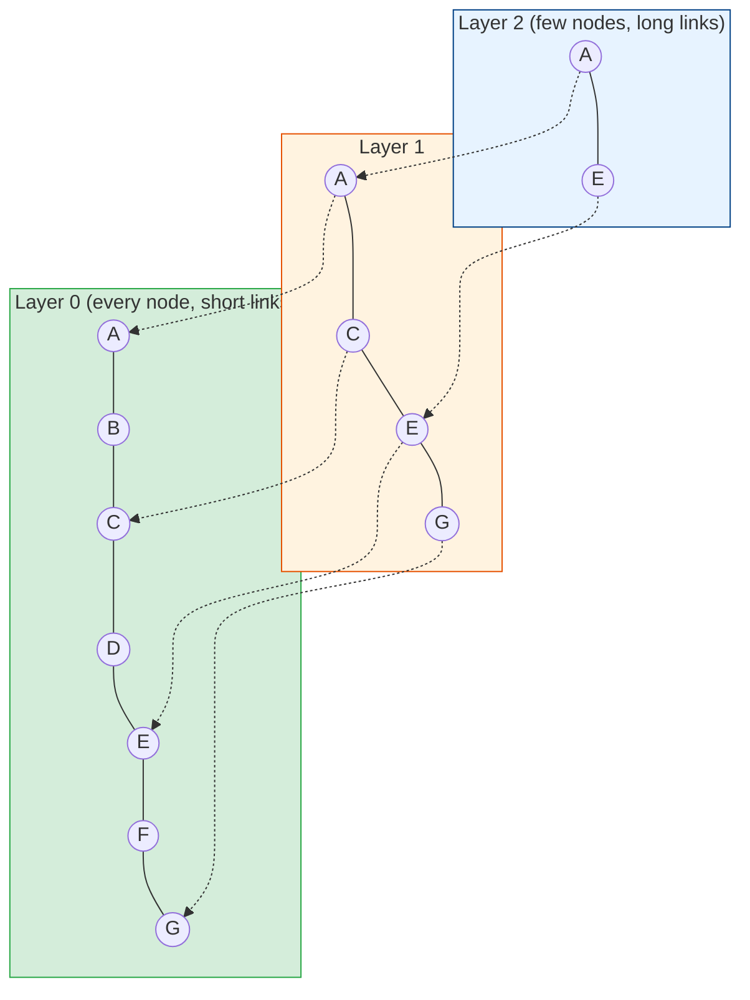
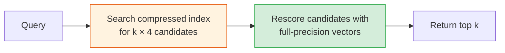

# ANN Indexes: HNSW, IVF, Quantization & DiskANN

[< Back](./embeddings-fundamentals.md) | [Index](./README.md) | [Next: The Vector Database Landscape >](./vector-database-landscape.md)

---

Finding the nearest vector exactly means comparing the query with every stored vector. At a
few thousand vectors that's instant. At 100 million it's tens of gigabytes of memory read
per query, and no amount of B-tree cleverness helps, because
[B-trees](../databases/indexing.md) sort along one dimension and these vectors have hundreds.

Approximate nearest neighbour (ANN) indexes give up a little accuracy to skip most of that
work. They return *most* of the true nearest neighbours, usually 90 to 99 percent of them,
in a millisecond or two. Every ANN index is a different answer to the same three-way
trade-off: recall, latency, and memory. You can pick two to optimise, and you pay for it in
the third.

## Exact kNN: the baseline

Brute-force search (also called flat search) computes the distance to every vector and keeps
the top k with a heap.

```python
import numpy as np

def knn_exact(query, vectors, k=10):
    scores = vectors @ query                 # dot product, vectors normalized
    top = np.argpartition(-scores, k)[:k]    # O(N), no full sort
    return top[np.argsort(-scores[top])]
```

The cost is `N × d` multiply-adds. For 1M vectors of 768 float32 dimensions, that's 3 GB of
memory to stream through per query. One core reading at around 10 to 20 GB/s takes 150 to
300 ms. Spread across 16 cores or a GPU it drops to 10 ms or less, which is why FAISS on a
GPU can brute-force surprisingly large sets.

Exact search is the right choice more often than people think:

- Under roughly 50k to 100k vectors, it's fast enough and needs no index at all.
- When a filter cuts the candidates to a few thousand (one user's documents, one tenant),
  scanning those exactly beats searching a global index.
- As the ground truth for measuring an ANN index's recall.

**Recall@k** for an ANN index means: of the true k nearest neighbours (from exact search),
what fraction did the index return? An index with recall@10 of 0.95 returns 9.5 of the real
top 10 on average. This is index recall, which is different from retrieval quality (did we
find the *relevant* documents), covered in [chapter 5](./vector-search-in-production.md#evaluating-retrieval).

## HNSW: a graph you walk downhill

Hierarchical Navigable Small World (Malkov and Yashunin, 2016) is the default index in
pgvector, Qdrant, Weaviate, Elasticsearch, OpenSearch, Redis, and Milvus's most common setup.

Each vector is a node in a graph, linked to a few of its near neighbours. Search starts at an
entry point and greedily moves to whichever neighbour is closer to the query, until no
neighbour is closer. A single flat graph like this gets stuck in local minima and takes many
hops to cross. HNSW fixes both with **layers**:



Every node lives in layer 0. A node's top layer is picked at random with exponentially
decreasing probability, so each layer up has a fraction of the nodes below it, like a skip
list. Search enters at the top, takes long hops across the sparse layer, drops down, and
refines. At layer 0 it keeps a candidate list of size `ef` (a beam search rather than a
single greedy path) and returns the best k from it.

| Parameter | What it controls | Typical values | Effect of raising it |
|-----------|------------------|----------------|----------------------|
| `M` | Max links per node (layer 0 usually allows `2M`) | 16 (pgvector, Qdrant default), 8 to 64 | Better recall, more memory, slower build |
| `efConstruction` | Candidate list size while inserting | 64 (pgvector), 100 (Qdrant), up to 500 | Better graph, slower build. No effect on memory |
| `efSearch` | Candidate list size per query (must be ≥ k) | 40 (pgvector default), 64 to 512 | Better recall, slower queries. Tunable per query |

`efSearch` is the knob you turn in production, because it costs nothing to change:

```sql
-- pgvector
CREATE INDEX ON chunks USING hnsw (embedding vector_cosine_ops)
  WITH (m = 16, ef_construction = 128);

SET hnsw.ef_search = 100;    -- per session or per transaction
```

Memory is the vectors plus the links. At layer 0 with `M = 16`, each node stores up to 32
neighbour IDs of 4 bytes each, about 128 bytes, plus a small amount for upper layers. For
768-dim float32 vectors (3 KB) that's a 5 to 10 percent overhead. The vectors dominate, which
is why quantization matters more than graph tuning for memory.

**Inserts** are incremental: a new node searches for its neighbours and links in. No
retraining. But each insert is itself a search of cost `efConstruction`, so building 10M
vectors takes from tens of minutes to a few hours depending on cores and parameters. For a
bulk load, insert the rows first and create the index afterwards. pgvector builds much
faster when `maintenance_work_mem` is large enough to hold the whole graph, and it uses
parallel workers (`max_parallel_maintenance_workers`) since 0.6.

**Deletes** are the weak spot. Removing a node can disconnect parts of the graph, so most
implementations mark the node deleted and keep it as a waypoint. Searches skip it in
results but still walk through it. After many deletes, recall drops and latency climbs.
pgvector repairs the graph during `VACUUM`, which is slow on large indexes. Qdrant and Milvus
rebuild segments in the background. Lucene-based engines (Elasticsearch, OpenSearch) drop
deleted docs on segment merge, which rebuilds the merged segment's graph.

## IVF: cluster first, search a few clusters

The inverted file index splits the space into `nlist` clusters with k-means. Each vector is
stored in the list for its nearest centroid. At query time you find the `nprobe` centroids
nearest the query and search only those lists exactly.

| Parameter | Rule of thumb | Effect |
|-----------|---------------|--------|
| `nlist` (pgvector: `lists`) | pgvector suggests `rows / 1000` up to 1M rows, `√rows` above. FAISS uses 4×√N to 16×√N | More lists means smaller lists to scan, but more centroids to compare and more risk of missing a neighbour across a boundary |
| `nprobe` (pgvector: `ivfflat.probes`) | Start at `√nlist`. pgvector's default is 1, which is almost always too low | More probes, better recall, linear increase in latency |

```sql
CREATE INDEX ON chunks USING ivfflat (embedding vector_cosine_ops) WITH (lists = 1000);
SET ivfflat.probes = 32;
```

IVF builds much faster than HNSW and uses less memory (just centroids plus list
membership). It recalls less at the same latency, and it has a training problem. The
centroids are computed from whatever data exists when you build. Build it on an empty table
and every vector lands in a handful of meaningless clusters. Add 10x more data later, or
data from a new domain, and the clusters no longer fit the distribution: some lists bloat,
recall drops, and nothing tells you. **Inserts** go to the nearest existing centroid, and
the centroids never move. The fix is a periodic rebuild. **Deletes** are easy, just remove
the entry from its list.

## Quantization: making vectors smaller

Quantization stores each vector in fewer bits. It's how you fit 10x more vectors in the same
RAM, and it's usually combined with HNSW or IVF rather than used alone.

| Method | How it works | Compression | Typical recall impact |
|--------|--------------|-------------|-----------------------|
| float16 / halfvec | Half-precision floats | 2x | Negligible |
| Scalar (int8) | Map each dimension's range to 256 levels | 4x | Around 1 percent, often less |
| Product quantization (PQ) | Split into `m` sub-vectors, replace each with the ID of its nearest of 256 learned centroids | 16x to 64x | Large without rescoring (recall can fall to 0.6 to 0.8) |
| Binary | Keep only the sign of each dimension, compare with Hamming distance | 32x | Large on its own, small with oversampling and rescoring, model-dependent |

**Product quantization** is worth understanding in detail. Take a 768-dim vector and split it
into 96 chunks of 8 dimensions. For each chunk position, run k-means over the training data
to get 256 centroids. Now store each vector as 96 one-byte centroid IDs: 96 bytes instead of
3,072. At query time, precompute the distance from each query chunk to all 256 centroids for
that position (a 96 × 256 lookup table), and the distance to any stored vector is 96 table
lookups summed. FAISS's `IVF4096,PQ96` string means exactly this, inside an IVF index.

**Binary quantization** is the most aggressive. A 1024-dim vector becomes 128 bytes, and
Hamming distance is a XOR plus a popcount, which CPUs do in one instruction per 64 bits. It
works well with models trained to tolerate it (Cohere v3, OpenAI `text-embedding-3`,
mixedbread) and badly with others. Test before relying on it.

The pattern that makes aggressive quantization usable is **oversample and rescore**:



Keep the compressed vectors in RAM for the search, and the full vectors on disk or in a
cheaper tier for the rescore. Qdrant does this with `rescore: true` and `oversampling: 3.0`.
pgvector does it with a `binary_quantize()` expression index and a re-ranking subquery.
Elasticsearch's `int8_hnsw` (the default for `dense_vector` since 8.14) and BBQ
(better binary quantization, 8.16+) do it internally.

## DiskANN: when the graph doesn't fit in RAM

HNSW assumes everything is in memory. At a billion 768-dim vectors that's 3 TB of RAM.
DiskANN (Subramanya et al., NeurIPS 2019) puts the graph and the full vectors on NVMe SSD
and keeps only PQ-compressed vectors in RAM.

Its graph, called Vamana, is built to need fewer hops than HNSW: one flat layer with some
deliberately long edges. Each hop costs one SSD read (about 100 µs on NVMe), so hop count is
what matters. Search walks the graph using the in-memory PQ distances to choose where to go,
reads full vectors from SSD for the nodes it visits, and rescores with them. The paper
indexed a billion points on one machine with 64 GB of RAM and reached 95 percent recall@1 at
under 5 ms.

You'll find it as the `DISKANN` index type in Milvus, as StreamingDiskANN in Timescale's
pgvectorscale extension for Postgres, and inside Azure Cosmos DB and SQL Server's vector
search.

## The trade-off in numbers

Ballpark figures for 1M vectors of 768 float32 dimensions on one modern server, single
query thread. Your numbers will differ with data, hardware, and k, so treat these as orders
of magnitude and benchmark your own (ann-benchmarks.com has curves for public datasets).

| Index | Recall@10 | Latency p50 | Memory | Build time |
|-------|-----------|-------------|--------|------------|
| Flat (exact) | 1.00 | 100 to 300 ms | 3.1 GB | None |
| HNSW, M=16, ef=40 | ~0.95 | ~1 ms | ~3.3 GB | 5 to 15 min |
| HNSW, M=16, ef=200 | ~0.99 | 2 to 4 ms | ~3.3 GB | Same |
| HNSW + int8, rescored | ~0.98 | ~1 ms | ~0.9 GB in RAM | Same |
| IVF, lists=1000, probes=32 | ~0.95 | 5 to 10 ms | ~3.1 GB | 1 to 2 min |
| IVF-PQ (96 bytes), no rescore | 0.6 to 0.8 | under 1 ms | ~100 MB | A few min |
| DiskANN | ~0.95 | 2 to 5 ms | PQ codes in RAM, rest on SSD | Slow (hours at 100M+) |

The shape of the curve is the part to remember. Going from 0.90 to 0.95 recall is cheap.
From 0.95 to 0.99 often doubles latency. From 0.99 to 0.999 can cost 5x more. Most RAG
systems lose far more quality to bad chunking than to the last 2 percent of ANN recall.

## How writes affect each index

| Index | Inserts | Deletes | Needs periodic rebuild? |
|-------|---------|---------|-------------------------|
| Flat | Append, free | Remove, free | No |
| HNSW | Incremental, each costs a search | Tombstones degrade the graph until repair or merge | After heavy delete or update churn |
| IVF | Assigned to existing centroids, which never move | Cheap | Yes, when the data distribution shifts |
| PQ | Encoded with existing codebooks | Cheap | Yes, if codebooks were trained on unrepresentative data |
| DiskANN | Supported in streaming variants (FreshDiskANN), with background merges | Tombstones plus consolidation | Background consolidation handles it |

An update is a delete plus an insert in every one of these. A workload that re-embeds a
large share of its documents every day is a heavy delete workload, whatever it looks like
from the application side.

## The takeaways

1. **Exact search is fine until it isn't.** Under 100k vectors, or after a selective
   filter, scan everything and skip the index.
2. **HNSW is the default for a reason.** High recall at low latency, incremental inserts.
   Tune `efSearch` per query. Watch out for deletes.
3. **IVF is cheaper to build and smaller, but it goes stale.** Build it on representative
   data and rebuild when the data shifts.
4. **Quantize, then rescore.** int8 is nearly free. PQ and binary need oversampling and a
   full-precision rescore to be usable.
5. **DiskANN is for when RAM is the bill.** Billion-scale on one machine, at the cost of
   SSD reads and slower builds.
6. **The last few points of recall are the expensive ones.** Measure where your quality is
   actually lost before paying for them.

---

[< Back](./embeddings-fundamentals.md) | [Index](./README.md) | [Next: The Vector Database Landscape >](./vector-database-landscape.md)
