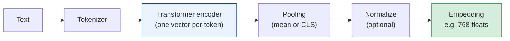

# Embeddings Fundamentals: Turning Meaning into Numbers

[Index](./README.md) | [Next: ANN Indexes >](./ann-indexes.md)

---

A keyword index knows that "car" and "car" match. It has no idea that "car" and "automobile"
mean the same thing, or that "my laptop won't turn on" is the same question as "notebook
doesn't power up". An embedding fixes that by turning text (or an image, or audio) into a
list of numbers, placed so that things with similar meaning end up close together.

Once meaning is a position in space, search becomes geometry. Embed the query, find the
stored vectors nearest to it, return those items. Everything else in this module, the
indexes, the databases, the pipelines, exists to do that one step fast and correctly at
scale. This chapter is about the vectors themselves: where they come from, how to compare
them, and what they're bad at.

## What an embedding is

An embedding is a fixed-length array of floats produced by a model. The length is the
**dimension**, and it's set by the model, not by the input. A three-word query and a
500-word paragraph both come out as, say, 768 numbers.

```python
from sentence_transformers import SentenceTransformer

model = SentenceTransformer("BAAI/bge-small-en-v1.5")   # 384 dimensions
vecs = model.encode(
    ["How do I reset my password?",
     "Steps to recover account access",
     "Quarterly revenue grew 12%"],
    normalize_embeddings=True,
)
print(vecs.shape)            # (3, 384)
print(vecs[0] @ vecs[1])     # ~0.75  related
print(vecs[0] @ vecs[2])     # ~0.30  unrelated
```

No single dimension means anything you can name. Dimension 17 is not "about passwords".
Meaning is spread across all of them, and only distances between vectors carry information.
That also means a raw vector tells you almost nothing about its source on its own, though as
[chapter 5](./vector-search-in-production.md#security-retrieval-is-a-permission-boundary)
shows, it leaks more than people expect.

## How embedding models produce them

Most text embedding models are transformer encoders (the same family as BERT, see
[transformers and LLMs](../ai-ml/transformers-and-llms.md)). The text is tokenized, every
token gets a contextual vector, and the model pools those into one vector, usually by
averaging them (mean pooling) or by taking a special `[CLS]` token's output.

What makes the vectors useful is the training objective. The model is trained with
**contrastive learning** on pairs that should match: a question and its answer, a title and
its body, a search query and the page someone clicked. For each pair, the loss pulls the two
vectors together and pushes away the other items in the same batch (in-batch negatives).
After a few hundred million pairs, the model has learned to place paraphrases near each
other.



Two consequences matter in practice:

- **Vectors from different models are not comparable.** Not even two versions of the same
  model. A vector only has meaning relative to other vectors from the exact same model. Mix
  them in one index and the results are garbage, with no error to tell you so.
- **Queries and documents are often embedded differently.** E5 models expect `query: ` and
  `passage: ` prefixes. BGE recommends an instruction prefix on queries. Cohere's API takes
  `input_type="search_query"` or `"search_document"`. Skip the prefix and recall drops by a
  few points, silently.

Models also have a maximum input length. `all-MiniLM-L6-v2` truncates at 256 word pieces.
OpenAI's `text-embedding-3` models accept 8,191 tokens. Anything past the limit is cut off,
which is one reason documents get split into chunks before embedding (see
[retrieval pipelines](./retrieval-pipelines.md#chunking)).

## Dimensions

| Model | Dimensions | Max input | Notes |
|-------|-----------|-----------|-------|
| `all-MiniLM-L6-v2` | 384 | 256 tokens | Tiny, fast on CPU, fine for prototypes |
| `bge-small-en-v1.5` / `bge-base-en-v1.5` | 384 / 768 | 512 tokens | Strong open-source English models |
| `multilingual-e5-large` | 1024 | 512 tokens | 100 languages |
| Cohere `embed-english-v3.0` | 1024 | 512 tokens | Hosted, has int8 and binary output types |
| OpenAI `text-embedding-3-small` | 1536 | 8,191 tokens | Hosted, can be shortened |
| OpenAI `text-embedding-3-large` | 3072 | 8,191 tokens | Hosted, can be shortened |

More dimensions can hold finer distinctions, but the gain flattens out fast and every
dimension costs memory and compute on every comparison. Some newer models are trained with
**Matryoshka representation learning**, which packs the most important information into the
first dimensions. You can cut a `text-embedding-3-large` vector to 256 or 1024 dimensions
(the API's `dimensions` parameter does this, or you truncate and re-normalize yourself) and
keep most of the retrieval quality. OpenAI reported that a 256-dimension `-3-large` vector
still beat the older 1536-dimension `ada-002` on the MTEB benchmark.

## Similarity metrics

Three metrics cover almost everything:

| Metric | Formula | Range | Meaning |
|--------|---------|-------|---------|
| Dot product (inner product) | `a · b = Σ aᵢbᵢ` | unbounded | Higher is more similar. Sensitive to vector length |
| Cosine similarity | `a · b / (‖a‖ ‖b‖)` | -1 to 1 | Angle only, length ignored |
| Euclidean (L2) distance | `‖a − b‖ = √Σ(aᵢ − bᵢ)²` | 0 to ∞ | Lower is more similar |

### When they're the same thing

If every vector has length 1 (it's **normalized**), the three metrics rank results
identically:

```
cosine(a, b) = a · b                  because ‖a‖ = ‖b‖ = 1
‖a − b‖²     = ‖a‖² + ‖b‖² − 2 a·b
             = 2 − 2 cosine(a, b)
```

L2 distance is a monotonic function of cosine, so the nearest neighbour by one is the
nearest neighbour by the other. That's why most guides say "normalize, then use dot
product": dot product is the cheapest to compute (no square root, no division), and on unit
vectors it is cosine.

Most popular models (OpenAI, Cohere, BGE with `normalize_embeddings=True`) return unit
vectors already. Check rather than assume:

```python
import numpy as np
norms = np.linalg.norm(vecs, axis=1)
assert np.allclose(norms, 1.0, atol=1e-3), "normalize before using dot product"
```

### When they're not

On unnormalized vectors, dot product favours long vectors. Some models deliberately encode
something like "importance" or "popularity" in vector length, and for those, maximum inner
product search (MIPS) is the intended metric. If the model card says "use dot product" and
the vectors aren't unit length, don't normalize them, because you'd throw that signal away.
The rule is simple: use the metric the model was trained with, and configure the index with
the same one. In pgvector that's the operator class:

```sql
-- pgvector operators: <-> L2, <#> negative inner product, <=> cosine distance
CREATE INDEX ON chunks USING hnsw (embedding vector_cosine_ops);

SELECT id, content
FROM chunks
ORDER BY embedding <=> $1      -- must match the index opclass, or the index is ignored
LIMIT 10;
```

## Why semantic search beats keyword search, and where it fails

[Keyword search](../search-systems/search-fundamentals.md#the-inverted-index) matches
tokens. It's exact, explainable, and fast. It also misses anything phrased differently.
Dense embeddings match meaning, which helps exactly where keywords struggle:

| Query | Relevant document | Keyword search | Semantic search |
|-------|-------------------|----------------|-----------------|
| "laptop won't turn on" | "Notebook doesn't power up after update" | Miss (no shared words) | Hit |
| "cancel my plan" | "How to end your subscription" | Miss | Hit |
| "¿cómo cambio mi contraseña?" | English password reset guide | Miss | Hit (multilingual model) |
| "cheap flights" | "Budget airfare deals" | Miss | Hit |

Now the other side. Embeddings compress text into a few hundred numbers, and anything the
model didn't learn to care about gets lost:

| Query | What goes wrong |
|-------|-----------------|
| `ERR_CONN_4012` | Error codes, SKUs, ticket IDs, and hashes are split into meaningless sub-tokens. The nearest vectors are "other error messages", not this one |
| "Kubernetes 1.29 release notes" | Version numbers are nearly invisible. 1.28 and 1.29 docs embed almost identically |
| Rare names or new jargon | Words the model rarely saw in training end up near generic neighbours |
| "hotels **not** near the airport" | Negation barely moves the vector. You get hotels near the airport |
| Very short queries ("java") | One word, several meanings, and no context to pick one |

There's also no clean "no match" signal. Keyword search can return zero results. Vector
search always returns the k nearest vectors, even when none of them is relevant, so a
question about something you have no docs on still gets five confident-looking chunks.
Filtering by a similarity threshold helps a little, but thresholds differ per model and
drift with the data.

This is why production systems run [hybrid search](./retrieval-pipelines.md#hybrid-search),
keywords and vectors together. Neither one alone is good enough.

## Sparse vs dense vectors

| | Sparse | Dense |
|---|--------|-------|
| Length | Vocabulary size (30k to millions) | Fixed, 256 to 4096 |
| Non-zero values | A few dozen to a few hundred | All of them |
| Example | BM25 / TF-IDF term weights, SPLADE | BGE, E5, OpenAI, Cohere |
| Each dimension means | One term | Nothing on its own |
| Exact terms and IDs | Strong | Weak |
| Synonyms and paraphrase | Weak (BM25), decent (SPLADE) | Strong |
| Index structure | Inverted index | ANN index (HNSW, IVF) |

BM25 is a sparse vector you've already met: one weight per term in the document. **Learned
sparse** models like SPLADE use a transformer to produce term weights and add related terms
that weren't in the text ("car" gets some weight on "vehicle"). The output still fits in an
inverted index, so you get some semantic matching with keyword-search infrastructure.
Elasticsearch's ELSER is the same idea. Qdrant, Milvus, Pinecone, and Weaviate all store
sparse vectors next to dense ones for hybrid queries.

## Picking an embedding model

Start with the retrieval tab of the [MTEB leaderboard](https://huggingface.co/spaces/mteb/leaderboard),
then narrow it down with the questions that actually decide it:

| Question | Why it matters |
|----------|----------------|
| Does it handle your languages? | English-only models fall apart on mixed-language corpora |
| Does it handle your domain? | Legal, medical, and code text behave differently from web text. Test on your data |
| Hosted API or self-hosted? | APIs are zero-ops but send your data out and add a network hop per query. Self-hosting needs GPUs for bulk embedding |
| Max input length? | Decides how big your chunks can be |
| Dimensions, and can you shorten them? | Directly sets memory and cost (next section) |
| Licence? | Some open-weight models are non-commercial |
| Will it still exist in two years? | Hosted models get deprecated. Switching means re-embedding everything ([chapter 5](./vector-search-in-production.md#changing-the-embedding-model)) |

Leaderboard scores are averages over public datasets, and the top ten models are often
within a point or two of each other. A 200-query test set from your own logs (see
[evaluating retrieval](./vector-search-in-production.md#evaluating-retrieval)) will tell
you more than the leaderboard ranking.

## What vectors cost

Storage is simple arithmetic. A float32 is 4 bytes:

```
bytes per vector = dimensions × bytes per value

1536 dims × 4 bytes (float32) = 6,144 bytes ≈ 6 KB
10M chunks × 6 KB             ≈ 61 GB, before any index overhead or replicas
```

| Precision | Bytes per value | 1536-dim vector | 10M vectors |
|-----------|-----------------|-----------------|-------------|
| float32 | 4 | 6 KB | 61 GB |
| float16 / bfloat16 | 2 | 3 KB | 31 GB |
| int8 (scalar quantized) | 1 | 1.5 KB | 15 GB |
| binary (1 bit per dim) | 1/8 | 192 B | 1.9 GB |

Compare that with the text: a 300-word chunk is about 2 KB of UTF-8. The embedding is often
**bigger than the document it describes**, and most ANN indexes want it in RAM.

Generating vectors costs money too. OpenAI lists `text-embedding-3-small` at $0.02 per
million tokens and `-3-large` at $0.13. Embedding 10M chunks of 400 tokens (4 billion
tokens) is about $80 with `small` and $520 with `large`. That's cheap once. It's the
re-embedding every time you change models, plus the RAM to hold the result, that shows up
on the bill. [Chapter 2](./ann-indexes.md#quantization-making-vectors-smaller) covers
quantization, and [chapter 5](./vector-search-in-production.md#sizing-memory-and-cost) does
the full sizing math.

## The takeaways

1. **An embedding is a position in a model's space.** Only distances mean anything, and
   only between vectors from the exact same model and version.
2. **Normalize, and cosine, dot product, and L2 rank the same.** Use the metric the model
   was trained for, and configure the index with that metric.
3. **Semantic search finds paraphrases and misses exact tokens.** IDs, codes, versions,
   rare names, and negation need keyword search alongside it.
4. **Sparse vectors are terms, dense vectors are meaning.** Hybrid systems use both.
5. **Pick a model on your own queries, not the leaderboard.** Languages, domain, input
   length, dimensions, licence, and how painful it will be to replace.
6. **Vectors are often bigger than the text.** Dimensions × precision × count is the number
   that sizes your hardware.

---

[Index](./README.md) | [Next: ANN Indexes >](./ann-indexes.md)
