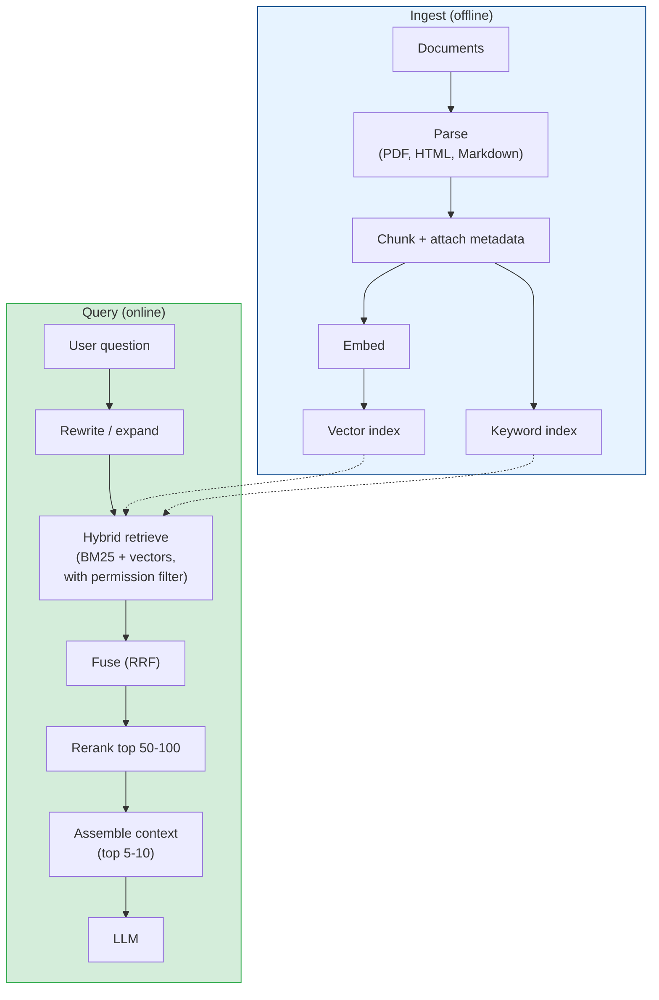

# Retrieval Pipelines: Chunking, Hybrid Search & Reranking

[< Back](./vector-database-landscape.md) | [Index](./README.md) | [Next: Vector Search in Production >](./vector-search-in-production.md)

---

The tutorial version of [RAG](../ai-ml/generative-ai-in-practice.md) has three steps: embed
the question, fetch the five nearest chunks, paste them into the prompt. It demos well and
then disappoints on real questions. It misses the document with the exact error code, it
returns three near-identical chunks from the same page, and now and then it hands the model
a document the user isn't allowed to see.

A production retrieval pipeline has more stages, and each one fixes a specific failure of
the one before. This chapter walks through them in order: how documents become chunks, how
queries become better queries, how keyword and vector results are combined, how a reranker
sorts the candidates, and how the final context is assembled.

## The whole pipeline



## Chunking

Documents get split into chunks because embedding models have input limits, because one
vector can't represent a 40-page PDF, and because the prompt has a token budget. Chunk size
is a real trade-off:

| Chunks too small (under ~100 tokens) | Chunks too large (over ~1,000 tokens) |
|--------------------------------------|---------------------------------------|
| Lose context ("it", "the above", "this setting") | One vector averages several topics, so it matches none of them well |
| A single answer gets split across chunks | Fewer chunks fit in the prompt |
| More vectors to store | The relevant sentence is buried in noise |

Most teams land between 200 and 800 tokens. The strategies, roughly from simplest to most
work:

| Strategy | How it works | Good for |
|----------|--------------|----------|
| Fixed size with overlap | Every N tokens, with 10 to 20 percent overlap so boundary sentences appear twice | Unstructured text, a baseline |
| Recursive splitting | Split on paragraphs, then sentences, then words, until under the limit (LangChain's `RecursiveCharacterTextSplitter`) | General prose |
| Structure-aware | Split on headings, list items, code blocks, table rows. Keep the heading path with each chunk | Docs, wikis, Markdown, HTML |
| Semantic | Embed sentences, start a new chunk where similarity between neighbours drops | Long text with topic shifts but no structure |
| Parent-child ("small to big") | Retrieve on small chunks, return the larger parent section to the LLM | Precise matching with enough context to answer |

Two cheap improvements beat clever splitting most of the time. First, **prepend the
document title and heading path** to every chunk before embedding: "Billing > Refunds >
Partial refunds" tells the model what "this policy" refers to. Second, keep **metadata** on
every chunk, because later stages need it:

```python
chunk = {
    "id": "doc-812#sec-4#c2",
    "doc_id": 812,
    "text": "Billing > Refunds > Partial refunds\n\nPartial refunds are issued ...",
    "heading_path": ["Billing", "Refunds", "Partial refunds"],
    "tenant_id": 17,
    "acl": ["group:finance", "user:4411"],
    "source_url": "https://wiki.internal/billing/refunds#partial",
    "updated_at": "2026-10-02T09:14:00Z",
    "embedding_model": "bge-m3@2024-01",
}
```

Anthropic's "contextual retrieval" write-up (2024) goes further: an LLM writes a one- or
two-sentence summary of where each chunk sits in its document, and that text is prepended
before both embedding and BM25 indexing. On their test sets, it cut the top-20 retrieval
failure rate by 35 percent with embeddings alone, 49 percent combined with contextual BM25,
and 67 percent with reranking added. It costs one LLM call per chunk at ingest, which prompt
caching makes affordable.

## Hybrid search

[Chapter 1](./embeddings-fundamentals.md#why-semantic-search-beats-keyword-search-and-where-it-fails)
covered why dense vectors miss exact tokens and keyword search misses paraphrases. Hybrid
search runs both and merges the results. Run [BM25](../search-systems/ranking-and-autocomplete.md#bm25-the-default-ranking-function)
for the top 50 to 100, run vector search for the top 50 to 100, then fuse.

Combining them is harder than it sounds, because the scores aren't comparable. BM25 scores
are unbounded and depend on the query's terms. Cosine similarities sit in a narrow band like
0.6 to 0.9. Adding them directly means one system dominates.

### Reciprocal rank fusion

RRF (Cormack, Clarke, and Büttcher, 2009) ignores scores and uses only ranks:

```
RRF(d) = Σ over each result list r:  1 / (k + rank_r(d))        k = 60 by convention
```

```python
from collections import defaultdict

def rrf(result_lists, k=60, top_n=50):
    scores = defaultdict(float)
    for results in result_lists:                 # each is a ranked list of doc IDs
        for rank, doc_id in enumerate(results, start=1):
            scores[doc_id] += 1.0 / (k + rank)
    return sorted(scores, key=scores.get, reverse=True)[:top_n]

fused = rrf([bm25_ids, vector_ids])
```

A document ranked 1st by BM25 and absent from the vector list scores `1/61 ≈ 0.0164`. One
ranked 5th in both scores `2/65 ≈ 0.0308` and wins. Agreement between retrievers counts for
more than a top spot in one of them. The constant `k` flattens the curve so that rank 1 vs
rank 2 matters less than appearing at all.

RRF needs no tuning and no score normalization, which is why Elasticsearch, OpenSearch,
Weaviate, Qdrant, and Milvus all offer it. The alternative is a weighted sum of normalized
scores (Weaviate's `alpha`, OpenSearch's normalization processor), which can do slightly
better once tuned on a labelled set and slightly worse when it isn't.

## Reranking

The retrievers so far are **bi-encoders**: the query and the document are embedded
separately, so document vectors can be computed ahead of time. That's what makes them fast,
and it also caps their accuracy, because the model never sees the query and the document
together.

A **cross-encoder** reranker takes the query and one candidate as a single input and outputs
a relevance score. It reads both, so it notices that "not compatible with Windows" doesn't
answer "does it run on Windows" positively. It's far too slow to run over a corpus, but fine
over 50 to 100 candidates:

```python
from sentence_transformers import CrossEncoder

reranker = CrossEncoder("BAAI/bge-reranker-v2-m3")
pairs = [(query, chunk_text[c]) for c in fused[:100]]
scores = reranker.predict(pairs, batch_size=32)
top = [c for _, c in sorted(zip(scores, fused[:100]), reverse=True)[:8]]
```

| Option | Type | Latency for ~100 candidates |
|--------|------|-----------------------------|
| `cross-encoder/ms-marco-MiniLM-L-6-v2` | Open, small | Tens of ms on GPU, a few hundred ms on CPU |
| `bge-reranker-v2-m3` | Open, multilingual | ~100 ms on GPU |
| Cohere Rerank, Voyage rerank, Jina reranker | Hosted API | 100 to 300 ms including the network |
| ColBERT (late interaction) | One vector per token, compared at query time | Between a bi-encoder and a cross-encoder |
| An LLM as judge | Prompted to score or order candidates | Seconds, expensive. Offline evaluation, rarely online |

Reranking is usually the single biggest quality gain after hybrid search. It also adds the
most latency to the pipeline, so measure both.

## Query rewriting

Users don't type good queries. Rewriting fixes the query before retrieval:

| Technique | What it does | When it helps |
|-----------|--------------|---------------|
| Conversational rewrite | Turns "what about for teams?" into "What is the refund policy for team plans?" using chat history | Any chat interface. Without it, follow-up questions retrieve nothing useful |
| Multi-query | LLM writes 3 to 5 paraphrases, retrieve for each, fuse with RRF | Vague or short queries |
| Decomposition | Splits "compare plan A and plan B limits" into one query per plan | Multi-part questions |
| HyDE | LLM writes a hypothetical answer, and you embed that instead of the question | Short questions against long, answer-shaped documents |
| Keyword extraction | Pulls IDs, codes, and names out for the BM25 side or for filters | Queries mixing natural language and identifiers |

**HyDE** (Gao et al., 2022) works because a fake answer looks more like the real answer
document than the question does. "How long do refunds take?" is short and question-shaped.
"Refunds are processed within 5 to 10 business days after approval" is shaped like the
policy page. The risk is that the invented answer contains invented specifics, which then
steer retrieval toward the wrong documents. Every rewrite technique costs an LLM call, often
100 to 500 ms, so use a small, fast model and skip rewriting when the query is already
specific.

## Metadata and permission filters

Filters go **inside the retrieval query**, on both the BM25 and vector sides:

```python
must = [
    {"key": "tenant_id", "match": {"value": user.tenant_id}},   # from the session, never the request
    {"key": "acl", "match": {"any": user.principals}},          # ["user:4411", "group:finance", ...]
]
if query_filters.product:
    must.append({"key": "product", "match": {"value": query_filters.product}})

hits = qdrant.query_points("chunks", query=qvec, limit=100,
                           query_filter={"must": must}).points
```

Filtering after retrieval, or worse, asking the LLM to ignore documents the user can't see,
leaks data. The model has already read the text, and it will quote it. Retrieval is an
[authorization](../auth/authorization-patterns.md) decision, and the same goes for the
[tenant isolation](../multi-tenant-architecture/data-isolation.md#beyond-the-main-database)
rules that apply to every other store. [Chapter 5](./vector-search-in-production.md#security-retrieval-is-a-permission-boundary)
covers the ways ACLs go stale in an index.

Non-security filters (date ranges, product, language, document type) can come from the UI
or be extracted from the query by the rewrite step. Prefer filters over hoping the
embedding picks up "from 2025" on its own. It won't.

## Context assembly

The reranker hands you an ordered list of chunks. Turning that into a prompt still involves
choices:

- **Dedupe.** Drop near-identical chunks (the same paragraph in three versions of a doc).
  Keep the newest.
- **Merge neighbours.** If chunks 3 and 4 of the same section both made the cut, join them
  in document order so the text reads naturally.
- **Respect a token budget.** Count tokens and stop. 5 to 10 chunks of 300 to 500 tokens is
  typical. Long contexts cost more and don't reliably help: the "lost in the middle" study
  (Liu et al., 2023) found models use information at the start and end of the context
  better than in the middle.
- **Put the best chunks first** (or first and last). Don't pad with low-scoring chunks to
  fill the budget.
- **Label every chunk with its source** so the model can cite and you can verify:

```
<source id="3" title="Refund policy" url="https://wiki.internal/billing/refunds#partial" updated="2026-10-02">
Partial refunds are issued ...
</source>
```

- **Treat retrieved text as untrusted.** A document can contain "ignore previous
  instructions". Wrap it in clear delimiters and tell the model it's reference material, not
  instructions.

## The takeaways

1. **Chunk on structure and keep the heading path.** Most retrieval failures start at
   ingest, not at query time.
2. **Run keyword and vector search together.** Each catches what the other misses.
3. **Fuse with RRF** unless you have a labelled set to tune weights on. It needs no score
   normalization.
4. **Rerank the top 50 to 100 with a cross-encoder.** Usually the biggest single gain, and
   the biggest latency cost.
5. **Rewrite conversational queries.** Follow-ups like "what about teams?" retrieve nothing
   on their own.
6. **Filter permissions inside the query.** Anything the retriever returns, the model reads.
7. **Assemble context deliberately.** Dedupe, merge, budget, cite, and treat it as
   untrusted input.

---

[< Back](./vector-database-landscape.md) | [Index](./README.md) | [Next: Vector Search in Production >](./vector-search-in-production.md)
