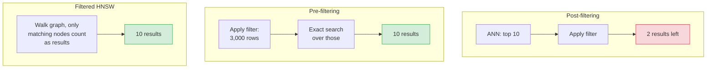

# The Vector Database Landscape: pgvector, Dedicated Engines & Search Engines

[< Back](./ann-indexes.md) | [Index](./README.md) | [Next: Retrieval Pipelines >](./retrieval-pipelines.md)

---

A "vector database" is an ANN index plus everything a database needs around it: storage,
durability, metadata, filters, replication, backups, access control. The index is the part
everyone benchmarks. The rest is the part that decides whether you can run it.

There are three families. Postgres with pgvector adds vectors to a database you probably
already run. Dedicated engines (Qdrant, Milvus, Weaviate, Pinecone) are built around vectors
first. Search engines (Elasticsearch, OpenSearch) added vectors next to an inverted index
they've had for a decade. All three use HNSW or something close to it, so raw search speed
at moderate scale is rarely what separates them. Filtering, operations, and how big you
need to get are what separate them.

## The three families

| | pgvector (Postgres) | Dedicated vector engine | Search engine with vectors |
|---|---------------------|------------------------|----------------------------|
| Examples | pgvector, pgvectorscale, Aurora/RDS/Cloud SQL/Supabase/Neon | Qdrant, Milvus, Weaviate, Pinecone | Elasticsearch, OpenSearch, Vespa |
| Data model | Rows, a `vector` column | Points or objects: ID, vector(s), JSON payload | Documents with fields, one of which is a vector |
| Transactions | Full ACID, joins with the rest of your schema | Per-point writes, no multi-record transactions | Near-real-time, no transactions |
| Keyword search | `tsvector` full-text, weaker ranking than BM25 | Varies: Weaviate built-in BM25, others via sparse vectors | Best-in-class BM25, analyzers, facets |
| Scale sweet spot | Up to ~10M to 50M vectors per node | 10M to billions | 10M to billions, with care |
| Operational cost | Lowest if you already run Postgres | One more stateful system, or a SaaS bill | High. JVM, shards, heap and page cache tuning |

## pgvector

pgvector is a Postgres extension that adds a `vector` type, distance operators, and HNSW
and IVFFlat indexes. Its main strength isn't the index. Your vectors live next to the data
they describe, in the same transaction, the same backups, the same access control:

```sql
CREATE EXTENSION vector;

CREATE TABLE chunks (
  id          bigserial PRIMARY KEY,
  doc_id      bigint NOT NULL REFERENCES documents(id) ON DELETE CASCADE,
  tenant_id   bigint NOT NULL,
  content     text NOT NULL,
  embedding   vector(1024) NOT NULL,
  model       text NOT NULL DEFAULT 'bge-m3'
);
CREATE INDEX ON chunks USING hnsw (embedding vector_cosine_ops);
CREATE INDEX ON chunks (tenant_id);

-- Delete a document and its vectors in one transaction. No sync job, no orphaned vectors.
DELETE FROM documents WHERE id = 42;
```

Limits worth knowing: the `vector` type stores up to 16,000 dimensions, but HNSW and IVFFlat
index at most 2,000. `halfvec` (float16) indexes up to 4,000, which is how you index 3072-dim
OpenAI vectors. There's also `bit` for binary vectors and `sparsevec` for sparse ones.

The weak spots are scale and filtering. HNSW build and vacuum get slow past tens of millions
of rows, the index has to fit in `shared_buffers` plus OS page cache to be fast, and
everything shares one primary with your OLTP traffic. Timescale's **pgvectorscale** adds a
DiskANN-based index and statistical binary quantization for larger sets.

## Dedicated engines

| Engine | Written in | Deployment | What stands out |
|--------|-----------|------------|-----------------|
| **Qdrant** | Rust | Self-host (single binary) or Qdrant Cloud | Filterable HNSW, rich payload indexes, scalar/binary/product quantization with rescoring, tenant-aware indexing |
| **Milvus** | Go and C++ | Self-host on Kubernetes, or Zilliz Cloud | Built for billions: separate query, data, and index nodes over object storage. Most index types (HNSW, IVF_PQ, DISKANN, GPU CAGRA) |
| **Weaviate** | Go | Self-host or Weaviate Cloud | Built-in BM25 and hybrid search, vectorizer modules that call embedding APIs for you, per-tenant shards that can be offloaded |
| **Pinecone** | Closed source | Managed only | Serverless: storage on object storage, pay per read and write units. Namespaces for tenants. Nothing to operate, nothing to tune |

Others you'll meet: **Chroma** and **LanceDB** for embedded and local use, **Redis** with
its vector search module, **MongoDB Atlas Vector Search**, and **Vespa**, which is a full
search and ranking engine in its own right.

What you get from a dedicated engine over pgvector: filtering that keeps working at low
selectivity, quantization built in, horizontal scaling, and hybrid queries in one call. What
you lose: transactions with your source data. Every document change now has to be
propagated to a second system, and it can fail halfway.

## Search engines with vector support

Elasticsearch has a `dense_vector` field type indexed with Lucene's HNSW, and `int8_hnsw`
quantization by default since 8.14. OpenSearch's k-NN plugin offers Lucene and FAISS engines.
Both can run a BM25 query and a kNN query in one request and fuse the results, Elasticsearch
through the `rrf` retriever and OpenSearch through a hybrid query with a normalization
processor.

```json
POST /docs/_search
{
  "retriever": {
    "rrf": {
      "retrievers": [
        { "standard": { "query": { "match": { "content": "reset 2fa token" } } } },
        { "knn": { "field": "embedding", "query_vector": [0.12, -0.03, ...],
                   "k": 50, "num_candidates": 200,
                   "filter": { "term": { "tenant_id": 17 } } } }
      ]
    }
  }
}
```

If you already run Elasticsearch for [search](../search-systems/search-engines.md), this is
often the easiest path to hybrid search. The costs: each Lucene segment has its own HNSW
graph, so a query searches every segment and merges, and segment merges rebuild graphs,
which makes heavy indexing CPU-expensive. Vectors also need to sit in the OS page cache, not
the JVM heap, so nodes need far more RAM than the heap setting suggests.

## Metadata filtering

Almost no real query is "the nearest vectors in the whole corpus". It's "the nearest vectors
belonging to tenant 17, in English, updated this year, that this user may read". How the
engine combines the filter with the ANN search matters more than any benchmark.



**Post-filtering** runs the ANN search, then drops results that fail the filter. If the
filter matches 1 percent of the data, a top-10 search returns about 0.1 matching results on
average. Asking for top 1,000 and filtering down helps, but you're guessing how many to ask
for. Plain pgvector HNSW before 0.8.0 behaved this way: the index returned `ef_search`
candidates and the `WHERE` clause removed most of them.

**Pre-filtering** applies the filter first, using a normal index, then searches only the
survivors. With a few thousand survivors, exact search over them is fast and has perfect
recall. With 10M survivors, it's a brute-force scan.

**Filtered HNSW** (in-filter search) walks the graph as usual but only counts nodes that
match the filter as results, while still using non-matching nodes to navigate. It works
until the filter is very selective. Then the matching nodes are sparse in the graph, the
walk wanders through mostly non-matching nodes, and either latency explodes or recall
collapses. Engines handle this differently:

| Engine | Strategy |
|--------|----------|
| Qdrant | Adds extra HNSW edges between points sharing an indexed payload value, so filtered subgraphs stay connected. Its query planner switches to payload index plus exact scan when the filter matches few points |
| Weaviate | Pre-filters with an allow-list. ACORN strategy (1.27+) expands two hops to step over non-matching nodes |
| pgvector 0.8+ | Iterative index scans: `SET hnsw.iterative_scan = relaxed_order` keeps pulling candidates until `LIMIT` is satisfied or `hnsw.max_scan_tuples` (default 20,000) is hit. The planner can also pick a B-tree on the filter column and scan exactly |
| Elasticsearch / OpenSearch | `filter` inside the `knn` clause is applied during graph search. Falls back to exact search when the filtered set is small |
| Pinecone | Metadata filters applied inside the index, single-stage |

Two rules apply everywhere. Index every field you filter on (payload indexes in Qdrant,
B-trees in Postgres, keyword fields in Elasticsearch), and test filtered queries at your
real selectivity, because unfiltered benchmarks say nothing about them.

## Payloads

Dedicated engines store a JSON payload with each vector: the chunk text, the document ID,
the tenant, the ACL, timestamps. Keep payloads small and keep the source of truth elsewhere.
Large payloads (full documents, base64 images) inflate memory and slow every query that
returns them. Store an ID and enough text to build the prompt, and fetch the rest from your
primary database or object storage.

## Sharding and replication

Vectors don't have a natural shard key. Two near neighbours can have any IDs, so you can't
route a similarity query to one shard the way you route `WHERE user_id = 7`. A global search
is a scatter-gather: every shard returns its local top k, and a coordinator merges them.

| Choice | Effect |
|--------|--------|
| More shards | Bigger total capacity, parallel search, but every query hits every shard, and tail latency is the slowest shard's |
| More replicas | More QPS and failover. Each replica holds a full copy of its shard's index in RAM |
| Shard by tenant | Queries hit one shard instead of all. Qdrant custom shard keys, Milvus partition keys, Weaviate tenant shards, Pinecone namespaces |

The same [replication and sharding trade-offs](../databases/replication-sharding.md) apply
as for any database. What's different is the cost of a replica: an HNSW index serving
traffic has to be in memory, so every replica doubles the RAM bill rather than the disk bill.

## When Postgres is enough

| Your situation | pgvector? | Why |
|----------------|-----------|-----|
| Under ~5M vectors, already on Postgres | Yes | One system, transactional deletes, joins with ACLs. HNSW handles this easily |
| 5M to 50M vectors, moderate QPS | Probably | Use `halfvec` or binary quantization, a dedicated replica for vector reads, and pgvector 0.8+ for filtering |
| Vectors must be deleted with their source rows (GDPR, permissions) | Strong yes | `ON DELETE CASCADE` beats a sync pipeline you have to monitor |
| Highly selective filters per tenant or per user | Yes, often | Partial indexes, partitioning by tenant, or exact scans after a B-tree filter |
| Hundreds of millions to billions of vectors | No | Build and vacuum times, memory per node. Use Milvus, Qdrant, or pgvectorscale's DiskANN |
| Thousands of vector QPS alongside heavy OLTP | No | The vector workload will compete with transactions for cache and CPU |
| You need strong BM25, analyzers, and facets too | No | Elasticsearch or OpenSearch already does both |
| No ops team, want zero tuning | Maybe not | A managed engine like Pinecone, or managed Postgres with pgvector |

Starting on pgvector and moving later is a sensible path. The data is in your database, so
exporting it to another engine is a batch job, not a migration of your source of truth.

## The takeaways

1. **The index is rarely the difference.** Everyone runs HNSW. Filtering, operations, and
   scale are what you're choosing between.
2. **pgvector wins on consistency.** Vectors share transactions, backups, and deletes with
   their source rows. It runs out of room in the tens of millions.
3. **Dedicated engines win on scale and filtering,** at the cost of a second system you
   have to keep in sync.
4. **Search engines win when you need BM25 too,** at the cost of RAM and indexing CPU.
5. **Post-filtering loses results.** Know which strategy your engine uses, index filter
   fields, and test at real selectivity.
6. **Sharding vectors means scatter-gather.** Shard by tenant where you can.

---

[< Back](./ann-indexes.md) | [Index](./README.md) | [Next: Retrieval Pipelines >](./retrieval-pipelines.md)
