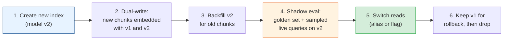

# Vector Search in Production: Evaluation, Migration, Sizing & Security

[< Back](./retrieval-pipelines.md) | [Index](./README.md)

---

The first version of a retrieval system usually ships on vibes. Someone tries twenty
questions, the answers look right, and it goes live. Six months later the corpus is three
times bigger, the embedding model is deprecated, the index takes all the RAM on the box,
and a customer has found another customer's contract in a chat answer.

None of those are index problems. They're the operating problems of a system whose quality
is hard to see, whose data is derived from another system, and whose results are only as
safe as the filters on them. This chapter covers how to measure retrieval, how to change
models without downtime, how to size the hardware, and how retrieval leaks data.

## Evaluating retrieval

You can't improve what you can't measure, and "the answers look good" isn't a measurement.
Evaluate retrieval separately from generation. If the right chunk never reaches the prompt,
no prompt engineering will fix the answer.

### Build a golden set

A golden set is a list of real queries, each with the IDs of the chunks or documents that
answer it.

- **Source queries from logs,** not from your imagination. Real users misspell, use
  internal jargon, and ask follow-ups.
- **Start with 100 to 300 queries.** That's enough to see a 5-point change. Add the queries
  behind every bug report.
- **Label with people first.** An LLM judge can scale labelling later, but check it agrees
  with human labels on a sample before trusting it.
- **Cover the hard cases** on purpose: IDs and codes, multi-hop questions, questions with no
  answer in the corpus, and each major tenant or language.

### The metrics

| Metric | Definition | What it tells you |
|--------|-----------|-------------------|
| Recall@k | Fraction of relevant items that appear in the top k | Did the right chunk make it into the prompt? The main RAG metric |
| Precision@k | Fraction of the top k that are relevant | How much noise the LLM has to read past |
| MRR | Mean of `1 / rank of the first relevant result` | How high the first good result is. Good for single-answer queries |
| nDCG@k | Discounted gain: `Σ relᵢ / log₂(i + 1)`, divided by the best possible ordering | Rewards putting the most relevant items first, with graded relevance |

```python
import math

def recall_at_k(retrieved, relevant, k):
    return len(set(retrieved[:k]) & relevant) / len(relevant)

def mrr(retrieved, relevant):
    return next((1 / i for i, d in enumerate(retrieved, 1) if d in relevant), 0.0)

def ndcg_at_k(retrieved, grades, k):            # grades: {doc_id: 0..3}
    dcg = sum(grades.get(d, 0) / math.log2(i + 1) for i, d in enumerate(retrieved[:k], 1))
    ideal = sorted(grades.values(), reverse=True)[:k]
    idcg = sum(g / math.log2(i + 1) for i, g in enumerate(ideal, 1))
    return dcg / idcg if idcg else 0.0
```

Keep two kinds of recall apart. **Retrieval recall** compares results with human-labelled
relevant documents. **ANN recall** compares the index's results with exact search over the
same vectors ([chapter 2](./ann-indexes.md#exact-knn-the-baseline)). A system can have 0.99
ANN recall and 0.60 retrieval recall: the index perfectly finds the nearest vectors, and
they're the wrong chunks. That's a chunking or model problem, and tuning `efSearch` won't
touch it.

Run the eval in CI on every change to chunking, model, prompt prefixes, fusion, or
reranking, and track it like any other [regression metric](../search-systems/ranking-and-autocomplete.md#measuring-whether-search-is-good).
Online, watch click-through on cited sources, thumbs-down rates, and "no answer" rates.

## Changing the embedding model

Sooner or later you'll switch models. The old one gets deprecated, a better one comes out,
or you move from a hosted API to self-hosting. Vectors from different models live in
different spaces, so there's no conversion. **Every chunk has to be re-embedded**, and
query vectors have to come from the same model as the vectors they're compared with.

Store the model with every vector from day one (`embedding_model = "bge-m3@2024-01"`). Then
migrate the same way as any [backfill with dual writes](../zero-downtime-migrations/backfills-and-dual-writes.md):



```sql
-- pgvector: a second column and a second index, built concurrently
ALTER TABLE chunks ADD COLUMN embedding_v2 halfvec(3072);
-- backfill in batches, then:
CREATE INDEX CONCURRENTLY chunks_emb_v2 ON chunks USING hnsw (embedding_v2 halfvec_cosine_ops);
```

The query path has to embed with the model that matches the index it searches. During the
switch, a feature flag picks the index and the query model together, never separately.

The cost is mostly time, not money. 50M chunks of 400 tokens is 20 billion tokens: about
$400 with `text-embedding-3-small`, about $2,600 with `-3-large`. But at a rate limit of a
few million tokens per minute, 20 billion tokens takes days, and a self-hosted model on one
GPU embedding 2,000 chunks per second needs about 7 hours. Plan the backfill like any other
long-running job, with checkpoints and a throttle.

## Index rebuilds

Indexes need rebuilding for reasons other than a model change: IVF centroids that no longer
fit the data, HNSW graphs degraded by deletes, new `M` or quantization settings. Don't
rebuild in place. Build a second index alongside and swap:

| System | How to swap |
|--------|-------------|
| Postgres / pgvector | `CREATE INDEX CONCURRENTLY` a new index, then drop the old one. `REINDEX CONCURRENTLY` also works |
| Qdrant | Build a new collection, then repoint a collection alias |
| Elasticsearch / OpenSearch | Reindex into a new index, then move the alias atomically |
| Milvus | Rebuild per collection. Load the new index before releasing the old |

Budget for double the memory during the overlap, because both indexes serve or build at
once.

## Sizing memory and cost

Start from vectors, then add the index, then multiply by replicas. The
[back-of-envelope method](../system-design-fundamentals/back-of-envelope.md) applies:

```
50M chunks × 1024 dims × 4 bytes  = 205 GB    raw float32 vectors
HNSW links, M=16: 50M × ~140 B    ≈   7 GB
Payload (IDs, 1 KB of text each)  ≈  50 GB    on disk, partly cached
                                    --------
Per replica in RAM                ≈ 212 GB    (+ payload cache)
× 2 replicas                      ≈ 425 GB
```

| Option | RAM per replica | What it costs you |
|--------|----------------|-------------------|
| float32 | ~212 GB | Nothing in recall. Two 256 GB nodes per replica, or one 512 GB node |
| halfvec (float16) | ~110 GB | Negligible recall loss |
| int8 in RAM, float32 on SSD for rescoring | ~58 GB | About 1 point of recall, SSD reads on rescore |
| binary in RAM, float32 on SSD | ~14 GB | Needs 3x to 10x oversampling, model-dependent |
| Matryoshka cut to 256 dims, float32 | ~58 GB | A few points of retrieval quality, measured on your golden set |

At AWS on-demand prices, a 512 GB memory-optimized instance (r7g.16xlarge) runs about
$2,500 a month. Two of them for float32 replicas is $5,000. With int8 and rescoring, each
replica fits on a 128 GB node for about a quarter of that. Quantization is the largest cost lever in
vector search, and the eval set is what tells you whether you can afford the recall loss.

## Multi-tenancy

| Pattern | How | Good for | Watch out for |
|---------|-----|----------|---------------|
| Shared index, `tenant_id` filter | One collection, filter on every query | Many small tenants | Filter selectivity. A 1-percent tenant is a very selective filter (see [filtering](./vector-database-landscape.md#metadata-filtering)) |
| Tenant-aware shared index | Qdrant `is_tenant` payload index, Milvus partition key, Postgres partitioning by tenant | Thousands of tenants of mixed size | Engine-specific setup |
| Namespace or shard per tenant | Pinecone namespaces, Weaviate tenants, Qdrant shard keys | Strong isolation, per-tenant delete | Overhead per tenant, limits on tenant count |
| Collection or database per tenant | Separate index per tenant | A few large or regulated tenants | Thousands of collections is an operational problem in most engines |

Large tenants also tend to need their own index because their filter matches so much of a
shared index that it stops being selective. The same tiering ideas as in
[multi-tenant architecture](../multi-tenant-architecture/README.md) apply: shared for the
long tail, dedicated for the whales.

## Deletes and freshness

A vector index is derived data. Every change to the source has to reach it:

- **Updating a document** means deleting all its old chunks by `doc_id` and inserting the
  new ones. Chunk boundaries move when text changes, so patching individual chunks in place
  leaves orphans.
- **Deleting a document** (a GDPR request, a revoked file) means removing the chunks, the
  vectors, the keyword index entries, and any cached query results that included them.
  In most engines a delete is a tombstone until compaction, so the data is still on disk
  for a while. Know how long, for your compliance answer.
- **Freshness lag** is the time from a source change to the index reflecting it. Feed
  changes through CDC or an outbox into an embedding queue, and measure the lag as a metric
  with an [SLO](../observability-and-reliability/slos-and-error-budgets.md). An hour of lag
  on a permissions change is a security incident, not a freshness issue.
- **Reconcile periodically.** Compare chunk IDs in the index with the source and delete
  anything orphaned. Pipelines drop events, and this is the only way to find out.

## Monitoring and drift

| Signal | Why |
|--------|-----|
| p50 / p99 query latency per stage (embed, retrieve, rerank) | The reranker and the embedding API are usually the slow parts |
| Top-1 similarity score distribution | A falling median means queries are drifting away from the corpus |
| Share of queries with low top score or no answer | New topics users ask about that you have no documents for |
| Sampled ANN recall against exact search | Catches index degradation from deletes or stale IVF centroids |
| Tombstone ratio, index size, RAM headroom | Rebuild and capacity planning |
| Freshness lag and failed embedding jobs | Silent staleness |
| Golden set scores, nightly | Regression detection that doesn't depend on users complaining |

Query drift is the one people miss. The corpus was chunked and evaluated for last year's
questions. When the product launches a feature, users ask about it before the docs exist,
retrieval returns the nearest unrelated chunks, and the LLM confidently answers from them.

## Security: retrieval is a permission boundary

Anything the retriever returns, the model reads, and anything the model reads, it can
repeat. Retrieval needs the same rigour as any other data access path:

| Leak | How it happens | Fix |
|------|----------------|-----|
| Cross-tenant results | Tenant filter missing on one code path, or taken from the request body | Set tenant from the authenticated session in one query helper. Use Postgres [row-level security](../multi-tenant-architecture/data-isolation.md#row-level-security-the-database-as-the-last-line) where vectors live in Postgres |
| Post-filtered ACLs | Retrieve top k, then drop forbidden docs, or ask the LLM to ignore them | Filter inside the vector and BM25 query |
| Stale ACLs | A user loses access, but chunk payloads still list their group | Sync ACL changes as a priority event stream, separate from content re-embedding. Or store a doc ID and check permissions at query time against the source |
| Cached answers | A response cached by query text is served to a user with fewer permissions | Include tenant and permission scope in the cache key |
| Embedding inversion | Vectors treated as anonymous and shared or logged | Treat vectors as sensitive as the text. Morris et al. (2023) reconstructed 92 percent of 32-token inputs exactly from their embeddings |
| Indirect prompt injection | A document contains instructions that the model follows | Delimit retrieved text, restrict what tools the model can call, and don't index untrusted content alongside trusted content without labelling it |

Test it like any other [isolation boundary](../multi-tenant-architecture/data-isolation.md#testing-for-leaks):
seed two tenants with distinctive content, query as each, and assert nothing crosses.

## The takeaways

1. **Measure retrieval on its own.** A golden set from real queries, recall@k and nDCG in
   CI, and ANN recall tracked separately from retrieval recall.
2. **Every model change is a full re-embed.** Store the model with each vector, build the
   new index alongside, shadow-test, and switch reads and query embedding together.
3. **Rebuild indexes alongside, then swap.** Aliases or concurrent builds, with double the
   memory during the overlap.
4. **Size it as vectors × precision × replicas.** Quantization is the biggest cost lever.
   Your eval set decides how far you can push it.
5. **The index is derived data.** Delete by document, measure freshness lag, and reconcile
   against the source.
6. **Retrieval is an authorization decision.** Filter inside the query, sync ACL changes
   fast, and treat embeddings as sensitive as the text they came from.

---

[< Back](./retrieval-pipelines.md) | [Index](./README.md)
